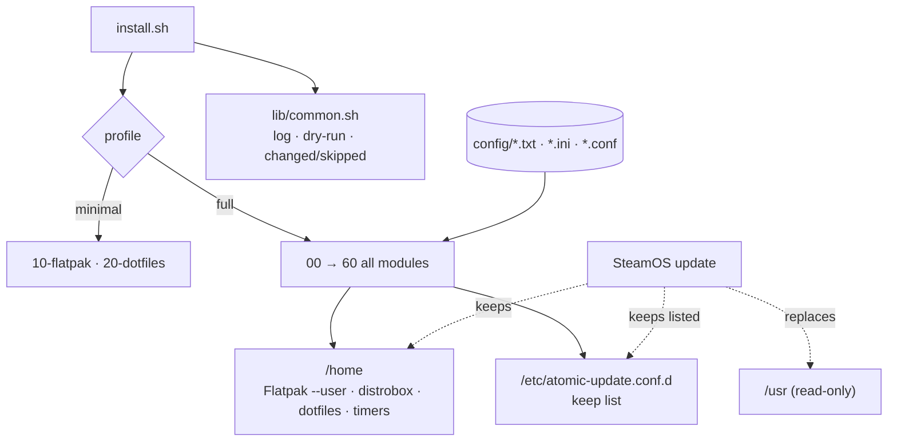

<div align="center">

# SteamOS-Unattended

**Reset it, update it — one command brings your Steam Deck setup back.**

Unattended, idempotent Desktop Mode setup for SteamOS

**English** | [한국어](README/README.ko.md) | [日本語](README/README.ja.md) | [简体中文](README/README.zh-CN.md) | [Español](README/README.es.md) | [Français](README/README.fr.md)

    

[Quick start](#quick-start) · [Modules](#modules) · [Results](#verified-results) · [Documentation](docs/README.md) · [Changelog](CHANGELOG.md)

</div>

```bash
curl -fsSL https://raw.githubusercontent.com/jongwooish/SteamOS-Unattended/main/install.sh | bash
```

## Contents

- [Why](#why)
- [Principles](#principles)
- [Modules](#modules)
- [Architecture](#architecture)
- [Quick start](#quick-start)
- [Where things live](#where-things-live)
- [Verified results](#verified-results)
- [Running SteamOS in VMware](#running-steamos-in-vmware)
- [Documentation](#documentation)
- [Project structure](#project-structure)
- [Roadmap](#roadmap)
- [Author](#author)

---

## Why

SteamOS keeps its system **read-only** and replaces it with a **whole new image** on every OS update. Anything installed with `pacman` and most system settings vanish after one update, and after a factory reset you redo apps, Hangul input and dev tools by hand.

SteamOS-Unattended removes that loop. It installs apps, settings and containers into **the one place updates never touch (`/home`)**, and you declare what to install in plain config files.

## Principles

| Principle | Meaning | Proof |
| --- | --- | --- |
| **Unattended** | Finishes in one go, no questions | First run: 18 changes, one sudo prompt |
| **Idempotent** | Same result no matter how often it runs; finished work is skipped | Second run: **0 changes** |
| **Survives updates** | Never touches the system area (`/usr`) | Every artifact is in `/home` or a keep-listed `/etc` file |

## Modules

| Module | What it does | Writes to | sudo |
| --- | --- | --- | :---: |
| `00-preflight` | Checks SteamOS version, network and free space | — | |
| `10-flatpak` | Installs the apps in `config/flatpaks.txt` per user | `~/.local/share/flatpak` | |
| `20-dotfiles` | Copies `dotfiles/` into `$HOME` (backs up differing files first) | `$HOME` | |
| `30-distrobox` | Creates the containers in `config/distrobox.ini` (`devbox`, `netkit`) | podman user storage | |
| `40-korean-input` | Installs fcitx5 + Hangul and sets the KDE input method (Ctrl+Space) | `~/.config`, `~/.var` | |
| `50-backup` | Daily config backup via a systemd user timer, keeps the last 7 | `~/Backups` | |
| `60-etc-keep` | Registers `/etc` files to keep across updates | `/etc/atomic-update.conf.d/` | ✓ |

## Architecture



## Quick start

```bash
git clone https://github.com/jongwooish/SteamOS-Unattended.git
cd SteamOS-Unattended

./install.sh --list                 # profiles and modules
./install.sh --dry-run              # preview only, changes nothing
./install.sh                        # minimal: apps + dotfiles
./install.sh --profile full         # full: every module
```

| To change | Edit |
| --- | --- |
| Apps | [`config/flatpaks.txt`](config/flatpaks.txt) |
| Containers | [`config/distrobox.ini`](config/distrobox.ini) |
| Backup targets | [`config/backup.conf`](config/backup.conf) |
| `/etc` files to keep | [`config/etc-keep.conf`](config/etc-keep.conf) |

> [!TIP]
> Logs are written to `~/.local/state/steamos-unattended/install.log`.

## Where things live

SteamOS has two system copies (A/B) and one shared home. The full investigation is in [Filesystem](docs/05-Filesystem/README.md).

| Location | After an update | In this project |
| --- | --- | --- |
| `/usr` | Replaced | Never touched |
| `/etc` | Only keep-listed files survive | Minimum necessary + keep list |
| `/home` | Survives (shared A/B partition) | Apps, settings, containers, logs, backups |

## Verified results

Tested from a clean SteamOS 3.8.14 install in VMware Workstation.

| Check | Result |
| --- | --- |
| First run | 18 changed, 0 failed |
| Second run | **0 changed**, 19 already done |
| Containers | `netkit`: `nmap 7.95`, `devbox`: `git 2.56.1` |
| Backup | Manual backup and **scheduled midnight backup** work |
| Hangul input | Works with Ctrl+Space after re-login |

<table>
<tr>
<td><br/><sub>First run: 18 changed</sub></td>
<td><br/><sub>Second run: 0 changed</sub></td>
</tr>
<tr>
<td><br/><sub>Containers and scheduled backup</sub></td>
<td><br/><sub>Hangul input in Desktop Mode</sub></td>
</tr>
</table>

## Running SteamOS in VMware

Building the test machine was a project of its own: **SteamOS 3.x shows no picture at all in VMware**, because the kernel ships without the VMware graphics driver (`vmwgfx`).

- Built **vmwgfx out of tree** against headers matching the Valve kernel exactly.
- Replaced two functions missing from the Valve kernel with a **compatibility patch** ([`compat_dirty.h`](vmware/compat_dirty.h)).
- Bypassed the `nvme format` step that VMware's virtual NVMe rejects, in **a copy of the installer**.
- Loaded the driver at boot and **autologged into Desktop Mode** using only `/etc` and `/home`.

> [!NOTE]
> The full walkthrough is in [Configuration](docs/03-Configuration/README.md), and all 15 problems met on the way are in [Troubleshooting](docs/04-Troubleshooting/README.md), with screenshots.

## Documentation

| Document | Contents |
| --- | --- |
| [Downloads](docs/01-Downloads/README.md) | Required files, official links, tested versions |
| [Cautions](docs/02-Cautions/README.md) | What to know before running |
| [Configuration](docs/03-Configuration/README.md) | Six steps from creating the VM to a verified run |
| [Troubleshooting](docs/04-Troubleshooting/README.md) | 15 symptoms with cause and fix |
| [Filesystem](docs/05-Filesystem/README.md) | What an update wipes and what survives |

## Project structure

```text
install.sh              Entry point (fetches the repo and re-runs itself if needed)
lib/common.sh           Logging, dry-run, changed/skipped counters
lib/su-backup.sh        Backup script (run by the timer)
modules/                Seven modules, run in numeric order
config/                 App list, container definitions, backup settings, /etc keep list
profiles/               minimal, full
dotfiles/               Personal settings copied to $HOME
systemd/                Backup timer units
tests/vm-test.ps1       Automated VMware snapshot test (Windows)
vmware/                 VMware-only files (driver patch, service, autologin)
docs/                   Downloads, Cautions, Configuration, Troubleshooting, Filesystem
.github/workflows/      Privacy check CI
```

## Roadmap

- [ ] Verify survival across a real SteamOS update
- [ ] Verify on real Steam Deck hardware
- [ ] More modules: Decky Loader, emulator setup
- [x] Documentation in six languages

## Author

**Jongwoo Yun** · [@jongwooish](https://github.com/jongwooish)
