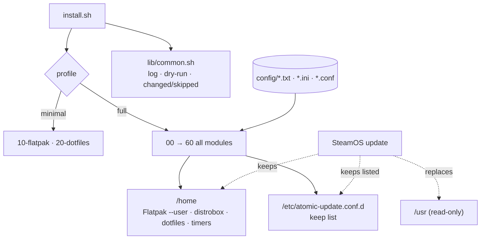
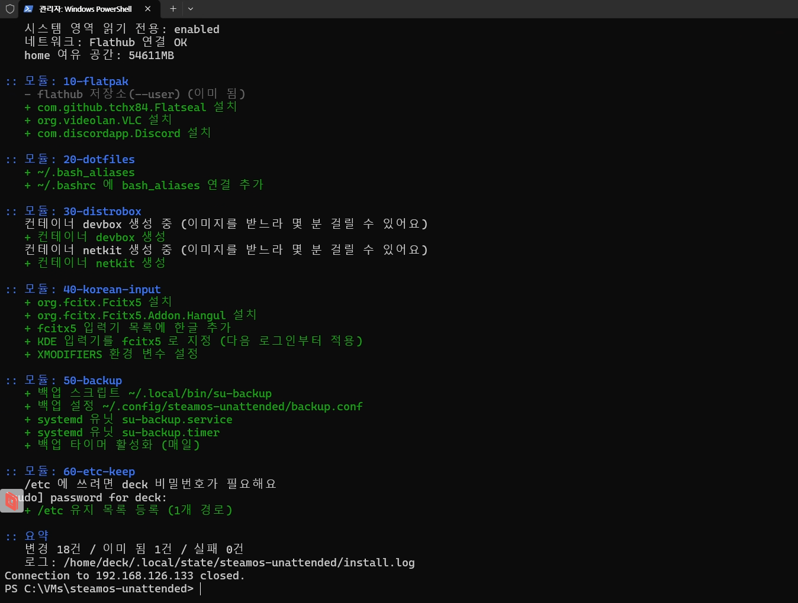
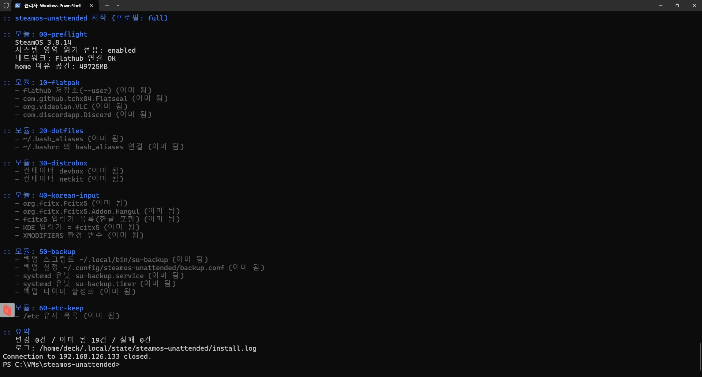

<div align="center">

# SteamOS-Unattended

**Restablécela o actualízala: un solo comando devuelve tu configuración de Steam Deck.**

Configuración desatendida e idempotente del modo escritorio de SteamOS

[English](../README.md) | [한국어](README.ko.md) | [日本語](README.ja.md) | [简体中文](README.zh-CN.md) | **Español** | [Français](README.fr.md)

    

[Inicio rápido](#inicio-rápido) · [Módulos](#módulos) · [Resultados](#resultados-verificados) · [Documentación](../docs/README/README.es.md) · [Registro de cambios](../CHANGELOG.md)

</div>

```bash
curl -fsSL https://raw.githubusercontent.com/jongwooish/SteamOS-Unattended/main/install.sh | bash
```

## Índice

- [Por qué](#por-qué)
- [Principios](#principios)
- [Módulos](#módulos)
- [Arquitectura](#arquitectura)
- [Inicio rápido](#inicio-rápido)
- [Dónde vive cada cosa](#dónde-vive-cada-cosa)
- [Resultados verificados](#resultados-verificados)
- [SteamOS en VMware](#steamos-en-vmware)
- [Documentación](#documentación)
- [Estructura del proyecto](#estructura-del-proyecto)
- [Hoja de ruta](#hoja-de-ruta)
- [Autor](#autor)

---

## Por qué

SteamOS mantiene su sistema en **solo lectura** y lo sustituye por una **imagen completamente nueva** en cada actualización. Lo instalado con `pacman` y la mayoría de ajustes del sistema desaparecen tras una actualización, y después de un restablecimiento hay que rehacer a mano las aplicaciones, la entrada en hangul y las herramientas de desarrollo.

SteamOS-Unattended elimina ese ciclo. Instala aplicaciones, ajustes y contenedores en **el único lugar que las actualizaciones nunca tocan (`/home`)**, y lo que se instala se declara en archivos de configuración sencillos.

## Principios

| Principio | Significado | Prueba |
| --- | --- | --- |
| **Desatendido** | Termina de una vez, sin preguntas | Primera ejecución: 18 cambios, una sola petición de sudo |
| **Idempotente** | Mismo resultado sin importar cuántas veces se ejecute; lo ya hecho se omite | Segunda ejecución: **0 cambios** |
| **Sobrevive a las actualizaciones** | Nunca toca la zona del sistema (`/usr`) | Todo queda en `/home` o en un archivo de `/etc` de la lista de conservación |

## Módulos

| Módulo | Qué hace | Escribe en | sudo |
| --- | --- | --- | :---: |
| `00-preflight` | Comprueba la versión de SteamOS, la red y el espacio libre | — | |
| `10-flatpak` | Instala por usuario las aplicaciones de `config/flatpaks.txt` | `~/.local/share/flatpak` | |
| `20-dotfiles` | Copia `dotfiles/` en `$HOME` (antes respalda los archivos distintos) | `$HOME` | |
| `30-distrobox` | Crea los contenedores de `config/distrobox.ini` (`devbox`, `netkit`) | Almacenamiento de usuario de podman | |
| `40-korean-input` | Instala fcitx5 + hangul y configura el método de entrada de KDE (Ctrl+Space) | `~/.config`, `~/.var` | |
| `50-backup` | Copia diaria de la configuración con un temporizador de usuario de systemd; guarda las 7 últimas | `~/Backups` | |
| `60-etc-keep` | Registra los archivos de `/etc` que deben conservarse tras actualizar | `/etc/atomic-update.conf.d/` | ✓ |

## Arquitectura



## Inicio rápido

```bash
git clone https://github.com/jongwooish/SteamOS-Unattended.git
cd SteamOS-Unattended

./install.sh --list                 # profiles and modules
./install.sh --dry-run              # preview only, changes nothing
./install.sh                        # minimal: apps + dotfiles
./install.sh --profile full         # full: every module
```

| Para cambiar | Edita |
| --- | --- |
| Aplicaciones | [`config/flatpaks.txt`](../config/flatpaks.txt) |
| Contenedores | [`config/distrobox.ini`](../config/distrobox.ini) |
| Qué se respalda | [`config/backup.conf`](../config/backup.conf) |
| Archivos de `/etc` a conservar | [`config/etc-keep.conf`](../config/etc-keep.conf) |

> [!TIP]
> Los registros se escriben en `~/.local/state/steamos-unattended/install.log`.

## Dónde vive cada cosa

SteamOS tiene dos copias del sistema (A/B) y un home compartido. La investigación completa está en [Sistema de archivos](../docs/05-Filesystem/README/README.es.md).

| Ubicación | Tras una actualización | En este proyecto |
| --- | --- | --- |
| `/usr` | Se reemplaza | Nunca se toca |
| `/etc` | Solo sobreviven los archivos de la lista | Lo mínimo necesario + lista de conservación |
| `/home` | Sobrevive (partición compartida A/B) | Aplicaciones, ajustes, contenedores, registros, copias |

## Resultados verificados

Probado desde una instalación limpia de SteamOS 3.8.14 en VMware Workstation.

| Comprobación | Resultado |
| --- | --- |
| Primera ejecución | 18 cambios, 0 fallos |
| Segunda ejecución | **0 cambios**, 19 ya hechos |
| Contenedores | `netkit`: `nmap 7.95`, `devbox`: `git 2.56.1` |
| Copia de seguridad | Funcionan la copia manual y la **copia programada a medianoche** |
| Entrada en hangul | Funciona con Ctrl+Space tras volver a iniciar sesión |

<table>
<tr>
<td><br/><sub>Primera ejecución: 18 cambios</sub></td>
<td><br/><sub>Segunda ejecución: 0 cambios</sub></td>
</tr>
<tr>
<td><br/><sub>Contenedores y copia programada</sub></td>
<td><br/><sub>Entrada en hangul en el modo escritorio</sub></td>
</tr>
</table>

## SteamOS en VMware

Montar la máquina de prueba fue un proyecto en sí mismo: **SteamOS 3.x no muestra ninguna imagen en VMware**, porque el kernel viene sin el controlador gráfico de VMware (`vmwgfx`).

- Se compiló **vmwgfx fuera del árbol** con cabeceras idénticas a las del kernel de Valve.
- Se sustituyeron dos funciones que faltan en el kernel de Valve con un **parche de compatibilidad** ([`compat_dirty.h`](../vmware/compat_dirty.h)).
- Se evitó el paso `nvme format`, que el NVMe virtual de VMware rechaza, en **una copia del instalador**.
- Se cargó el controlador al arrancar y se configuró el **inicio automático en el modo escritorio** usando solo `/etc` y `/home`.

> [!NOTE]
> El recorrido completo está en [Configuración](../docs/03-Configuration/README/README.es.md), y los 15 problemas encontrados por el camino están en [Solución de problemas](../docs/04-Troubleshooting/README/README.es.md), con capturas.

## Documentación

| Documento | Contenido |
| --- | --- |
| [Descargas](../docs/01-Downloads/README/README.es.md) | Archivos necesarios, enlaces oficiales, versiones probadas |
| [Precauciones](../docs/02-Cautions/README/README.es.md) | Lo que conviene saber antes de ejecutar |
| [Configuración](../docs/03-Configuration/README/README.es.md) | Seis pasos desde crear la VM hasta una ejecución verificada |
| [Solución de problemas](../docs/04-Troubleshooting/README/README.es.md) | 15 síntomas con causa y solución |
| [Sistema de archivos](../docs/05-Filesystem/README/README.es.md) | Qué borra una actualización y qué sobrevive |

## Estructura del proyecto

```text
install.sh              Punto de entrada (descarga el repositorio y se relanza si hace falta)
lib/common.sh           Registro, dry-run, contadores de cambios/omitidos
lib/su-backup.sh        Script de copia de seguridad (lo ejecuta el temporizador)
modules/                Siete módulos, ejecutados en orden numérico
config/                 Lista de apps, contenedores, ajustes de copia, lista de /etc a conservar
profiles/               minimal, full
dotfiles/               Ajustes personales copiados a $HOME
systemd/                Unidades del temporizador de copia
tests/vm-test.ps1       Prueba automática con instantáneas de VMware (Windows)
vmware/                 Archivos solo para VMware (parche del controlador, servicio, inicio automático)
docs/                   Descargas, Precauciones, Configuración, Solución de problemas, Sistema de archivos
.github/workflows/      CI de comprobación de privacidad
```

## Hoja de ruta

- [ ] Verificar que todo sobrevive a una actualización real de SteamOS
- [ ] Verificar en una Steam Deck real
- [ ] Más módulos: Decky Loader, configuración de emuladores
- [x] Documentación en seis idiomas

## Autor

**Jongwoo Yun** · [@jongwooish](https://github.com/jongwooish)
