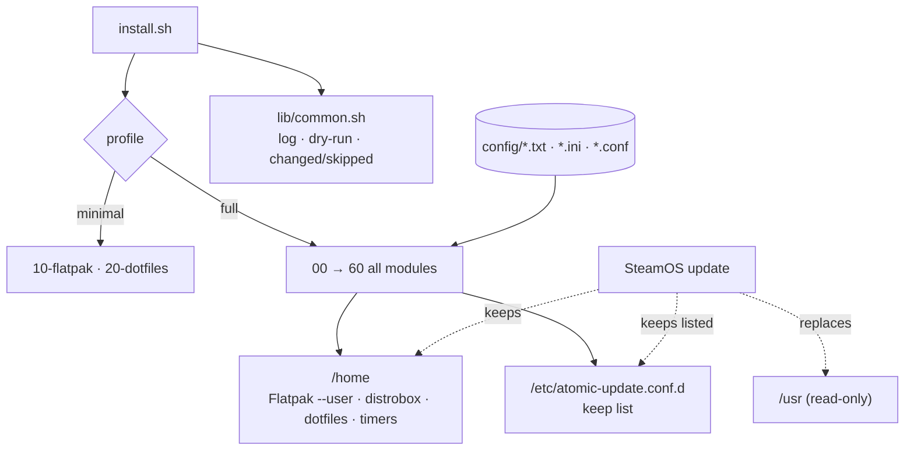
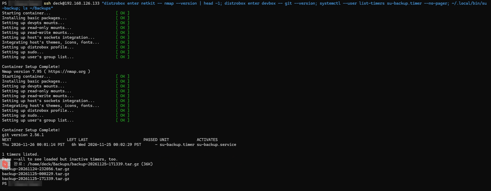

<div align="center">

# SteamOS-Unattended

**Réinitialisation ou mise à jour : une seule commande restaure votre configuration Steam Deck.**

Configuration sans surveillance et idempotente du mode bureau de SteamOS

[English](../README.md) | [한국어](README.ko.md) | [日本語](README.ja.md) | [简体中文](README.zh-CN.md) | [Español](README.es.md) | **Français**

    

[Démarrage rapide](#démarrage-rapide) · [Modules](#modules) · [Résultats](#résultats-vérifiés) · [Documentation](../docs/README/README.fr.md) · [Journal des modifications](../CHANGELOG.md)

</div>

```bash
curl -fsSL https://raw.githubusercontent.com/jongwooish/SteamOS-Unattended/main/install.sh | bash
```

## Sommaire

- [Quel problème il résout](#quel-problème-il-résout)
- [Pour les joueurs Steam Deck](#pour-les-joueurs-steam-deck)
- [Principes](#principes)
- [Modules](#modules)
- [Architecture](#architecture)
- [Démarrage rapide](#démarrage-rapide)
- [Où se trouve chaque chose](#où-se-trouve-chaque-chose)
- [Résultats vérifiés](#résultats-vérifiés)
- [Faire tourner SteamOS dans VMware](#faire-tourner-steamos-dans-vmware)
- [Documentation](#documentation)
- [Structure du projet](#structure-du-projet)
- [Feuille de route](#feuille-de-route)
- [Auteur](#auteur)

---

## Quel problème il résout

Sur SteamOS, il existe deux types très différents de « mes modifications », et une mise à jour du système ne les traite pas de la même façon.

| | Votre compte : jeux et réglages personnels | Modifications du système lui-même avec `sudo` |
| --- | --- | --- |
| Exemples | Jeux et sauvegardes Steam, applis de Discover, fond d'écran, raccourcis, configuration de la manette | Programmes installés avec `pacman`, services système, pilotes, modifications dans `/etc` |
| Stocké dans | `/home` | Zone système (`/usr`, presque tout `/etc`) |
| Après une mise à jour | **Conservé** | **Effacé** — remplacé par la nouvelle image de Valve |
| Après une réinitialisation | Effacé | Effacé |

> [!NOTE]
> Règle simple : **ce qui a demandé le mot de passe sudo disparaît en général à la mise à jour suivante.** Les jeux et sauvegardes ne posent pas de problème : ils sont dans `/home` et survivent aux mises à jour.

SteamOS-Unattended règle la colonne de droite de deux façons :

1. **Survivre aux mises à jour** — il ne modifie jamais la zone système. Les applis sont installées en Flatpak utilisateur, les outils en ligne de commande dans des conteneurs sous `/home`, et les rares fichiers `/etc` vraiment nécessaires sont ajoutés à la liste de conservation de SteamOS.
2. **Reconstruire après une réinitialisation** — toute la configuration est déclarée dans des fichiers, donc sur un Deck effacé ou neuf, une seule commande restaure le même environnement.

## Pour les joueurs Steam Deck

Vous n'en avez **pas** besoin si vous jouez uniquement en mode jeu. C'est pour ceux qui utilisent aussi le **mode bureau** et en ont assez de tout reconfigurer.

| Après l'exécution | Ce que vous remarquez |
| --- | --- |
| Mode jeu | Rien ne change : jeux, sauvegardes et configuration de la manette intacts |
| Applis du mode bureau | Flatseal, VLC et Discord apparaissent dans le menu (liste modifiable) |
| Saisie en coréen | Ctrl+Space bascule en hangeul en mode bureau |
| Outils en ligne de commande | Les boîtes à outils `devbox` et `netkit` ; ignorez-les si vous n'ouvrez jamais de terminal |
| Sauvegarde | Vos réglages sont sauvegardés chaque nuit dans `~/Backups` |
| Après une mise à jour de SteamOS | Tout ce qui précède est toujours là |
| Après une réinitialisation | Recollez la même ligne |

> [!IMPORTANT]
> Ce projet ne sauvegarde **ni** les jeux **ni** les fichiers de sauvegarde. Les jeux survivent déjà aux mises à jour, et les sauvegardes sont couvertes par Steam Cloud.

## Principes

| Principe | Signification | Preuve |
| --- | --- | --- |
| **Sans surveillance** | Se termine d'un coup, sans question | Première exécution : 18 changements, une seule demande sudo |
| **Idempotent** | Même résultat quel que soit le nombre d'exécutions ; le travail déjà fait est ignoré | Deuxième exécution : **0 changement** |
| **Survit aux mises à jour** | Ne touche jamais la zone système (`/usr`) | Tout se trouve dans `/home` ou dans un fichier `/etc` de la liste de conservation |

## Modules

| Module | Rôle | Écrit dans | sudo |
| --- | --- | --- | :---: |
| `00-preflight` | Vérifie la version de SteamOS, le réseau et l'espace libre | — | |
| `10-flatpak` | Installe par utilisateur les applications de `config/flatpaks.txt` | `~/.local/share/flatpak` | |
| `20-dotfiles` | Copie `dotfiles/` dans `$HOME` (sauvegarde d'abord les fichiers différents) | `$HOME` | |
| `30-distrobox` | Crée les conteneurs de `config/distrobox.ini` (`devbox`, `netkit`) | Stockage utilisateur de podman | |
| `40-korean-input` | Installe fcitx5 + hangeul et règle la méthode de saisie KDE (Ctrl+Space) | `~/.config`, `~/.var` | |
| `50-backup` | Sauvegarde quotidienne de la configuration via un minuteur utilisateur systemd, garde les 7 dernières | `~/Backups` | |
| `60-etc-keep` | Enregistre les fichiers `/etc` à conserver après les mises à jour | `/etc/atomic-update.conf.d/` | ✓ |

## Architecture



## Démarrage rapide

```bash
git clone https://github.com/jongwooish/SteamOS-Unattended.git
cd SteamOS-Unattended

./install.sh --list                 # profiles and modules
./install.sh --dry-run              # preview only, changes nothing
./install.sh                        # minimal: apps + dotfiles
./install.sh --profile full         # full: every module
```

| Pour modifier | Éditez |
| --- | --- |
| Applications | [`config/flatpaks.txt`](../config/flatpaks.txt) |
| Conteneurs | [`config/distrobox.ini`](../config/distrobox.ini) |
| Cibles de sauvegarde | [`config/backup.conf`](../config/backup.conf) |
| Fichiers `/etc` à conserver | [`config/etc-keep.conf`](../config/etc-keep.conf) |

> [!TIP]
> Les journaux sont écrits dans `~/.local/state/steamos-unattended/install.log`.

## Où se trouve chaque chose

SteamOS possède deux copies du système (A/B) et un home partagé. L'enquête complète est dans [Système de fichiers](../docs/05-Filesystem/README/README.fr.md).

| Emplacement | Après une mise à jour | Dans ce projet |
| --- | --- | --- |
| `/usr` | Remplacé | Jamais touché |
| `/etc` | Seuls les fichiers listés survivent | Le strict nécessaire + liste de conservation |
| `/home` | Survit (partition A/B partagée) | Applications, réglages, conteneurs, journaux, sauvegardes |

## Résultats vérifiés

Testé à partir d'une installation propre de SteamOS 3.8.14 dans VMware Workstation.

| Vérification | Résultat |
| --- | --- |
| Première exécution | 18 changements, 0 échec |
| Deuxième exécution | **0 changement**, 19 déjà faits |
| Conteneurs | `netkit` : `nmap 7.95`, `devbox` : `git 2.56.1` |
| Sauvegarde | Sauvegarde manuelle et **sauvegarde planifiée à minuit** fonctionnelles |
| Saisie en hangeul | Fonctionne avec Ctrl+Space après reconnexion |

<table>
<tr>
<td><br/><sub>Première exécution : 18 changements</sub></td>
<td><br/><sub>Deuxième exécution : 0 changement</sub></td>
</tr>
<tr>
<td><br/><sub>Conteneurs et sauvegarde planifiée</sub></td>
<td><br/><sub>Saisie en hangeul en mode bureau</sub></td>
</tr>
</table>

## Faire tourner SteamOS dans VMware

Construire la machine de test était un projet en soi : **SteamOS 3.x n'affiche aucune image dans VMware**, car le noyau est livré sans le pilote graphique VMware (`vmwgfx`).

- Compilation de **vmwgfx hors de l'arborescence** avec des en-têtes identiques au noyau Valve.
- Remplacement de deux fonctions absentes du noyau Valve par un **correctif de compatibilité** ([`compat_dirty.h`](../vmware/compat_dirty.h)).
- Contournement de l'étape `nvme format`, refusée par le NVMe virtuel de VMware, dans **une copie de l'installateur**.
- Chargement du pilote au démarrage et **connexion automatique au mode bureau** avec seulement `/etc` et `/home`.

> [!NOTE]
> La procédure complète est dans [Configuration](../docs/03-Configuration/README/README.fr.md), et les 15 problèmes rencontrés en chemin sont dans [Dépannage](../docs/04-Troubleshooting/README/README.fr.md), avec captures.

## Documentation

| Document | Contenu |
| --- | --- |
| [Téléchargements](../docs/01-Downloads/README/README.fr.md) | Fichiers nécessaires, liens officiels, versions testées |
| [Précautions](../docs/02-Cautions/README/README.fr.md) | Ce qu'il faut savoir avant de lancer |
| [Configuration](../docs/03-Configuration/README/README.fr.md) | Six étapes, de la création de la VM à une exécution vérifiée |
| [Dépannage](../docs/04-Troubleshooting/README/README.fr.md) | 15 symptômes avec cause et solution |
| [Système de fichiers](../docs/05-Filesystem/README/README.fr.md) | Ce qu'une mise à jour efface et ce qui survit |

## Structure du projet

```text
install.sh              Point d'entrée (récupère le dépôt et se relance si nécessaire)
lib/common.sh           Journalisation, dry-run, compteurs modifié/ignoré
lib/su-backup.sh        Script de sauvegarde (lancé par le minuteur)
modules/                Sept modules, exécutés dans l'ordre numérique
config/                 Liste d'applis, conteneurs, réglages de sauvegarde, liste /etc à conserver
profiles/               minimal, full
dotfiles/               Réglages personnels copiés dans $HOME
systemd/                Unités du minuteur de sauvegarde
tests/vm-test.ps1       Test automatique par instantanés VMware (Windows)
vmware/                 Fichiers propres à VMware (correctif du pilote, service, connexion auto)
docs/                   Téléchargements, Précautions, Configuration, Dépannage, Système de fichiers
.github/workflows/      CI de vérification de la confidentialité
```

## Feuille de route

- [ ] Vérifier la survie après une vraie mise à jour de SteamOS
- [ ] Vérifier sur un vrai Steam Deck
- [ ] Plus de modules : Decky Loader, configuration d'émulateurs
- [x] Documentation en six langues

## Auteur

**Jongwoo Yun** · [@jongwooish](https://github.com/jongwooish)
