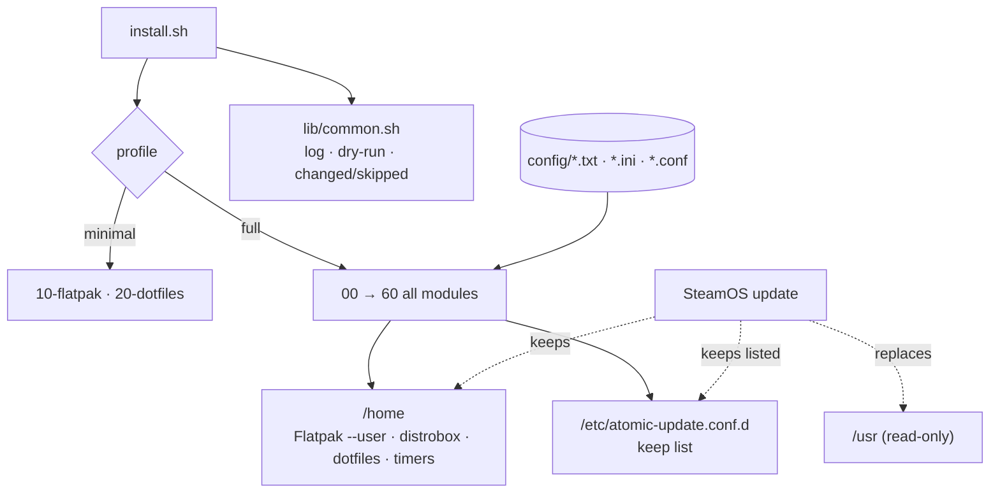

<div align="center">

# SteamOS-Unattended

**初期化しても、アップデートしても — コマンド 1 行で Steam Deck の環境が元どおりに。**

SteamOS デスクトップモード向けの無人・冪等セットアップ

[English](../README.md) | [한국어](README.ko.md) | **日本語** | [简体中文](README.zh-CN.md) | [Español](README.es.md) | [Français](README.fr.md)

    

[クイックスタート](#クイックスタート) · [モジュール](#モジュール) · [検証結果](#検証結果) · [ドキュメント](../docs/README/README.ja.md) · [変更履歴](../CHANGELOG.md)

</div>

```bash
curl -fsSL https://raw.githubusercontent.com/jongwooish/SteamOS-Unattended/main/install.sh | bash
```

## 目次

- [なぜ作ったか](#なぜ作ったか)
- [原則](#原則)
- [モジュール](#モジュール)
- [アーキテクチャ](#アーキテクチャ)
- [クイックスタート](#クイックスタート)
- [何をどこに置くか](#何をどこに置くか)
- [検証結果](#検証結果)
- [VMware で SteamOS を動かす](#vmware-で-steamos-を動かす)
- [ドキュメント](#ドキュメント)
- [リポジトリ構成](#リポジトリ構成)
- [ロードマップ](#ロードマップ)
- [作者](#作者)

---

## なぜ作ったか

SteamOS はシステム領域が **読み取り専用** で、OS アップデートのたびにシステムを **新しいイメージに丸ごと置き換え** ます。`pacman` で入れたプログラムや多くのシステム設定は 1 回のアップデートで消え、初期化すればアプリ、ハングル入力、開発ツールの準備を毎回手作業でやり直すことになります。

SteamOS-Unattended はこの繰り返しをなくします。**アップデートが決して触れない場所（`/home`）** にアプリ、設定、コンテナを自動でインストールし、何を入れるかはシンプルな設定ファイルで宣言します。

## 原則

| 原則 | 意味 | 根拠 |
| --- | --- | --- |
| **無人** | 質問なしで一度に終わる | 1 回目: 変更 18 件、sudo 入力は 1 回 |
| **冪等** | 何回実行しても結果は同じ。済んだ作業は飛ばす | 2 回目: **変更 0 件** |
| **アップデートに強い** | システム領域（`/usr`）には触れない | 成果物はすべて `/home` か保持リストに登録した `/etc` ファイル |

## モジュール

| モジュール | 内容 | 書き込み先 | sudo |
| --- | --- | --- | :---: |
| `00-preflight` | SteamOS のバージョン、ネットワーク、空き容量を確認 | — | |
| `10-flatpak` | `config/flatpaks.txt` のアプリをユーザー単位でインストール | `~/.local/share/flatpak` | |
| `20-dotfiles` | `dotfiles/` を `$HOME` にコピー（差分があれば先にバックアップ） | `$HOME` | |
| `30-distrobox` | `config/distrobox.ini` のコンテナを作成（`devbox`、`netkit`） | podman のユーザーストレージ | |
| `40-korean-input` | fcitx5 + ハングルを導入し KDE の入力メソッドを設定（Ctrl+Space） | `~/.config`、`~/.var` | |
| `50-backup` | systemd ユーザータイマーで毎日設定をバックアップ、直近 7 件を保持 | `~/Backups` | |
| `60-etc-keep` | アップデート後も残す `/etc` ファイルを登録 | `/etc/atomic-update.conf.d/` | ✓ |

## アーキテクチャ



## クイックスタート

```bash
git clone https://github.com/jongwooish/SteamOS-Unattended.git
cd SteamOS-Unattended

./install.sh --list                 # profiles and modules
./install.sh --dry-run              # preview only, changes nothing
./install.sh                        # minimal: apps + dotfiles
./install.sh --profile full         # full: every module
```

| 変えたいもの | 編集するファイル |
| --- | --- |
| アプリ | [`config/flatpaks.txt`](../config/flatpaks.txt) |
| コンテナ | [`config/distrobox.ini`](../config/distrobox.ini) |
| バックアップ対象 | [`config/backup.conf`](../config/backup.conf) |
| 残す `/etc` ファイル | [`config/etc-keep.conf`](../config/etc-keep.conf) |

> [!TIP]
> ログは `~/.local/state/steamos-unattended/install.log` に書き込まれます。

## 何をどこに置くか

SteamOS のシステムは A/B の 2 組で、home だけが共有です。詳しい調査は [ファイルシステム](../docs/05-Filesystem/README/README.ja.md) にあります。

| 場所 | アップデート後 | このプロジェクトでは |
| --- | --- | --- |
| `/usr` | 置き換えられる | 触らない |
| `/etc` | 保持リストのファイルだけ残る | 必要最小限 + 保持リストに登録 |
| `/home` | 残る（A/B 共有パーティション） | アプリ、設定、コンテナ、ログ、バックアップすべて |

## 検証結果

VMware Workstation に SteamOS 3.8.14 をクリーンインストールした状態でテストしました。

| 項目 | 結果 |
| --- | --- |
| 1 回目 | 変更 18 件、失敗 0 件 |
| 2 回目 | **変更 0 件**、実行済み 19 件 |
| コンテナ | `netkit`: `nmap 7.95`、`devbox`: `git 2.56.1` |
| バックアップ | 手動バックアップと **深夜 0 時の自動バックアップ** が動作 |
| ハングル入力 | 再ログイン後、Ctrl+Space で入力可能 |

<table>
<tr>
<td><br/><sub>1 回目: 変更 18 件</sub></td>
<td><br/><sub>2 回目: 変更 0 件</sub></td>
</tr>
<tr>
<td><br/><sub>コンテナと自動バックアップ</sub></td>
<td><br/><sub>デスクトップモードでのハングル入力</sub></td>
</tr>
</table>

## VMware で SteamOS を動かす

テストマシン作りそのものが一つのプロジェクトでした。カーネルに VMware のグラフィックドライバー（`vmwgfx`）が含まれていないため、**SteamOS 3.x は VMware では画面がまったく表示されません。**

- Valve カーネルと完全に一致するヘッダーで **vmwgfx をツリー外ビルド** しました。
- Valve カーネルにない 2 つの関数を **互換パッチ**（[`compat_dirty.h`](../vmware/compat_dirty.h)）で置き換えました。
- VMware の仮想 NVMe が拒否する `nvme format` を **インストーラーのコピー** で回避しました。
- `/etc` と `/home` だけで、起動時にドライバーを読み込み **デスクトップモードへ自動ログイン** させました。

> [!NOTE]
> 全手順は [構成](../docs/03-Configuration/README/README.ja.md) に、途中で出会った 15 の問題は [トラブルシューティング](../docs/04-Troubleshooting/README/README.ja.md) にスクリーンショット付きでまとめています。

## ドキュメント

| ドキュメント | 内容 |
| --- | --- |
| [ダウンロード](../docs/01-Downloads/README/README.ja.md) | 必要なファイル、公式リンク、検証済みバージョン |
| [注意事項](../docs/02-Cautions/README/README.ja.md) | 実行前に知っておくこと |
| [構成](../docs/03-Configuration/README/README.ja.md) | VM の作成から検証済みの実行までの 6 ステップ |
| [トラブルシューティング](../docs/04-Troubleshooting/README/README.ja.md) | 症状別の原因と対処 15 件 |
| [ファイルシステム](../docs/05-Filesystem/README/README.ja.md) | アップデートで消えるもの、残るもの |

## リポジトリ構成

```text
install.sh              エントリーポイント（必要ならリポジトリを取得して再実行）
lib/common.sh           ログ、dry-run、変更/スキップの集計
lib/su-backup.sh        バックアップスクリプト（タイマーが実行）
modules/                番号順に実行される 7 つのモジュール
config/                 アプリ一覧、コンテナ定義、バックアップ設定、/etc 保持リスト
profiles/               minimal、full
dotfiles/               $HOME にコピーする個人設定
systemd/                バックアップタイマーのユニット
tests/vm-test.ps1       VMware スナップショットの自動テスト（Windows）
vmware/                 VMware 専用ファイル（ドライバーパッチ、サービス、自動ログイン）
docs/                   ダウンロード、注意事項、構成、トラブルシューティング、ファイルシステム
.github/workflows/      個人情報チェック CI
```

## ロードマップ

- [ ] 実際の SteamOS アップデート後に残ることを検証
- [ ] 実機の Steam Deck で検証
- [ ] モジュール追加: Decky Loader、エミュレーター設定
- [x] 6 言語のドキュメント

## 作者

**Jongwoo Yun** · [@jongwooish](https://github.com/jongwooish)
