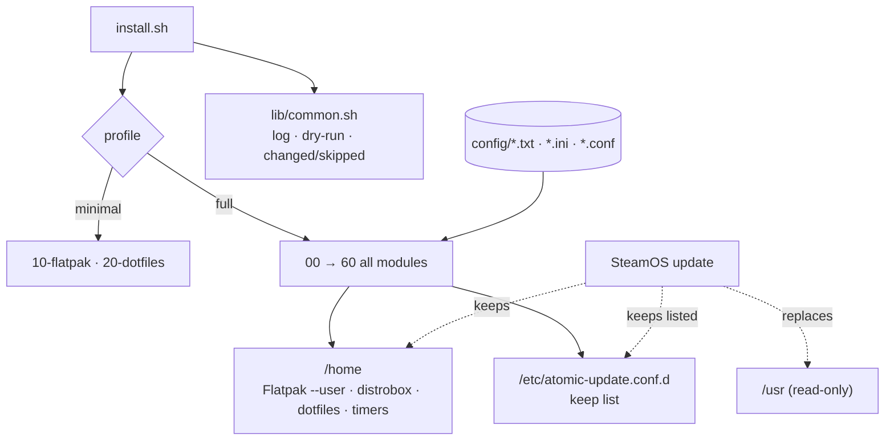

<div align="center">

# SteamOS-Unattended

**초기화해도, 업데이트해도 — 명령 한 줄이면 Steam Deck 환경이 그대로 돌아옵니다.**

SteamOS 데스크톱 모드용 무인·멱등 세팅 스크립트

[English](../README.md) | **한국어** | [日本語](README.ja.md) | [简体中文](README.zh-CN.md) | [Español](README.es.md) | [Français](README.fr.md)

    

[빠른 시작](#빠른-시작) · [모듈](#모듈) · [검증 결과](#검증-결과) · [문서](../docs/README/README.ko.md) · [변경 기록](../CHANGELOG.md)

</div>

```bash
curl -fsSL https://raw.githubusercontent.com/jongwooish/SteamOS-Unattended/main/install.sh | bash
```

## 목차

- [왜 만들었나](#왜-만들었나)
- [원칙](#원칙)
- [모듈](#모듈)
- [구조](#구조)
- [빠른 시작](#빠른-시작)
- [어디에 무엇을 두나](#어디에-무엇을-두나)
- [검증 결과](#검증-결과)
- [VMware에서 SteamOS 띄우기](#vmware에서-steamos-띄우기)
- [문서](#문서)
- [저장소 구성](#저장소-구성)
- [로드맵](#로드맵)
- [만든 사람](#만든-사람)

---

## 왜 만들었나

SteamOS는 시스템 영역이 **읽기 전용**이고, OS 업데이트 때마다 시스템을 **통째로 새 이미지로 교체**합니다. `pacman` 으로 설치한 프로그램과 대부분의 시스템 설정은 업데이트 한 번에 사라지고, 기기를 초기화하면 앱 설치, 한글 입력, 개발 도구 준비를 매번 손으로 다시 해야 합니다.

SteamOS-Unattended는 이 반복을 없앱니다. **업데이트가 절대 건드리지 않는 곳(`/home`)** 에 앱, 설정, 컨테이너를 자동으로 설치하며, 무엇을 설치할지는 평범한 설정 파일로 선언합니다.

## 원칙

| 원칙 | 의미 | 근거 |
| --- | --- | --- |
| **무인** | 질문 없이 한 번에 끝납니다 | 첫 실행: 변경 18건, sudo 입력 1회 |
| **멱등** | 몇 번을 실행해도 결과가 같고, 끝난 작업은 건너뜁니다 | 두 번째 실행: **변경 0건** |
| **업데이트 생존** | 시스템 영역(`/usr`)은 절대 건드리지 않습니다 | 모든 결과물이 `/home` 또는 유지 목록에 등록된 `/etc` 파일 |

## 모듈

| 모듈 | 하는 일 | 저장 위치 | sudo |
| --- | --- | --- | :---: |
| `00-preflight` | SteamOS 버전, 네트워크, 남은 공간 점검 | — | |
| `10-flatpak` | `config/flatpaks.txt` 의 앱을 사용자 영역에 설치 | `~/.local/share/flatpak` | |
| `20-dotfiles` | `dotfiles/` 를 `$HOME` 에 복사 (다른 파일은 먼저 백업) | `$HOME` | |
| `30-distrobox` | `config/distrobox.ini` 의 컨테이너 생성 (`devbox`, `netkit`) | podman 사용자 저장소 | |
| `40-korean-input` | fcitx5 + 한글 설치, KDE 입력기 지정 (Ctrl+Space) | `~/.config`, `~/.var` | |
| `50-backup` | systemd 사용자 타이머로 매일 설정 백업, 최근 7개 보관 | `~/Backups` | |
| `60-etc-keep` | 업데이트 후에도 지킬 `/etc` 파일 등록 | `/etc/atomic-update.conf.d/` | ✓ |

## 구조



## 빠른 시작

```bash
git clone https://github.com/jongwooish/SteamOS-Unattended.git
cd SteamOS-Unattended

./install.sh --list                 # profiles and modules
./install.sh --dry-run              # preview only, changes nothing
./install.sh                        # minimal: apps + dotfiles
./install.sh --profile full         # full: every module
```

| 바꾸고 싶은 것 | 고칠 파일 |
| --- | --- |
| 앱 | [`config/flatpaks.txt`](../config/flatpaks.txt) |
| 컨테이너 | [`config/distrobox.ini`](../config/distrobox.ini) |
| 백업 대상 | [`config/backup.conf`](../config/backup.conf) |
| 유지할 `/etc` 파일 | [`config/etc-keep.conf`](../config/etc-keep.conf) |

> [!TIP]
> 로그는 `~/.local/state/steamos-unattended/install.log` 에 남습니다.

## 어디에 무엇을 두나

SteamOS는 시스템이 A/B 두 벌이고 home만 공용입니다. 자세한 조사 내용은 [파일 시스템](../docs/05-Filesystem/README/README.ko.md)에 있습니다.

| 위치 | 업데이트 후 | 이 프로젝트에서 |
| --- | --- | --- |
| `/usr` | 교체됨 | 건드리지 않음 |
| `/etc` | 유지 목록의 파일만 남음 | 꼭 필요한 것만 + 유지 목록 등록 |
| `/home` | 남음 (A/B 공용 파티션) | 앱, 설정, 컨테이너, 로그, 백업 전부 |

## 검증 결과

VMware Workstation에 SteamOS 3.8.14를 새로 설치한 깨끗한 상태에서 테스트했습니다.

| 항목 | 결과 |
| --- | --- |
| 첫 실행 | 변경 18건, 실패 0건 |
| 두 번째 실행 | **변경 0건**, 이미 됨 19건 |
| 컨테이너 | `netkit`: `nmap 7.95`, `devbox`: `git 2.56.1` |
| 백업 | 수동 백업과 **자정 자동 백업** 동작 |
| 한글 입력 | 재로그인 후 Ctrl+Space로 입력 |

<table>
<tr>
<td><br/><sub>첫 실행: 변경 18건</sub></td>
<td><br/><sub>두 번째 실행: 변경 0건</sub></td>
</tr>
<tr>
<td><br/><sub>컨테이너와 자동 백업</sub></td>
<td><br/><sub>데스크톱 모드 한글 입력</sub></td>
</tr>
</table>

## VMware에서 SteamOS 띄우기

테스트 머신을 만드는 것부터가 하나의 프로젝트였습니다. 커널에 VMware 그래픽 드라이버(`vmwgfx`)가 빠져 있어서 **SteamOS 3.x는 VMware에서 화면이 아예 나오지 않습니다.**

- Valve 커널과 정확히 같은 헤더로 **vmwgfx를 트리 밖에서 직접 빌드**했습니다.
- Valve 커널에 없는 함수 두 개를 **호환 패치**([`compat_dirty.h`](../vmware/compat_dirty.h))로 대체했습니다.
- VMware 가상 NVMe가 거부하는 `nvme format` 단계를 **설치 스크립트 복사본**에서 우회했습니다.
- `/etc` 와 `/home` 만으로 부팅 때 드라이버를 올리고 **데스크톱 모드로 자동 로그인**하게 했습니다.

> [!NOTE]
> 전 과정은 [구성](../docs/03-Configuration/README/README.ko.md)에, 진행 중 만난 문제 15가지는 [트러블슈팅](../docs/04-Troubleshooting/README/README.ko.md)에 화면과 함께 정리했습니다.

## 문서

| 문서 | 내용 |
| --- | --- |
| [자료실](../docs/01-Downloads/README/README.ko.md) | 필요한 파일, 공식 링크, 검증 버전 |
| [주의사항](../docs/02-Cautions/README/README.ko.md) | 실행 전에 알아 둘 것 |
| [구성](../docs/03-Configuration/README/README.ko.md) | VM 만들기부터 검증된 실행까지 6단계 |
| [트러블슈팅](../docs/04-Troubleshooting/README/README.ko.md) | 증상별 원인과 해결 15가지 |
| [파일 시스템](../docs/05-Filesystem/README/README.ko.md) | 업데이트 때 무엇이 사라지고 무엇이 남는지 |

## 저장소 구성

```text
install.sh              진입점 (필요하면 저장소를 받아 스스로 다시 실행)
lib/common.sh           로그, dry-run, 변경/건너뜀 집계
lib/su-backup.sh        백업 스크립트 (타이머가 실행)
modules/                번호 순서대로 실행되는 모듈 7개
config/                 앱 목록, 컨테이너 선언, 백업 설정, /etc 유지 목록
profiles/               minimal, full
dotfiles/               $HOME 으로 복사할 개인 설정
systemd/                백업 타이머 유닛
tests/vm-test.ps1       VMware 스냅샷 자동 테스트 (Windows)
vmware/                 VMware 전용 파일 (드라이버 패치, 서비스, 자동 로그인)
docs/                   자료실, 주의사항, 구성, 트러블슈팅, 파일 시스템
.github/workflows/      개인정보 검사 CI
```

## 로드맵

- [ ] 실제 SteamOS 업데이트 후 생존 검증
- [ ] 실제 Steam Deck 하드웨어에서 검증
- [ ] 모듈 추가: Decky Loader, 에뮬레이터 설정
- [x] 6개 언어 문서

## 만든 사람

**Jongwoo Yun** · [@jongwooish](https://github.com/jongwooish)
