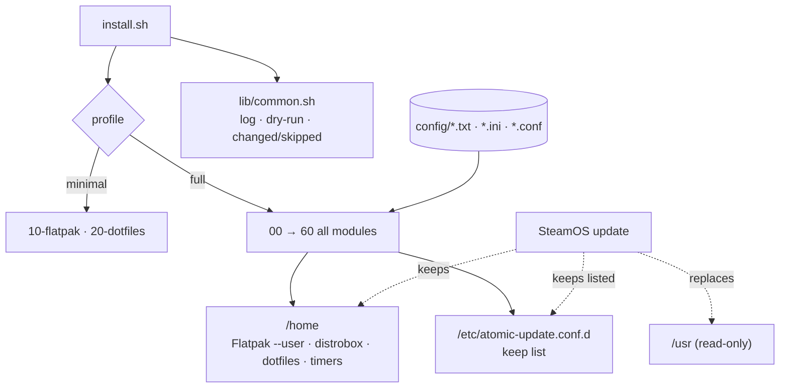

<div align="center">

# SteamOS-Unattended

**无论重置还是更新 — 一条命令就能恢复你的 Steam Deck 环境。**

适用于 SteamOS 桌面模式的无人值守、幂等配置脚本

[English](../README.md) | [한국어](README.ko.md) | [日本語](README.ja.md) | **简体中文** | [Español](README.es.md) | [Français](README.fr.md)

    

[快速开始](#快速开始) · [模块](#模块) · [验证结果](#验证结果) · [文档](../docs/README/README.zh-CN.md) · [更新日志](../CHANGELOG.md)

</div>

```bash
curl -fsSL https://raw.githubusercontent.com/jongwooish/SteamOS-Unattended/main/install.sh | bash
```

## 目录

- [为什么做这个](#为什么做这个)
- [原则](#原则)
- [模块](#模块)
- [架构](#架构)
- [快速开始](#快速开始)
- [文件放在哪里](#文件放在哪里)
- [验证结果](#验证结果)
- [在 VMware 中运行 SteamOS](#在-vmware-中运行-steamos)
- [文档](#文档)
- [仓库结构](#仓库结构)
- [路线图](#路线图)
- [作者](#作者)

---

## 为什么做这个

SteamOS 的系统区域是 **只读** 的，每次系统更新都会 **整体替换为新镜像**。用 `pacman` 安装的程序和大部分系统设置一次更新就会消失；恢复出厂设置后，应用、韩文输入和开发工具都得手动重新配置。

SteamOS-Unattended 消除了这种重复劳动。它把应用、设置和容器自动安装到 **更新永远不会触碰的位置（`/home`）**，安装什么则用简单的配置文件来声明。

## 原则

| 原则 | 含义 | 依据 |
| --- | --- | --- |
| **无人值守** | 一次完成，不提任何问题 | 第一次运行：18 项改动，只输入一次 sudo |
| **幂等** | 运行多少次结果都一样；已完成的工作会跳过 | 第二次运行：**0 项改动** |
| **更新后保留** | 从不触碰系统区域（`/usr`） | 所有产物都位于 `/home` 或保留列表中的 `/etc` 文件 |

## 模块

| 模块 | 作用 | 写入位置 | sudo |
| --- | --- | --- | :---: |
| `00-preflight` | 检查 SteamOS 版本、网络和剩余空间 | — | |
| `10-flatpak` | 按用户安装 `config/flatpaks.txt` 中的应用 | `~/.local/share/flatpak` | |
| `20-dotfiles` | 把 `dotfiles/` 复制到 `$HOME`（不同的文件先备份） | `$HOME` | |
| `30-distrobox` | 创建 `config/distrobox.ini` 中的容器（`devbox`、`netkit`） | podman 用户存储 | |
| `40-korean-input` | 安装 fcitx5 + 韩文并设置 KDE 输入法（Ctrl+Space） | `~/.config`、`~/.var` | |
| `50-backup` | 用 systemd 用户计时器每天备份配置，保留最近 7 份 | `~/Backups` | |
| `60-etc-keep` | 登记更新后需保留的 `/etc` 文件 | `/etc/atomic-update.conf.d/` | ✓ |

## 架构



## 快速开始

```bash
git clone https://github.com/jongwooish/SteamOS-Unattended.git
cd SteamOS-Unattended

./install.sh --list                 # profiles and modules
./install.sh --dry-run              # preview only, changes nothing
./install.sh                        # minimal: apps + dotfiles
./install.sh --profile full         # full: every module
```

| 要修改的内容 | 编辑文件 |
| --- | --- |
| 应用 | [`config/flatpaks.txt`](../config/flatpaks.txt) |
| 容器 | [`config/distrobox.ini`](../config/distrobox.ini) |
| 备份对象 | [`config/backup.conf`](../config/backup.conf) |
| 需保留的 `/etc` 文件 | [`config/etc-keep.conf`](../config/etc-keep.conf) |

> [!TIP]
> 日志写入 `~/.local/state/steamos-unattended/install.log`。

## 文件放在哪里

SteamOS 的系统有 A/B 两套，只有 home 是共享的。完整的调查见 [文件系统](../docs/05-Filesystem/README/README.zh-CN.md)。

| 位置 | 更新之后 | 本项目中 |
| --- | --- | --- |
| `/usr` | 被替换 | 从不修改 |
| `/etc` | 只保留列表中的文件 | 仅限必要内容 + 登记保留列表 |
| `/home` | 保留（A/B 共享分区） | 应用、设置、容器、日志、备份全部在此 |

## 验证结果

在 VMware Workstation 中全新安装 SteamOS 3.8.14 后进行测试。

| 检查项 | 结果 |
| --- | --- |
| 第一次运行 | 改动 18 项，失败 0 项 |
| 第二次运行 | **改动 0 项**，已完成 19 项 |
| 容器 | `netkit`：`nmap 7.95`，`devbox`：`git 2.56.1` |
| 备份 | 手动备份与 **午夜定时备份** 均正常 |
| 韩文输入 | 重新登录后用 Ctrl+Space 输入 |

<table>
<tr>
<td><br/><sub>第一次运行：改动 18 项</sub></td>
<td><br/><sub>第二次运行：改动 0 项</sub></td>
</tr>
<tr>
<td><br/><sub>容器与定时备份</sub></td>
<td><br/><sub>桌面模式下的韩文输入</sub></td>
</tr>
</table>

## 在 VMware 中运行 SteamOS

搭建测试机本身就是一个项目：由于内核没有附带 VMware 图形驱动（`vmwgfx`），**SteamOS 3.x 在 VMware 中完全没有画面。**

- 使用与 Valve 内核完全一致的头文件，**在树外构建了 vmwgfx**。
- 用 **兼容补丁**（[`compat_dirty.h`](../vmware/compat_dirty.h)）替代了 Valve 内核中缺失的两个函数。
- 在 **安装程序的副本** 中绕过了 VMware 虚拟 NVMe 拒绝的 `nvme format` 步骤。
- 只用 `/etc` 和 `/home`，实现开机加载驱动并 **自动登录桌面模式**。

> [!NOTE]
> 完整流程见 [配置](../docs/03-Configuration/README/README.zh-CN.md)，过程中遇到的 15 个问题及截图见 [故障排除](../docs/04-Troubleshooting/README/README.zh-CN.md)。

## 文档

| 文档 | 内容 |
| --- | --- |
| [下载](../docs/01-Downloads/README/README.zh-CN.md) | 所需文件、官方链接、已验证版本 |
| [注意事项](../docs/02-Cautions/README/README.zh-CN.md) | 运行前需要了解的内容 |
| [配置](../docs/03-Configuration/README/README.zh-CN.md) | 从创建虚拟机到验证运行的 6 个步骤 |
| [故障排除](../docs/04-Troubleshooting/README/README.zh-CN.md) | 15 种症状的原因与解决方法 |
| [文件系统](../docs/05-Filesystem/README/README.zh-CN.md) | 更新会清除什么、保留什么 |

## 仓库结构

```text
install.sh              入口（必要时下载仓库并重新运行自身）
lib/common.sh           日志、dry-run、改动/跳过计数
lib/su-backup.sh        备份脚本（由计时器运行）
modules/                按编号顺序运行的 7 个模块
config/                 应用列表、容器定义、备份设置、/etc 保留列表
profiles/               minimal、full
dotfiles/               复制到 $HOME 的个人设置
systemd/                备份计时器单元
tests/vm-test.ps1       VMware 快照自动测试（Windows）
vmware/                 VMware 专用文件（驱动补丁、服务、自动登录）
docs/                   下载、注意事项、配置、故障排除、文件系统
.github/workflows/      隐私检查 CI
```

## 路线图

- [ ] 验证真实 SteamOS 更新后的保留情况
- [ ] 在真实 Steam Deck 硬件上验证
- [ ] 更多模块：Decky Loader、模拟器配置
- [x] 6 种语言的文档

## 作者

**Jongwoo Yun** · [@jongwooish](https://github.com/jongwooish)
