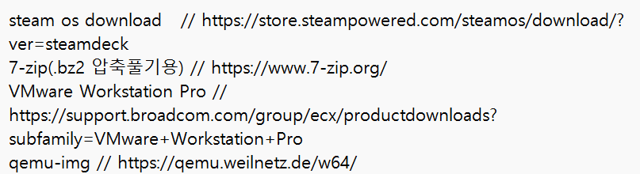

# Downloads

**English** | [한국어](README/README.ko.md) | [日本語](README/README.ja.md) | [简体中文](README/README.zh-CN.md) | [Español](README/README.es.md) | [Français](README/README.fr.md)

 

Everything you need to follow this project, with the official place to get each file. All of it is free.

## Contents

- [1. This project](#1-this-project)
- [2. Test environment](#2-test-environment)
- [3. Tested versions](#3-tested-versions)
- [4. On a real Steam Deck](#4-on-a-real-steam-deck)
- [5. Before you download](#5-before-you-download)

---

## 1. This project

| Item | Where | Notes |
| --- | --- | --- |
| SteamOS-Unattended (latest) | `git clone https://github.com/jongwooish/SteamOS-Unattended.git` | Or **Code → Download ZIP** on the repository page |
| Release files | **Releases** tab of the repository | From tag `v1.0.0` |
| One-line install (inside SteamOS) | `curl -fsSL https://raw.githubusercontent.com/jongwooish/SteamOS-Unattended/main/install.sh \| bash` | Downloads the repository and runs the `minimal` profile |

---

## 2. Test environment

| Item | Where | Used for | Notes |
| --- | --- | --- | --- |
| SteamOS recovery image | https://store.steampowered.com/steamos/download/?ver=steamdeck | SteamOS to install in the VM | Guide: https://help.steampowered.com/faqs/view/1B71-EDF2-EB6D-2BB3 |
| 7-Zip | https://www.7-zip.org/ | Extracting the `.bz2` recovery image | |
| VMware Workstation Pro | https://support.broadcom.com/group/ecx/productdownloads?subfamily=VMware+Workstation+Pro | Virtual machine | Free for personal, educational and commercial use. Free Broadcom account required |
| qemu-img (QEMU for Windows) | https://qemu.weilnetz.de/w64/ | Converting the `.img` to a VMware `.vmdk` | On Debian/Ubuntu: `sudo apt install qemu-utils` |
| Git for Windows | https://git-scm.com/download/win | Cloning the repository | |

---

## 3. Tested versions

| Component | Version |
| --- | --- |
| SteamOS | 3.8.14 |
| Kernel | `6.16.12-valve24.4-1-neptune-616-gfe145653a794` |
| Kernel headers package | `linux-neptune-616-headers 6.16.12.valve24.4-1` |
| vmwgfx source | kernel.org `linux-6.16.12` |
| distrobox / podman | 1.8.1.2 / 5.5.2 |
| Host | Windows, VMware Workstation Pro |

---

## 4. On a real Steam Deck

You do not need any of the test environment files. Open Konsole in Desktop Mode and run the one-line install command.

---

## 5. Before you download

- Get the recovery image **only from Valve's official page**. Re-uploaded images may be modified or incomplete.
- Get the VMware installer **only from the Broadcom portal**. Avoid sites that offer it "without an account".
- With a different SteamOS version the kernel changes, so you must [rebuild the vmwgfx driver for that version](../03-Configuration/03-vmwgfx-Driver/README.md).
