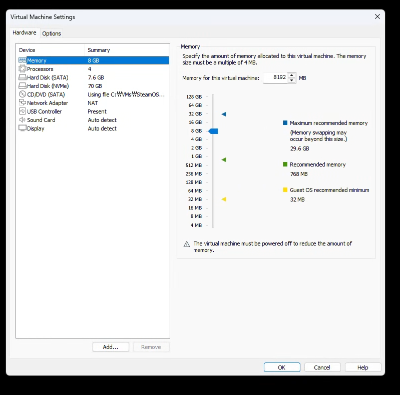

# Paso 1 · Crear la VM

[English](../README.md) | [한국어](README.ko.md) | [日本語](README.ja.md) | [简体中文](README.zh-CN.md) | **Español** | [Français](README.fr.md)

  

Crea una VM de VMware Workstation capaz de arrancar la imagen de recuperación de SteamOS.

> [!NOTE]
> Este paso es solo para el entorno de pruebas en VMware. En una Steam Deck real, ve directamente al [Paso 6](../../06-Run-Unattended/README/README.es.md).

## Índice

- [Descripción general](#descripción-general)
- [Requisitos previos](#requisitos-previos)
- [Pasos](#pasos)
  - [1-1. Descomprimir la imagen de recuperación](#1-1-descomprimir-la-imagen-de-recuperación)
  - [1-2. Convertirla en un disco de VMware](#1-2-convertirla-en-un-disco-de-vmware)
  - [1-3. Crear la VM](#1-3-crear-la-vm)
  - [1-4. Conectar el disco de recuperación y activar 3D](#1-4-conectar-el-disco-de-recuperación-y-activar-3d)
- [Verificación](#verificación)
- [Siguiente](#siguiente)

---

## Descripción general

La imagen de recuperación de SteamOS es una imagen USB en bruto (raw) creada para la Steam Deck. Para arrancarla en VMware hay que cumplir tres condiciones que la imagen espera:

| Requisito | Motivo |
| --- | --- |
| **Firmware UEFI** | La imagen no tiene cargador de arranque BIOS. Con BIOS [recurre al arranque por red](../../../04-Troubleshooting/README/README.es.md#t1). |
| **Disco de destino NVMe** | El instalador escribe en `/dev/nvme0n1`, el SSD interno de la Steam Deck. |
| **Formato de disco `.vmdk`** | VMware no puede conectar directamente un archivo `.img` en bruto. |

## Requisitos previos

- [ ] VMware Workstation Pro instalado
- [ ] Imagen de recuperación de SteamOS (`steamdeck-repair-….img.bz2`)
- [ ] 7-Zip y `qemu-img`
- [ ] Unos 100 GB de espacio libre

Todos los enlaces están en [Descargas](../../../01-Downloads/README/README.es.md).

---

## Pasos

### 1-1. Descomprimir la imagen de recuperación

Descomprime el archivo `.bz2` con 7-Zip. Renombrar el resultado a `SteamOS.img` acorta los comandos siguientes.

### 1-2. Convertirla en un disco de VMware

```powershell
cd C:\VMs
& "C:\Program Files\qemu\qemu-img.exe" convert -p -f raw -O vmdk .\SteamOS.img .\recovery.vmdk
```


> [!WARNING]
> No muevas `recovery.vmdk` hasta terminar la instalación. La VM guarda su ruta absoluta.

### 1-3. Crear la VM

**File → New Virtual Machine → Custom (advanced)** y después:

| Pantalla | Valor |
| --- | --- |
| Instalación del SO invitado | I will install the operating system later |
| SO invitado | Linux · **Other Linux 6.x kernel 64-bit** |
| Firmware | **UEFI**, Secure Boot **desactivado** |
| Procesadores | 4 núcleos |
| Memoria | 8 GB o más |
| Red | NAT |
| Disco | **NVMe**, 64 GB o más, un solo archivo |




### 1-4. Conectar el disco de recuperación y activar 3D

En **Edit virtual machine settings**:

1. **Add → Hard Disk → SATA → Use an existing virtual disk** → `recovery.vmdk` → **Keep Existing Format**
2. Activa **Display → Accelerate 3D graphics** y pon Graphics memory en 4 GB o más


> [!TIP]
> Si las opciones aparecen en gris y desactivadas, la VM está encendida. Apágala antes de cambiar los ajustes ([T3](../../../04-Troubleshooting/README/README.es.md#t3)).

---

## Verificación

**Edit virtual machine settings** debería mostrar:

| Dispositivo | Contenido |
| --- | --- |
| Hard Disk (NVMe) | 70 GB, vacío — destino de instalación de SteamOS |
| Hard Disk (SATA 0.0) | `recovery.vmdk` — entorno de recuperación |
| Memory / Processors | 8 GB / 4 |
| Network / Display | NAT / aceleración 3D |

El disco de trabajo de 20 GB se añade en el [Paso 3](../../03-vmwgfx-Driver/README/README.es.md).

> [!TIP]
> Toma ahora una instantánea llamada `before-install` (con la VM apagada). Si algo falla más adelante, vuelves aquí en segundos.

## Siguiente

[Paso 2 · Arranque de recuperación y SSH →](../../02-Recovery-Boot/README/README.es.md)
