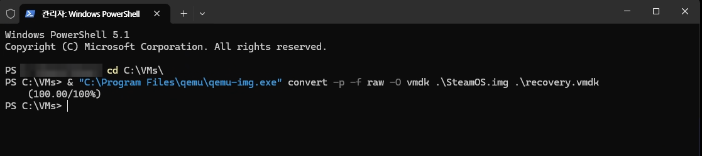

# ステップ 1 · VM の作成

[English](../README.md) | [한국어](README.ko.md) | **日本語** | [简体中文](README.zh-CN.md) | [Español](README.es.md) | [Français](README.fr.md)

  

SteamOS リカバリーイメージで起動できる VMware Workstation の VM を作成します。

> [!NOTE]
> この手順は VMware テスト環境専用です。実機の Steam Deck では [ステップ 6](../../06-Run-Unattended/README/README.ja.md) に進んでください。

## 目次

- [概要](#概要)
- [前提条件](#前提条件)
- [手順](#手順)
  - [1-1. リカバリーイメージを展開する](#1-1-リカバリーイメージを展開する)
  - [1-2. VMware ディスクに変換する](#1-2-vmware-ディスクに変換する)
  - [1-3. VM を作成する](#1-3-vm-を作成する)
  - [1-4. リカバリーディスクの接続と 3D 有効化](#1-4-リカバリーディスクの接続と-3d-有効化)
- [確認](#確認)
- [次へ](#次へ)

---

## 概要

SteamOS リカバリーイメージは Steam Deck 向けの USB 用 raw イメージです。VMware で起動するには、イメージが前提とする 3 つの条件を満たす必要があります。

| 条件 | 理由 |
| --- | --- |
| **UEFI ファームウェア** | イメージには BIOS 用ブートローダーがありません。BIOS だと [ネットワークブートに落ちます](../../../04-Troubleshooting/README/README.ja.md#t1)。 |
| **NVMe のインストール先ディスク** | インストーラーは Steam Deck の内蔵 SSD である `/dev/nvme0n1` に書き込みます。 |
| **`.vmdk` ディスク形式** | VMware は raw の `.img` ファイルをそのまま接続できません。 |

## 前提条件

- [ ] VMware Workstation Pro のインストール
- [ ] SteamOS リカバリーイメージ（`steamdeck-repair-….img.bz2`）
- [ ] 7-Zip と `qemu-img`
- [ ] 約 100 GB の空き容量

ダウンロードリンクはすべて [ダウンロード](../../../01-Downloads/README/README.ja.md) にあります。

---

## 手順

### 1-1. リカバリーイメージを展開する

7-Zip で `.bz2` ファイルを展開します。ファイル名を `SteamOS.img` に変えると以降のコマンドが短くなります。

### 1-2. VMware ディスクに変換する

```powershell
cd C:\VMs
& "C:\Program Files\qemu\qemu-img.exe" convert -p -f raw -O vmdk .\SteamOS.img .\recovery.vmdk
```



> [!WARNING]
> インストールが終わるまで `recovery.vmdk` を移動しないでください。VM はこのファイルの絶対パスを保持しています。

### 1-3. VM を作成する

**File → New Virtual Machine → Custom (advanced)** を選び、次のように設定します。

| 画面 | 値 |
| --- | --- |
| ゲスト OS のインストール | I will install the operating system later |
| ゲスト OS | Linux · **Other Linux 6.x kernel 64-bit** |
| ファームウェア | **UEFI**、Secure Boot は **オフ** |
| プロセッサ | 4 コア |
| メモリ | 8 GB 以上 |
| ネットワーク | NAT |
| ディスク | **NVMe**、64 GB 以上、単一ファイル |


### 1-4. リカバリーディスクの接続と 3D 有効化

**Edit virtual machine settings** で次を行います。

1. **Add → Hard Disk → SATA → Use an existing virtual disk** → `recovery.vmdk` → **Keep Existing Format**
2. **Display → Accelerate 3D graphics** をオン、Graphics memory を 4 GB 以上に


> [!TIP]
> 項目がグレーで無効になっている場合、VM は起動中です。電源を切ってから設定を変更してください（[T3](../../../04-Troubleshooting/README/README.ja.md#t3)）。

---

## 確認

**Edit virtual machine settings** が次のようになっていれば完了です。

| デバイス | 内容 |
| --- | --- |
| Hard Disk (NVMe) | 70 GB、空 — SteamOS のインストール先 |
| Hard Disk (SATA 0.0) | `recovery.vmdk` — リカバリー環境 |
| Memory / Processors | 8 GB / 4 |
| Network / Display | NAT / 3D アクセラレーション |

20 GB の作業ディスクは [ステップ 3](../../03-vmwgfx-Driver/README/README.ja.md) で追加します。

> [!TIP]
> ここで `before-install` というスナップショットを取っておきましょう（VM の電源オフ時）。後で失敗しても数秒でこの状態に戻れます。

## 次へ

[ステップ 2 · リカバリー起動と SSH →](../../02-Recovery-Boot/README/README.ja.md)
