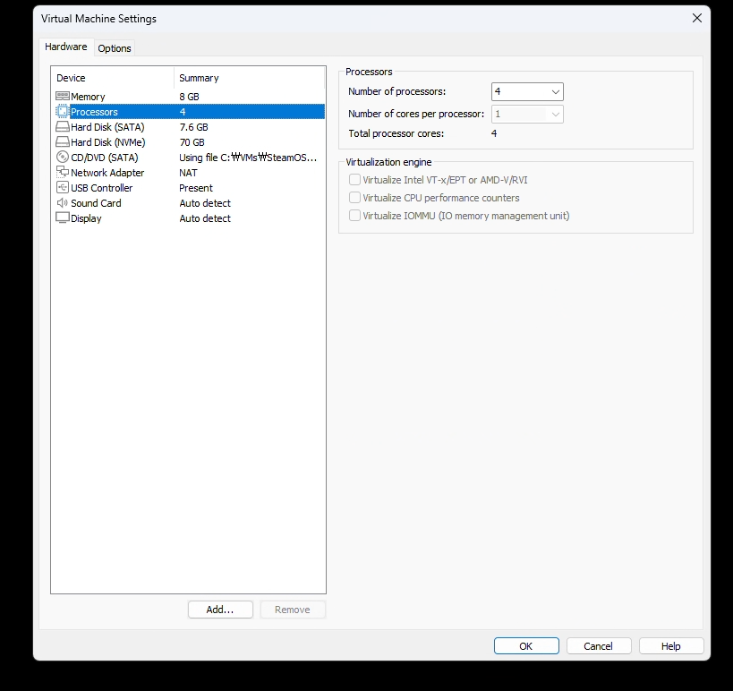

# 第 1 步 · 创建虚拟机

[English](../README.md) | [한국어](README.ko.md) | [日本語](README.ja.md) | **简体中文** | [Español](README.es.md) | [Français](README.fr.md)

  

创建一台能够启动 SteamOS 恢复镜像的 VMware Workstation 虚拟机。

> [!NOTE]
> 此步骤仅用于 VMware 测试环境。在真实的 Steam Deck 上请直接前往 [第 6 步](../../06-Run-Unattended/README/README.zh-CN.md)。

## 目录

- [概述](#概述)
- [前提条件](#前提条件)
- [步骤](#步骤)
  - [1-1. 解压恢复镜像](#1-1-解压恢复镜像)
  - [1-2. 转换为 VMware 磁盘](#1-2-转换为-vmware-磁盘)
  - [1-3. 创建虚拟机](#1-3-创建虚拟机)
  - [1-4. 挂载恢复盘并启用 3D](#1-4-挂载恢复盘并启用-3d)
- [验证](#验证)
- [下一步](#下一步)

---

## 概述

SteamOS 恢复镜像是为 Steam Deck 制作的 USB 原始（raw）镜像。要在 VMware 中启动它，必须满足镜像预期的三个条件：

| 条件 | 原因 |
| --- | --- |
| **UEFI 固件** | 镜像中没有 BIOS 引导程序。使用 BIOS 会 [退回到网络启动](../../../04-Troubleshooting/README/README.zh-CN.md#t1)。 |
| **NVMe 目标磁盘** | 安装脚本写入 Steam Deck 内置 SSD `/dev/nvme0n1`。 |
| **`.vmdk` 磁盘格式** | VMware 无法直接挂载原始 `.img` 文件。 |

## 前提条件

- [ ] 已安装 VMware Workstation Pro
- [ ] SteamOS 恢复镜像（`steamdeck-repair-….img.bz2`）
- [ ] 7-Zip 和 `qemu-img`
- [ ] 约 100 GB 可用磁盘空间

所有下载链接见 [下载](../../../01-Downloads/README/README.zh-CN.md)。

---

## 步骤

### 1-1. 解压恢复镜像

用 7-Zip 解压 `.bz2` 文件。把结果改名为 `SteamOS.img` 可以让后面的命令更短。

### 1-2. 转换为 VMware 磁盘

```powershell
cd C:\VMs
& "C:\Program Files\qemu\qemu-img.exe" convert -p -f raw -O vmdk .\SteamOS.img .\recovery.vmdk
```


> [!WARNING]
> 在安装完成之前不要移动 `recovery.vmdk`。虚拟机记录的是它的绝对路径。

### 1-3. 创建虚拟机

选择 **File → New Virtual Machine → Custom (advanced)**，然后：

| 界面 | 值 |
| --- | --- |
| 客户机操作系统安装 | I will install the operating system later |
| 客户机操作系统 | Linux · **Other Linux 6.x kernel 64-bit** |
| 固件 | **UEFI**，Secure Boot **关闭** |
| 处理器 | 4 核 |
| 内存 | 8 GB 或以上 |
| 网络 | NAT |
| 磁盘 | **NVMe**，64 GB 或以上，单个文件 |




### 1-4. 挂载恢复盘并启用 3D

在 **Edit virtual machine settings** 中：

1. **Add → Hard Disk → SATA → Use an existing virtual disk** → `recovery.vmdk` → **Keep Existing Format**
2. 打开 **Display → Accelerate 3D graphics**，Graphics memory 设为 4 GB 或以上


> [!TIP]
> 选项呈灰色不可用，说明虚拟机正在运行。请先关机再修改设置（[T3](../../../04-Troubleshooting/README/README.zh-CN.md#t3)）。

---

## 验证

**Edit virtual machine settings** 应如下所示：

| 设备 | 内容 |
| --- | --- |
| Hard Disk (NVMe) | 70 GB，空 — SteamOS 安装目标 |
| Hard Disk (SATA 0.0) | `recovery.vmdk` — 恢复环境 |
| Memory / Processors | 8 GB / 4 |
| Network / Display | NAT / 3D 加速 |

20 GB 工作盘将在 [第 3 步](../../03-vmwgfx-Driver/README/README.zh-CN.md) 中添加。

> [!TIP]
> 现在（虚拟机关机状态）拍一个名为 `before-install` 的快照。之后出现任何失败都可以在几秒内回到这里。

## 下一步

[第 2 步 · 恢复环境启动与 SSH →](../../02-Recovery-Boot/README/README.zh-CN.md)
