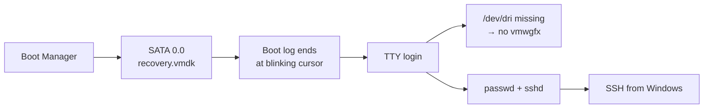
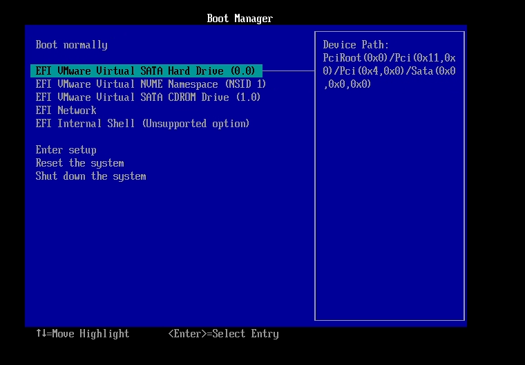

# Step 2 · Recovery boot and SSH

**English** | [한국어](README/README.ko.md) | [日本語](README/README.ja.md) | [简体中文](README/README.zh-CN.md) | [Español](README/README.es.md) | [Français](README/README.fr.md)

  

Boot the recovery disk, find out why no desktop appears, and connect from Windows over SSH.

## Contents

- [Overview](#overview)
- [Prerequisites](#prerequisites)
- [Steps](#steps)
  - [2-1. Pick the recovery disk in Boot Manager](#2-1-pick-the-recovery-disk-in-boot-manager)
  - [2-2. Read the boot log](#2-2-read-the-boot-log)
  - [2-3. Log in on a TTY and diagnose](#2-3-log-in-on-a-tty-and-diagnose)
  - [2-4. Enable SSH](#2-4-enable-ssh)
- [Verification](#verification)
- [Next](#next)

---

## Overview

The recovery environment boots, but stops at a blinking cursor instead of showing a desktop. This step proves the cause from a text console and opens SSH, so that every later command can be copied and pasted from Windows.



## Prerequisites

- [ ] [Step 1](../01-Create-VM/README.md) completed (UEFI VM with `recovery.vmdk` on SATA 0.0)

---

## Steps

### 2-1. Pick the recovery disk in Boot Manager

**VM → Power → Power On to Firmware → Boot Manager**



| Entry | What it is |
| --- | --- |
| **EFI VMware Virtual SATA Hard Drive (0.0)** | `recovery.vmdk` — **select this** |
| EFI VMware Virtual NVME Namespace | Empty install target |
| EFI VMware Virtual SATA CDROM Drive | Virtual CD drive, not used |

Use the arrow keys and Enter. The mouse does not work on this screen.

### 2-2. Read the boot log

Early messages include `ERROR`, but they are **normal in a VM**.


| Message | Meaning |
| --- | --- |
| `tsc: Unable to calibrate` | The VM measures the CPU clock differently |
| `core: CPUID marked event…` | The virtual CPU hides some performance counters |
| `ERROR: unknown fsck.mode parameter: 'auto'` | Harmless despite the name |

The `[ OK ]` lines then stop at a **blinking cursor** — the graphical session never starts.


> [!NOTE]
> Waiting longer or raising memory, CPU or graphics memory does not change this. The cause is shown in the next step.

### 2-3. Log in on a TTY and diagnose

In VMware, Ctrl+Alt releases the mouse instead of reaching the guest. Click the VM, press **Ctrl+Alt+Space**, release only Space, then press **F3** while still holding Ctrl+Alt. Log in as `deck` with an empty password.

```bash
uname -r
grep VERSION_ID /etc/os-release
lsmod | grep -E 'vmwgfx|drm'
ls /dev/dri
ip -4 addr | grep inet
```


| Result | Meaning |
| --- | --- |
| Kernel `6.16.12-valve24.4-1-neptune-616-…` | Valve's kernel. The driver must match it exactly |
| `lsmod` prints nothing | No graphics driver is loaded at all |
| **`/dev/dri` missing** | **No display device → no desktop possible** |
| `192.168.126.133` | Networking works |

### 2-4. Enable SSH

```bash
passwd                              # set a password for deck
sudo systemctl enable --now sshd    # start now and after every reboot
```

From Windows PowerShell:

```powershell
ssh deck@192.168.126.133
```


The banner points to `~/tools/repair_device.sh`, the installer used in [Step 4](../04-Install-SteamOS/README.md).

---

## Verification

- [ ] `ssh deck@<VM IP>` from Windows reaches `(deck@steamdeck ~)$`
- [ ] `ls /dev/dri` reports *No such file or directory* — expected at this point

## Next

[Step 3 · Build the vmwgfx driver →](../03-vmwgfx-Driver/README.md)
