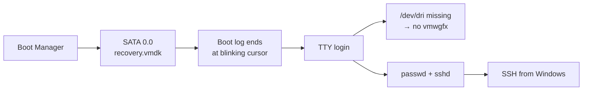
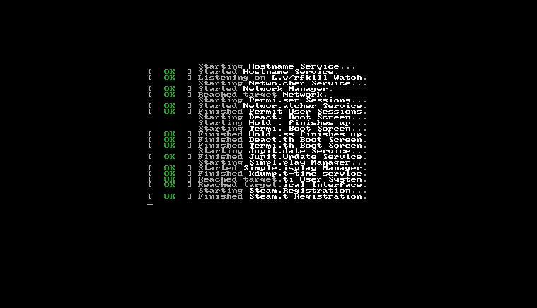

# Paso 2 · Arranque de recuperación y SSH

[English](../README.md) | [한국어](README.ko.md) | [日本語](README.ja.md) | [简体中文](README.zh-CN.md) | **Español** | [Français](README.fr.md)

  

Arranca el disco de recuperación, averigua por qué no aparece el escritorio y conéctate desde Windows por SSH.

## Índice

- [Descripción general](#descripción-general)
- [Requisitos previos](#requisitos-previos)
- [Pasos](#pasos)
  - [2-1. Elegir el disco de recuperación en Boot Manager](#2-1-elegir-el-disco-de-recuperación-en-boot-manager)
  - [2-2. Leer el registro de arranque](#2-2-leer-el-registro-de-arranque)
  - [2-3. Iniciar sesión en una TTY y diagnosticar](#2-3-iniciar-sesión-en-una-tty-y-diagnosticar)
  - [2-4. Activar SSH](#2-4-activar-ssh)
- [Verificación](#verificación)
- [Siguiente](#siguiente)

---

## Descripción general

El entorno de recuperación arranca, pero se detiene en un cursor parpadeante en lugar de mostrar el escritorio. Este paso demuestra la causa desde una consola de texto y activa SSH, para poder copiar y pegar desde Windows todos los comandos posteriores.



## Requisitos previos

- [ ] [Paso 1](../../01-Create-VM/README/README.es.md) completado (VM UEFI con `recovery.vmdk` en SATA 0.0)

---

## Pasos

### 2-1. Elegir el disco de recuperación en Boot Manager

**VM → Power → Power On to Firmware → Boot Manager**


| Entrada | Qué es |
| --- | --- |
| **EFI VMware Virtual SATA Hard Drive (0.0)** | `recovery.vmdk` — **elige esta** |
| EFI VMware Virtual NVME Namespace | Destino de instalación vacío |
| EFI VMware Virtual SATA CDROM Drive | Unidad de CD virtual, no se usa |

Usa las flechas y Enter. El ratón no funciona en esta pantalla.

### 2-2. Leer el registro de arranque

Los primeros mensajes incluyen `ERROR`, pero son **normales en una VM**.


| Mensaje | Significado |
| --- | --- |
| `tsc: Unable to calibrate` | La VM mide el reloj de la CPU de otra forma |
| `core: CPUID marked event…` | La CPU virtual oculta algunos contadores de rendimiento |
| `ERROR: unknown fsck.mode parameter: 'auto'` | Inofensivo pese al nombre |

Después, las líneas `[ OK ]` se detienen en un **cursor parpadeante**: la sesión gráfica nunca se inicia.



> [!NOTE]
> Esperar más o subir la memoria, la CPU o la memoria gráfica no lo cambia. La causa se muestra en el siguiente paso.

### 2-3. Iniciar sesión en una TTY y diagnosticar

En VMware, Ctrl+Alt libera el ratón en lugar de llegar al invitado. Haz clic en la VM, pulsa **Ctrl+Alt+Space**, suelta solo Space y pulsa **F3** sin soltar Ctrl+Alt. Inicia sesión como `deck` con la contraseña vacía.

```bash
uname -r
grep VERSION_ID /etc/os-release
lsmod | grep -E 'vmwgfx|drm'
ls /dev/dri
ip -4 addr | grep inet
```


| Resultado | Significado |
| --- | --- |
| Kernel `6.16.12-valve24.4-1-neptune-616-…` | Kernel de Valve. El controlador debe coincidir exactamente |
| `lsmod` no muestra nada | No hay ningún controlador gráfico cargado |
| **Falta `/dev/dri`** | **Sin dispositivo de pantalla → no puede haber escritorio** |
| `192.168.126.133` | La red funciona |

### 2-4. Activar SSH

```bash
passwd                              # set a password for deck
sudo systemctl enable --now sshd    # start now and after every reboot
```

Desde Windows PowerShell:

```powershell
ssh deck@192.168.126.133
```


El mensaje de bienvenida señala `~/tools/repair_device.sh`, el instalador que se usa en el [Paso 4](../../04-Install-SteamOS/README/README.es.md).

---

## Verificación

- [ ] `ssh deck@<IP de la VM>` desde Windows llega a `(deck@steamdeck ~)$`
- [ ] `ls /dev/dri` indica *No such file or directory* — esperado en este punto

## Siguiente

[Paso 3 · Compilar el controlador vmwgfx →](../../03-vmwgfx-Driver/README/README.es.md)
