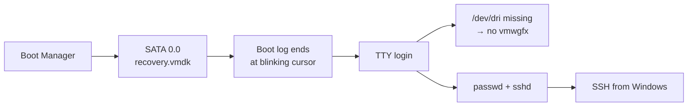
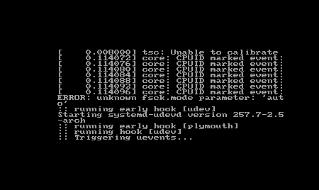

# Étape 2 · Démarrage de récupération et SSH

[English](../README.md) | [한국어](README.ko.md) | [日本語](README.ja.md) | [简体中文](README.zh-CN.md) | [Español](README.es.md) | **Français**

  

Démarrer le disque de récupération, comprendre pourquoi aucun bureau n'apparaît et se connecter depuis Windows en SSH.

## Sommaire

- [Vue d'ensemble](#vue-densemble)
- [Prérequis](#prérequis)
- [Étapes](#étapes)
  - [2-1. Choisir le disque de récupération dans Boot Manager](#2-1-choisir-le-disque-de-récupération-dans-boot-manager)
  - [2-2. Lire le journal de démarrage](#2-2-lire-le-journal-de-démarrage)
  - [2-3. Se connecter sur un TTY et diagnostiquer](#2-3-se-connecter-sur-un-tty-et-diagnostiquer)
  - [2-4. Activer SSH](#2-4-activer-ssh)
- [Vérification](#vérification)
- [Suite](#suite)

---

## Vue d'ensemble

L'environnement de récupération démarre, mais s'arrête sur un curseur clignotant au lieu d'afficher le bureau. Cette étape démontre la cause depuis une console texte et active SSH, afin que toutes les commandes suivantes puissent être copiées-collées depuis Windows.



## Prérequis

- [ ] [Étape 1](../../01-Create-VM/README/README.fr.md) terminée (VM UEFI avec `recovery.vmdk` sur SATA 0.0)

---

## Étapes

### 2-1. Choisir le disque de récupération dans Boot Manager

**VM → Power → Power On to Firmware → Boot Manager**


| Entrée | Description |
| --- | --- |
| **EFI VMware Virtual SATA Hard Drive (0.0)** | `recovery.vmdk` — **à sélectionner** |
| EFI VMware Virtual NVME Namespace | Cible d'installation vide |
| EFI VMware Virtual SATA CDROM Drive | Lecteur CD virtuel, non utilisé |

Utilisez les flèches et Entrée. La souris ne fonctionne pas sur cet écran.

### 2-2. Lire le journal de démarrage

Les premiers messages contiennent `ERROR`, mais ils sont **normaux dans une VM**.



| Message | Signification |
| --- | --- |
| `tsc: Unable to calibrate` | La VM mesure l'horloge du CPU autrement |
| `core: CPUID marked event…` | Le CPU virtuel masque certains compteurs de performance |
| `ERROR: unknown fsck.mode parameter: 'auto'` | Inoffensif malgré son nom |

Les lignes `[ OK ]` s'arrêtent ensuite sur un **curseur clignotant** : la session graphique ne démarre jamais.


> [!NOTE]
> Attendre plus longtemps ou augmenter la mémoire, le CPU ou la mémoire graphique n'y change rien. La cause apparaît à l'étape suivante.

### 2-3. Se connecter sur un TTY et diagnostiquer

Dans VMware, Ctrl+Alt libère la souris au lieu d'atteindre l'invité. Cliquez dans la VM, appuyez sur **Ctrl+Alt+Space**, relâchez seulement Space, puis appuyez sur **F3** en maintenant Ctrl+Alt. Connectez-vous en `deck` avec un mot de passe vide.

```bash
uname -r
grep VERSION_ID /etc/os-release
lsmod | grep -E 'vmwgfx|drm'
ls /dev/dri
ip -4 addr | grep inet
```


| Résultat | Signification |
| --- | --- |
| Noyau `6.16.12-valve24.4-1-neptune-616-…` | Noyau de Valve. Le pilote doit correspondre exactement |
| `lsmod` n'affiche rien | Aucun pilote graphique n'est chargé |
| **`/dev/dri` absent** | **Aucun périphérique d'affichage → pas de bureau possible** |
| `192.168.126.133` | Le réseau fonctionne |

### 2-4. Activer SSH

```bash
passwd                              # set a password for deck
sudo systemctl enable --now sshd    # start now and after every reboot
```

Depuis Windows PowerShell :

```powershell
ssh deck@192.168.126.133
```


La bannière indique `~/tools/repair_device.sh`, l'installeur utilisé à l'[étape 4](../../04-Install-SteamOS/README/README.fr.md).

---

## Vérification

- [ ] `ssh deck@<IP de la VM>` depuis Windows atteint `(deck@steamdeck ~)$`
- [ ] `ls /dev/dri` répond *No such file or directory* — attendu à ce stade

## Suite

[Étape 3 · Compiler le pilote vmwgfx →](../../03-vmwgfx-Driver/README/README.fr.md)
