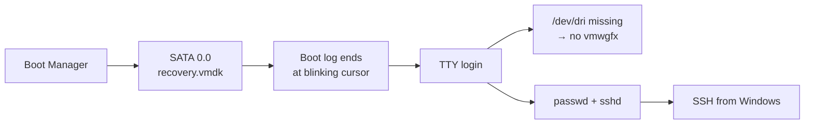

# ステップ 2 · リカバリー起動と SSH

[English](../README.md) | [한국어](README.ko.md) | **日本語** | [简体中文](README.zh-CN.md) | [Español](README.es.md) | [Français](README.fr.md)

  

リカバリーディスクから起動し、デスクトップが表示されない原因を確認したうえで、Windows から SSH で接続します。

## 目次

- [概要](#概要)
- [前提条件](#前提条件)
- [手順](#手順)
  - [2-1. Boot Manager でリカバリーディスクを選ぶ](#2-1-boot-manager-でリカバリーディスクを選ぶ)
  - [2-2. 起動ログを読む](#2-2-起動ログを読む)
  - [2-3. TTY にログインして診断する](#2-3-tty-にログインして診断する)
  - [2-4. SSH を有効にする](#2-4-ssh-を有効にする)
- [確認](#確認)
- [次へ](#次へ)

---

## 概要

リカバリー環境は起動しますが、デスクトップではなく点滅するカーソルで止まります。この手順ではテキストコンソールで原因を確かめ、SSH を有効にして、以降のコマンドをすべて Windows からコピー＆ペーストできるようにします。



## 前提条件

- [ ] [ステップ 1](../../01-Create-VM/README/README.ja.md) 完了（SATA 0.0 に `recovery.vmdk` を接続した UEFI VM）

---

## 手順

### 2-1. Boot Manager でリカバリーディスクを選ぶ

**VM → Power → Power On to Firmware → Boot Manager**


| 項目 | 内容 |
| --- | --- |
| **EFI VMware Virtual SATA Hard Drive (0.0)** | `recovery.vmdk` — **これを選択** |
| EFI VMware Virtual NVME Namespace | 空のインストール先 |
| EFI VMware Virtual SATA CDROM Drive | 仮想 CD ドライブ、使用しない |

矢印キーと Enter を使います。この画面ではマウスは使えません。

### 2-2. 起動ログを読む

序盤のメッセージに `ERROR` が含まれますが、**VM では正常** です。


| メッセージ | 意味 |
| --- | --- |
| `tsc: Unable to calibrate` | VM のため CPU クロックの測定方法が異なる |
| `core: CPUID marked event…` | 仮想 CPU が一部の性能カウンターを隠している |
| `ERROR: unknown fsck.mode parameter: 'auto'` | 名前に反して無害 |

続いて `[ OK ]` のログが流れ、**点滅するカーソル** で止まります。グラフィカルセッションが起動していない状態です。


> [!NOTE]
> 待ち続けても、メモリ・CPU・グラフィックメモリを増やしても変わりません。原因は次の手順で確認します。

### 2-3. TTY にログインして診断する

VMware では Ctrl+Alt はゲストに届かず、マウスの解放に使われます。VM 画面をクリックし、**Ctrl+Alt+Space** を押してから Space だけを離し、Ctrl+Alt を押したまま **F3** を押します。`deck` でパスワードは空のままログインします。

```bash
uname -r
grep VERSION_ID /etc/os-release
lsmod | grep -E 'vmwgfx|drm'
ls /dev/dri
ip -4 addr | grep inet
```


| 結果 | 意味 |
| --- | --- |
| カーネル `6.16.12-valve24.4-1-neptune-616-…` | Valve のカーネル。ドライバーはこれと完全に一致させる必要がある |
| `lsmod` の出力なし | グラフィックドライバーが一つも読み込まれていない |
| **`/dev/dri` がない** | **表示デバイスがないため、デスクトップは起動できない** |
| `192.168.126.133` | ネットワークは動作している |

### 2-4. SSH を有効にする

```bash
passwd                              # set a password for deck
sudo systemctl enable --now sshd    # start now and after every reboot
```

Windows PowerShell から：

```powershell
ssh deck@192.168.126.133
```


バナーに表示される `~/tools/repair_device.sh` が、[ステップ 4](../../04-Install-SteamOS/README/README.ja.md) で使うインストーラーです。

---

## 確認

- [ ] Windows から `ssh deck@<VM の IP>` で `(deck@steamdeck ~)$` に入れる
- [ ] `ls /dev/dri` が *No such file or directory* — この時点では正常

## 次へ

[ステップ 3 · vmwgfx ドライバーのビルド →](../../03-vmwgfx-Driver/README/README.ja.md)
