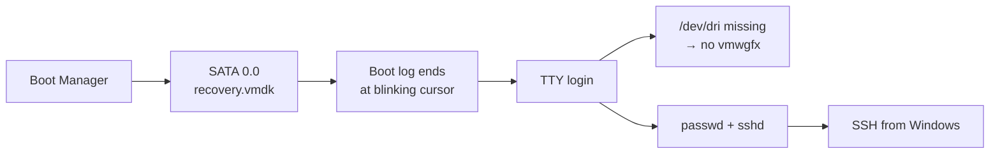
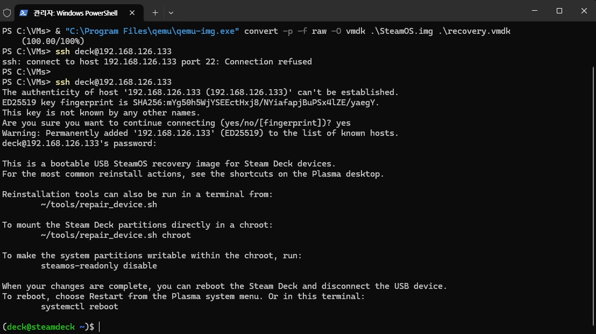

# 2단계 · 복구 환경 부팅과 SSH

[English](../README.md) | **한국어** | [日本語](README.ja.md) | [简体中文](README.zh-CN.md) | [Español](README.es.md) | [Français](README.fr.md)

  

복구 디스크로 부팅하고, 데스크톱이 뜨지 않는 원인을 확인한 뒤, Windows에서 SSH로 접속합니다.

## 목차

- [개요](#개요)
- [준비물](#준비물)
- [진행](#진행)
  - [2-1. Boot Manager에서 복구 디스크 고르기](#2-1-boot-manager에서-복구-디스크-고르기)
  - [2-2. 부팅 로그 읽기](#2-2-부팅-로그-읽기)
  - [2-3. TTY 로그인과 진단](#2-3-tty-로그인과-진단)
  - [2-4. SSH 켜기](#2-4-ssh-켜기)
- [확인](#확인)
- [다음 단계](#다음-단계)

---

## 개요

복구 환경은 부팅되지만 데스크톱 대신 깜빡이는 커서에서 멈춥니다. 이 단계에서는 텍스트 콘솔에서 원인을 확인하고 SSH를 켜서, 이후 모든 명령을 Windows에서 복사해 붙여 넣을 수 있게 합니다.



## 준비물

- [ ] [1단계](../../01-Create-VM/README/README.ko.md) 완료 (SATA 0.0에 `recovery.vmdk` 를 붙인 UEFI VM)

---

## 진행

### 2-1. Boot Manager에서 복구 디스크 고르기

**VM → Power → Power On to Firmware → Boot Manager**


| 항목 | 정체 |
| --- | --- |
| **EFI VMware Virtual SATA Hard Drive (0.0)** | `recovery.vmdk` — **이것을 고릅니다** |
| EFI VMware Virtual NVME Namespace | 비어 있는 설치 대상 |
| EFI VMware Virtual SATA CDROM Drive | 가상 CD 드라이브, 사용하지 않음 |

방향키와 Enter를 사용합니다. 이 화면에서는 마우스가 동작하지 않습니다.

### 2-2. 부팅 로그 읽기

초반 메시지에 `ERROR` 가 섞여 있지만 **VM에서는 정상**입니다.


| 메시지 | 의미 |
| --- | --- |
| `tsc: Unable to calibrate` | VM이라 CPU 시계 측정 방식이 다릅니다 |
| `core: CPUID marked event…` | 가상 CPU가 일부 성능 카운터를 숨깁니다 |
| `ERROR: unknown fsck.mode parameter: 'auto'` | 이름과 달리 무해합니다 |

이어서 `[ OK ]` 로그가 나오다가 **깜빡이는 커서**에서 멈춥니다. 그래픽 세션이 시작되지 않은 상태입니다.


> [!NOTE]
> 더 기다리거나 메모리, CPU, 그래픽 메모리를 늘려도 바뀌지 않습니다. 원인은 다음 단계에서 확인합니다.

### 2-3. TTY 로그인과 진단

VMware에서는 Ctrl+Alt가 게스트로 가지 않고 마우스 해제에 쓰입니다. VM 화면을 클릭하고 **Ctrl+Alt+Space** 를 누른 뒤, Space만 떼고 Ctrl+Alt를 누른 채로 **F3** 을 누릅니다. `deck` 으로, 비밀번호는 빈 채로 로그인합니다.

```bash
uname -r
grep VERSION_ID /etc/os-release
lsmod | grep -E 'vmwgfx|drm'
ls /dev/dri
ip -4 addr | grep inet
```


| 결과 | 의미 |
| --- | --- |
| 커널 `6.16.12-valve24.4-1-neptune-616-…` | Valve 커널입니다. 드라이버를 정확히 이 버전에 맞춰야 합니다 |
| `lsmod` 출력 없음 | 그래픽 드라이버가 하나도 로드되지 않았습니다 |
| **`/dev/dri` 없음** | **화면 장치가 없으므로 데스크톱이 뜰 수 없습니다** |
| `192.168.126.133` | 네트워크는 동작합니다 |

### 2-4. SSH 켜기

```bash
passwd                              # set a password for deck
sudo systemctl enable --now sshd    # start now and after every reboot
```

Windows PowerShell에서:

```powershell
ssh deck@192.168.126.133
```



안내문에 나오는 `~/tools/repair_device.sh` 가 [4단계](../../04-Install-SteamOS/README/README.ko.md)에서 쓸 설치 스크립트입니다.

---

## 확인

- [ ] Windows에서 `ssh deck@<VM IP>` 로 `(deck@steamdeck ~)$` 에 접속됨
- [ ] `ls /dev/dri` 가 *No such file or directory* — 지금 시점에서는 정상

## 다음 단계

[3단계 · vmwgfx 드라이버 빌드 →](../../03-vmwgfx-Driver/README/README.ko.md)
