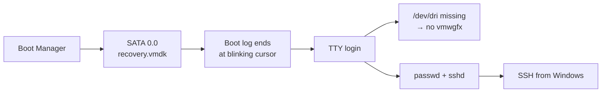

# 第 2 步 · 恢复环境启动与 SSH

[English](../README.md) | [한국어](README.ko.md) | [日本語](README.ja.md) | **简体中文** | [Español](README.es.md) | [Français](README.fr.md)

  

从恢复盘启动，查明桌面不显示的原因，然后从 Windows 通过 SSH 连接。

## 目录

- [概述](#概述)
- [前提条件](#前提条件)
- [步骤](#步骤)
  - [2-1. 在 Boot Manager 中选择恢复盘](#2-1-在-boot-manager-中选择恢复盘)
  - [2-2. 阅读启动日志](#2-2-阅读启动日志)
  - [2-3. 登录 TTY 并诊断](#2-3-登录-tty-并诊断)
  - [2-4. 开启 SSH](#2-4-开启-ssh)
- [验证](#验证)
- [下一步](#下一步)

---

## 概述

恢复环境可以启动，但停在闪烁的光标处而不显示桌面。本步骤在文本控制台中确认原因并开启 SSH，这样之后的所有命令都可以从 Windows 复制粘贴。



## 前提条件

- [ ] 已完成 [第 1 步](../../01-Create-VM/README/README.zh-CN.md)（SATA 0.0 上挂载了 `recovery.vmdk` 的 UEFI 虚拟机）

---

## 步骤

### 2-1. 在 Boot Manager 中选择恢复盘

**VM → Power → Power On to Firmware → Boot Manager**


| 项目 | 说明 |
| --- | --- |
| **EFI VMware Virtual SATA Hard Drive (0.0)** | `recovery.vmdk` — **选择这一项** |
| EFI VMware Virtual NVME Namespace | 空的安装目标 |
| EFI VMware Virtual SATA CDROM Drive | 虚拟光驱，不使用 |

使用方向键和 Enter。此界面不能使用鼠标。

### 2-2. 阅读启动日志

开头的消息中有 `ERROR`，但 **在虚拟机中属于正常现象**。


| 消息 | 含义 |
| --- | --- |
| `tsc: Unable to calibrate` | 虚拟机测量 CPU 时钟的方式不同 |
| `core: CPUID marked event…` | 虚拟 CPU 隐藏了部分性能计数器 |
| `ERROR: unknown fsck.mode parameter: 'auto'` | 名字吓人，实际无害 |

随后 `[ OK ]` 日志滚动，并停在 **闪烁的光标** 处——图形会话没有启动。


> [!NOTE]
> 继续等待，或增加内存、CPU、显存都无法改变这一点。原因在下一步中确认。

### 2-3. 登录 TTY 并诊断

在 VMware 中，Ctrl+Alt 用于释放鼠标，不会传给客户机。点击虚拟机画面，按 **Ctrl+Alt+Space**，只松开 Space，在按住 Ctrl+Alt 的同时按 **F3**。以 `deck` 登录，密码留空。

```bash
uname -r
grep VERSION_ID /etc/os-release
lsmod | grep -E 'vmwgfx|drm'
ls /dev/dri
ip -4 addr | grep inet
```


| 结果 | 含义 |
| --- | --- |
| 内核 `6.16.12-valve24.4-1-neptune-616-…` | Valve 的内核，驱动必须与其完全一致 |
| `lsmod` 没有输出 | 没有加载任何显卡驱动 |
| **没有 `/dev/dri`** | **没有显示设备 → 桌面无法启动** |
| `192.168.126.133` | 网络正常 |

### 2-4. 开启 SSH

```bash
passwd                              # set a password for deck
sudo systemctl enable --now sshd    # start now and after every reboot
```

在 Windows PowerShell 中：

```powershell
ssh deck@192.168.126.133
```


横幅中提到的 `~/tools/repair_device.sh` 就是 [第 4 步](../../04-Install-SteamOS/README/README.zh-CN.md) 使用的安装脚本。

---

## 验证

- [ ] 从 Windows 执行 `ssh deck@<虚拟机 IP>` 能进入 `(deck@steamdeck ~)$`
- [ ] `ls /dev/dri` 显示 *No such file or directory* — 此时属于正常

## 下一步

[第 3 步 · 编译 vmwgfx 驱动 →](../../03-vmwgfx-Driver/README/README.zh-CN.md)
