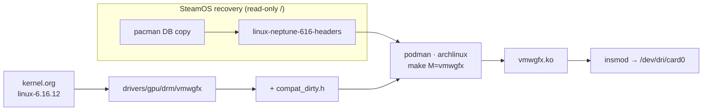
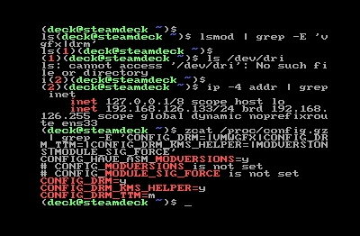
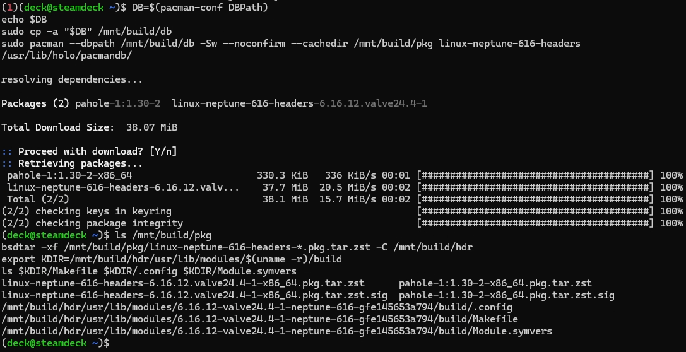

# Step 3 · Build the vmwgfx driver

**English** | [한국어](README/README.ko.md) | [日本語](README/README.ja.md) | [简体中文](README/README.zh-CN.md) | [Español](README/README.es.md) | [Français](README/README.fr.md)

   

Build the VMware graphics driver that Valve's kernel leaves out, load it, and bring up the recovery desktop.

> [!IMPORTANT]
> A kernel module only loads on the **exact** kernel it was built for. Every version in this guide matches SteamOS 3.8.14. With another release, repeat the steps with that release's versions.

## Contents

- [Overview](#overview)
- [Prerequisites](#prerequisites)
- [Steps](#steps)
  - [3-1. Check that a build is possible](#3-1-check-that-a-build-is-possible)
  - [3-2. Add a work disk](#3-2-add-a-work-disk)
  - [3-3. Fetch matching kernel headers](#3-3-fetch-matching-kernel-headers)
  - [3-4. Get the vmwgfx source](#3-4-get-the-vmwgfx-source)
  - [3-5. Start a build container](#3-5-start-a-build-container)
  - [3-6. Apply the compatibility patch](#3-6-apply-the-compatibility-patch)
  - [3-7. Build](#3-7-build)
  - [3-8. Load the driver](#3-8-load-the-driver)
- [Verification](#verification)
- [Next](#next)

---

## Overview

SteamOS has no compiler and almost no free space on its read-only root, so the build runs in a podman container on a separate work disk. Nothing in the system area is modified.



## Prerequisites

- [ ] [Step 2](../02-Recovery-Boot/README.md) completed — SSH session to the recovery environment
- [ ] Network access from the VM

---

## Steps

### 3-1. Check that a build is possible

```bash
zcat /proc/config.gz | grep -E 'CONFIG_DRM=|VMWGFX|CONFIG_DRM_TTM=|CONFIG_DRM_KMS_HELPER=|MODVERSIONS|MODULE_SIG_FORCE'
ls /usr/lib/modules/$(uname -r)/kernel/drivers/gpu/drm/ | head -20
lspci -k | grep -A3 -i vga
ls /usr/lib/modules/$(uname -r)/build 2>&1 | head -3
df -h /
sudo -n true && echo SUDO_OK
```

<details>
<summary>Screenshots</summary>




</details>

| Check | Result | Meaning |
| --- | --- | --- |
| `CONFIG_DRM=y`, `KMS_HELPER=y` | built in | The graphics core exists |
| `CONFIG_DRM_TTM=m`, `drm_ttm_helper.ko` | modules | vmwgfx's dependencies are available |
| no `VMWGFX` line | not built | **Only the driver itself is missing** |
| `MODVERSIONS is not set` | off | An out-of-tree module will be accepted |
| `MODULE_SIG_FORCE is not set` | off | Unsigned modules can load |
| VMware SVGA II, no driver | — | The device exists but nothing drives it |
| no `build` directory | — | Headers must be fetched |
| `/` has 867 MB free | — | **Build on another disk** |
| `SUDO_OK` | — | Passwordless sudo |

### 3-2. Add a work disk

Power off (`sudo systemctl poweroff`), then **Add → Hard Disk → SATA → Create a new virtual disk → 20 GB**. Boot SATA 0.0 again and reconnect over SSH.

```bash
lsblk -o NAME,SIZE,TYPE,MOUNTPOINT
```


> [!CAUTION]
> Format only the **20 GB disk with no partitions** (`sdb` here). `sda` is the recovery disk.

```bash
sudo mkfs.ext4 -F /dev/sdb
sudo mkdir -p /mnt/build
sudo mount /dev/sdb /mnt/build
sudo chown deck:deck /mnt/build
```

### 3-3. Fetch matching kernel headers

```bash
sudo pacman-key --init
sudo pacman-key --populate
uname -r
pacman -Si linux-neptune-616-headers | grep Version
```


Kernel `6.16.12-valve24.4-1-…` and headers `6.16.12.valve24.4-1` **match**. `pacman -Sy` fails with a read-only error ([T4](../../04-Troubleshooting/README.md#t4)) — which helps here: the package list shipped in the image still points at the headers that match this kernel.

The pacman database lives in the read-only area (`/usr/lib/holo/pacmandb`), so copy it to the work disk and **download only**:

```bash
sudo cp -a "$(pacman-conf DBPath)" /mnt/build/db
mkdir -p /mnt/build/pkg /mnt/build/hdr
sudo pacman --dbpath /mnt/build/db -Sw --noconfirm --cachedir /mnt/build/pkg linux-neptune-616-headers
bsdtar -xf /mnt/build/pkg/linux-neptune-616-headers-*.pkg.tar.zst -C /mnt/build/hdr
export KDIR=/mnt/build/hdr/usr/lib/modules/$(uname -r)/build
ls $KDIR/Makefile $KDIR/.config $KDIR/Module.symvers
```



> [!WARNING]
> Do not refresh with `-Sy`. A new package list points at newer headers that no longer match the running kernel.

### 3-4. Get the vmwgfx source

```bash
cd /mnt/build
curl -LO https://cdn.kernel.org/pub/linux/kernel/v6.x/linux-6.16.12.tar.xz
tar -xf linux-6.16.12.tar.xz linux-6.16.12/drivers/gpu/drm/vmwgfx
export SRC=/mnt/build/linux-6.16.12/drivers/gpu/drm/vmwgfx
```

### 3-5. Start a build container

```bash
sudo podman --root /mnt/build/containers --runroot /mnt/build/run \
  run --rm -it -v /mnt/build:/mnt/build -e KDIR="$KDIR" -e SRC="$SRC" \
  docker.io/library/archlinux:latest bash
```

Inside the container:

```bash
pacman -Sy --noconfirm base-devel bc pahole
grep CONFIG_CC_VERSION_TEXT $KDIR/.config
```


The kernel was built with `gcc 15.1.1`, so gcc is the right compiler.

<a id="compat-patch"></a>

### 3-6. Apply the compatibility patch

As is, the build stops in `vmwgfx_page_dirty.c` ([T5](../../04-Troubleshooting/README.md#t5)). Valve's kernel disables `CONFIG_MAPPING_DIRTY_HELPERS`, which provides two functions vmwgfx needs. They are part of the core kernel and cannot be added as a module, so the patch implements them inside vmwgfx.

The replacement marks the whole range dirty and re-arms write tracking, instead of tracking individual pages. No change is ever missed, so correctness is kept; the cost is some extra data transfer.

<details>
<summary><code>compat_dirty.h</code> (also in [vmware/compat_dirty.h](../../../vmware/compat_dirty.h))</summary>

```bash
cat > $SRC/compat_dirty.h <<'EOF'
#ifndef VMW_COMPAT_DIRTY_H
#define VMW_COMPAT_DIRTY_H
#include <linux/mm.h>
#include <linux/bitops.h>
#ifndef CONFIG_MAPPING_DIRTY_HELPERS
static inline unsigned long
wp_shared_mapping_range(struct address_space *mapping,
			pgoff_t first_index, pgoff_t nr)
{
	unmap_mapping_range(mapping, (loff_t)first_index << PAGE_SHIFT,
			    (loff_t)nr << PAGE_SHIFT, 0);
	return 0;
}

static inline unsigned long
clean_record_shared_mapping_range(struct address_space *mapping,
				  pgoff_t first_index, pgoff_t nr,
				  pgoff_t bitmap_pgoff, unsigned long *bitmap,
				  pgoff_t *start, pgoff_t *end)
{
	pgoff_t first = first_index - bitmap_pgoff;
	pgoff_t i;

	for (i = 0; i < nr; i++)
		__set_bit(first + i, bitmap);
	if (*start > first)
		*start = first;
	if (*end < first + nr)
		*end = first + nr;
	unmap_mapping_range(mapping, (loff_t)first_index << PAGE_SHIFT,
			    (loff_t)nr << PAGE_SHIFT, 0);
	return nr;
}
#endif
#endif
EOF
```

</details>

```bash
sed -i '0,/^#include/s//#include "compat_dirty.h"\n#include/' $SRC/vmwgfx_page_dirty.c
```

### 3-7. Build

```bash
cd $SRC
make -C $KDIR M=$SRC CONFIG_DRM_VMWGFX=m modules -j4
modinfo $SRC/vmwgfx.ko | grep -E 'vermagic|depends'
exit
```


- `warning: the compiler differs…` can be ignored.
- **`vermagic` must equal `uname -r`** — here `6.16.12-valve24.4-1-neptune-616-gfe145653a794`.
- `depends: ttm,drm_ttm_helper` are already shipped with SteamOS.

### 3-8. Load the driver

```bash
sudo modprobe ttm
sudo modprobe drm_ttm_helper
sudo insmod $SRC/vmwgfx.ko
ls /dev/dri
sudo systemctl restart display-manager
```


Keep a copy of the module on the host:

```powershell
scp deck@192.168.126.133:/mnt/build/linux-6.16.12/drivers/gpu/drm/vmwgfx/vmwgfx.ko C:\VMs\
```

---

## Verification

- [ ] `ls /dev/dri` shows `card0` and `renderD128`
- [ ] The recovery desktop appears in the VM window

> [!NOTE]
> The module is gone after a reboot. [Step 5](../05-Desktop-Autostart/README.md) makes the installed system load it on every boot.

## Next

[Step 4 · Install SteamOS to NVMe →](../04-Install-SteamOS/README.md)
