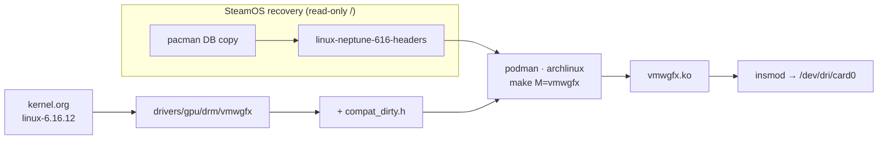
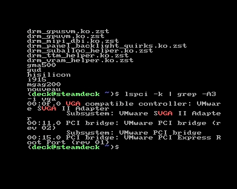

# Paso 3 · Compilar el controlador vmwgfx

[English](../README.md) | [한국어](README.ko.md) | [日本語](README.ja.md) | [简体中文](README.zh-CN.md) | **Español** | [Français](README.fr.md)

   

Compila el controlador gráfico de VMware que el kernel de Valve omite, cárgalo y muestra el escritorio de recuperación.

> [!IMPORTANT]
> Un módulo del kernel solo se carga en el **mismo** kernel para el que se compiló. Todas las versiones de esta guía corresponden a SteamOS 3.8.14. Con otra versión, repite los pasos con las versiones de esa versión.

## Índice

- [Descripción general](#descripción-general)
- [Requisitos previos](#requisitos-previos)
- [Pasos](#pasos)
  - [3-1. Comprobar que se puede compilar](#3-1-comprobar-que-se-puede-compilar)
  - [3-2. Añadir un disco de trabajo](#3-2-añadir-un-disco-de-trabajo)
  - [3-3. Obtener las cabeceras del kernel correspondientes](#3-3-obtener-las-cabeceras-del-kernel-correspondientes)
  - [3-4. Obtener el código de vmwgfx](#3-4-obtener-el-código-de-vmwgfx)
  - [3-5. Iniciar un contenedor de compilación](#3-5-iniciar-un-contenedor-de-compilación)
  - [3-6. Aplicar el parche de compatibilidad](#3-6-aplicar-el-parche-de-compatibilidad)
  - [3-7. Compilar](#3-7-compilar)
  - [3-8. Cargar el controlador](#3-8-cargar-el-controlador)
- [Verificación](#verificación)
- [Siguiente](#siguiente)

---

## Descripción general

SteamOS no tiene compilador y su raíz de solo lectura casi no tiene espacio libre, así que la compilación se hace en un contenedor podman sobre un disco de trabajo aparte. No se modifica nada del área del sistema.



## Requisitos previos

- [ ] [Paso 2](../../02-Recovery-Boot/README/README.es.md) completado — sesión SSH en el entorno de recuperación
- [ ] Acceso a internet desde la VM

---

## Pasos

### 3-1. Comprobar que se puede compilar

```bash
zcat /proc/config.gz | grep -E 'CONFIG_DRM=|VMWGFX|CONFIG_DRM_TTM=|CONFIG_DRM_KMS_HELPER=|MODVERSIONS|MODULE_SIG_FORCE'
ls /usr/lib/modules/$(uname -r)/kernel/drivers/gpu/drm/ | head -20
lspci -k | grep -A3 -i vga
ls /usr/lib/modules/$(uname -r)/build 2>&1 | head -3
df -h /
sudo -n true && echo SUDO_OK
```

<details>
<summary>Capturas</summary>





</details>

| Comprobación | Resultado | Significado |
| --- | --- | --- |
| `CONFIG_DRM=y`, `KMS_HELPER=y` | integrado | El núcleo gráfico existe |
| `CONFIG_DRM_TTM=m`, `drm_ttm_helper.ko` | módulos | Las dependencias de vmwgfx están disponibles |
| sin línea `VMWGFX` | no compilado | **Solo falta el propio controlador** |
| `MODVERSIONS is not set` | desactivado | Se aceptará un módulo compilado aparte |
| `MODULE_SIG_FORCE is not set` | desactivado | Se pueden cargar módulos sin firmar |
| VMware SVGA II, sin controlador | — | El dispositivo existe pero nadie lo controla |
| sin directorio `build` | — | Hay que conseguir las cabeceras |
| `/` con 867 MB libres | — | **Compilar en otro disco** |
| `SUDO_OK` | — | sudo sin contraseña |

### 3-2. Añadir un disco de trabajo

Apaga (`sudo systemctl poweroff`) y añade **Add → Hard Disk → SATA → Create a new virtual disk → 20 GB**. Arranca de nuevo desde SATA 0.0 y vuelve a conectarte por SSH.

```bash
lsblk -o NAME,SIZE,TYPE,MOUNTPOINT
```


> [!CAUTION]
> Formatea solo el **disco de 20 GB sin particiones** (aquí `sdb`). `sda` es el disco de recuperación.

```bash
sudo mkfs.ext4 -F /dev/sdb
sudo mkdir -p /mnt/build
sudo mount /dev/sdb /mnt/build
sudo chown deck:deck /mnt/build
```

### 3-3. Obtener las cabeceras del kernel correspondientes

```bash
sudo pacman-key --init
sudo pacman-key --populate
uname -r
pacman -Si linux-neptune-616-headers | grep Version
```


El kernel `6.16.12-valve24.4-1-…` y las cabeceras `6.16.12.valve24.4-1` **coinciden**. `pacman -Sy` falla con un error de solo lectura ([T4](../../../04-Troubleshooting/README/README.es.md#t4)), lo que aquí ayuda: la lista de paquetes incluida en la imagen sigue apuntando a las cabeceras de este kernel.

La base de datos de pacman está en el área de solo lectura (`/usr/lib/holo/pacmandb`), así que se copia al disco de trabajo y **solo se descarga**:

```bash
sudo cp -a "$(pacman-conf DBPath)" /mnt/build/db
mkdir -p /mnt/build/pkg /mnt/build/hdr
sudo pacman --dbpath /mnt/build/db -Sw --noconfirm --cachedir /mnt/build/pkg linux-neptune-616-headers
bsdtar -xf /mnt/build/pkg/linux-neptune-616-headers-*.pkg.tar.zst -C /mnt/build/hdr
export KDIR=/mnt/build/hdr/usr/lib/modules/$(uname -r)/build
ls $KDIR/Makefile $KDIR/.config $KDIR/Module.symvers
```


> [!WARNING]
> No actualices con `-Sy`. Una lista nueva apunta a cabeceras más recientes que ya no coinciden con el kernel en ejecución.

### 3-4. Obtener el código de vmwgfx

```bash
cd /mnt/build
curl -LO https://cdn.kernel.org/pub/linux/kernel/v6.x/linux-6.16.12.tar.xz
tar -xf linux-6.16.12.tar.xz linux-6.16.12/drivers/gpu/drm/vmwgfx
export SRC=/mnt/build/linux-6.16.12/drivers/gpu/drm/vmwgfx
```

### 3-5. Iniciar un contenedor de compilación

```bash
sudo podman --root /mnt/build/containers --runroot /mnt/build/run \
  run --rm -it -v /mnt/build:/mnt/build -e KDIR="$KDIR" -e SRC="$SRC" \
  docker.io/library/archlinux:latest bash
```

Dentro del contenedor:

```bash
pacman -Sy --noconfirm base-devel bc pahole
grep CONFIG_CC_VERSION_TEXT $KDIR/.config
```


El kernel se compiló con `gcc 15.1.1`, así que gcc es el compilador adecuado.

<a id="compat-patch"></a>

### 3-6. Aplicar el parche de compatibilidad

Tal cual, la compilación se detiene en `vmwgfx_page_dirty.c` ([T5](../../../04-Troubleshooting/README/README.es.md#t5)). El kernel de Valve desactiva `CONFIG_MAPPING_DIRTY_HELPERS`, que aporta dos funciones que vmwgfx necesita. Forman parte del núcleo del kernel y no pueden añadirse como módulo, así que el parche las implementa dentro de vmwgfx.

La sustitución marca todo el rango como modificado y vuelve a activar el seguimiento de escrituras, en lugar de seguir cada página. Nunca se pierde un cambio, así que se mantiene la corrección; el coste es transferir algo más de datos.

<details>
<summary><code>compat_dirty.h</code> (también en [vmware/compat_dirty.h](../../../../vmware/compat_dirty.h))</summary>

```bash
cat > $SRC/compat_dirty.h <<'EOF'
#ifndef VMW_COMPAT_DIRTY_H
#define VMW_COMPAT_DIRTY_H
#include <linux/mm.h>
#include <linux/bitops.h>
#ifndef CONFIG_MAPPING_DIRTY_HELPERS
static inline unsigned long
wp_shared_mapping_range(struct address_space *mapping,
			pgoff_t first_index, pgoff_t nr)
{
	unmap_mapping_range(mapping, (loff_t)first_index << PAGE_SHIFT,
			    (loff_t)nr << PAGE_SHIFT, 0);
	return 0;
}

static inline unsigned long
clean_record_shared_mapping_range(struct address_space *mapping,
				  pgoff_t first_index, pgoff_t nr,
				  pgoff_t bitmap_pgoff, unsigned long *bitmap,
				  pgoff_t *start, pgoff_t *end)
{
	pgoff_t first = first_index - bitmap_pgoff;
	pgoff_t i;

	for (i = 0; i < nr; i++)
		__set_bit(first + i, bitmap);
	if (*start > first)
		*start = first;
	if (*end < first + nr)
		*end = first + nr;
	unmap_mapping_range(mapping, (loff_t)first_index << PAGE_SHIFT,
			    (loff_t)nr << PAGE_SHIFT, 0);
	return nr;
}
#endif
#endif
EOF
```

</details>

```bash
sed -i '0,/^#include/s//#include "compat_dirty.h"\n#include/' $SRC/vmwgfx_page_dirty.c
```

### 3-7. Compilar

```bash
cd $SRC
make -C $KDIR M=$SRC CONFIG_DRM_VMWGFX=m modules -j4
modinfo $SRC/vmwgfx.ko | grep -E 'vermagic|depends'
exit
```


- `warning: the compiler differs…` puede ignorarse.
- **`vermagic` debe ser igual a `uname -r`** — aquí `6.16.12-valve24.4-1-neptune-616-gfe145653a794`.
- `depends: ttm,drm_ttm_helper` ya vienen con SteamOS.

### 3-8. Cargar el controlador

```bash
sudo modprobe ttm
sudo modprobe drm_ttm_helper
sudo insmod $SRC/vmwgfx.ko
ls /dev/dri
sudo systemctl restart display-manager
```


Guarda una copia del módulo en el anfitrión:

```powershell
scp deck@192.168.126.133:/mnt/build/linux-6.16.12/drivers/gpu/drm/vmwgfx/vmwgfx.ko C:\VMs\
```

---

## Verificación

- [ ] `ls /dev/dri` muestra `card0` y `renderD128`
- [ ] El escritorio de recuperación aparece en la ventana de la VM

> [!NOTE]
> El módulo desaparece al reiniciar. El [Paso 5](../../05-Desktop-Autostart/README/README.es.md) hace que el sistema instalado lo cargue en cada arranque.

## Siguiente

[Paso 4 · Instalar SteamOS en NVMe →](../../04-Install-SteamOS/README/README.es.md)
