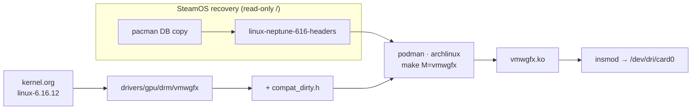
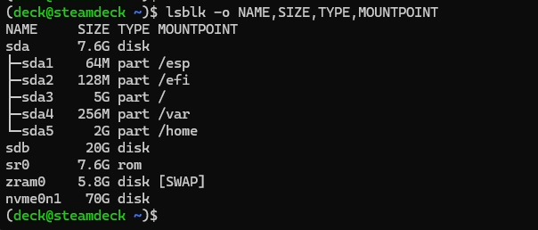
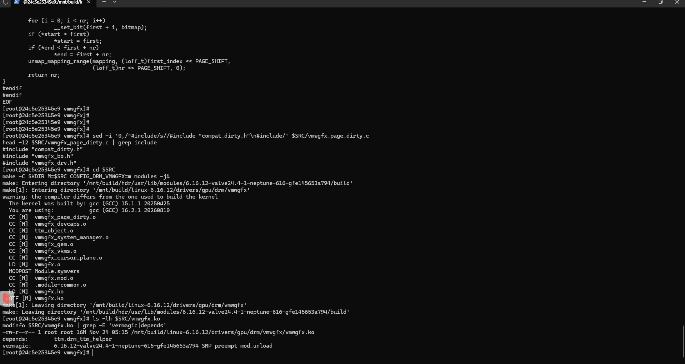

# Étape 3 · Compiler le pilote vmwgfx

[English](../README.md) | [한국어](README.ko.md) | [日本語](README.ja.md) | [简体中文](README.zh-CN.md) | [Español](README.es.md) | **Français**

   

Compiler le pilote graphique VMware que le noyau de Valve omet, le charger et afficher le bureau de récupération.

> [!IMPORTANT]
> Un module du noyau ne se charge que sur **exactement** le noyau pour lequel il a été compilé. Toutes les versions de ce guide correspondent à SteamOS 3.8.14. Avec une autre version, refaites les étapes avec les versions correspondantes.

## Sommaire

- [Vue d'ensemble](#vue-densemble)
- [Prérequis](#prérequis)
- [Étapes](#étapes)
  - [3-1. Vérifier qu'une compilation est possible](#3-1-vérifier-quune-compilation-est-possible)
  - [3-2. Ajouter un disque de travail](#3-2-ajouter-un-disque-de-travail)
  - [3-3. Récupérer les en-têtes du noyau correspondants](#3-3-récupérer-les-en-têtes-du-noyau-correspondants)
  - [3-4. Récupérer la source de vmwgfx](#3-4-récupérer-la-source-de-vmwgfx)
  - [3-5. Démarrer un conteneur de compilation](#3-5-démarrer-un-conteneur-de-compilation)
  - [3-6. Appliquer le correctif de compatibilité](#3-6-appliquer-le-correctif-de-compatibilité)
  - [3-7. Compiler](#3-7-compiler)
  - [3-8. Charger le pilote](#3-8-charger-le-pilote)
- [Vérification](#vérification)
- [Suite](#suite)

---

## Vue d'ensemble

SteamOS n'a pas de compilateur et sa racine en lecture seule n'a presque pas d'espace libre : la compilation se fait donc dans un conteneur podman sur un disque de travail séparé. Rien n'est modifié dans la zone système.



## Prérequis

- [ ] [Étape 2](../../02-Recovery-Boot/README/README.fr.md) terminée — session SSH sur l'environnement de récupération
- [ ] Accès réseau depuis la VM

---

## Étapes

### 3-1. Vérifier qu'une compilation est possible

```bash
zcat /proc/config.gz | grep -E 'CONFIG_DRM=|VMWGFX|CONFIG_DRM_TTM=|CONFIG_DRM_KMS_HELPER=|MODVERSIONS|MODULE_SIG_FORCE'
ls /usr/lib/modules/$(uname -r)/kernel/drivers/gpu/drm/ | head -20
lspci -k | grep -A3 -i vga
ls /usr/lib/modules/$(uname -r)/build 2>&1 | head -3
df -h /
sudo -n true && echo SUDO_OK
```

<details>
<summary>Captures d'écran</summary>


</details>

| Vérification | Résultat | Signification |
| --- | --- | --- |
| `CONFIG_DRM=y`, `KMS_HELPER=y` | intégré | Le cœur graphique existe |
| `CONFIG_DRM_TTM=m`, `drm_ttm_helper.ko` | modules | Les dépendances de vmwgfx sont présentes |
| pas de ligne `VMWGFX` | non compilé | **Seul le pilote lui-même manque** |
| `MODVERSIONS is not set` | désactivé | Un module compilé à part sera accepté |
| `MODULE_SIG_FORCE is not set` | désactivé | Les modules non signés peuvent se charger |
| VMware SVGA II, sans pilote | — | Le périphérique existe mais n'est piloté par rien |
| pas de répertoire `build` | — | Il faut récupérer les en-têtes |
| `/` avec 867 Mo libres | — | **Compiler sur un autre disque** |
| `SUDO_OK` | — | sudo sans mot de passe |

### 3-2. Ajouter un disque de travail

Éteignez (`sudo systemctl poweroff`), puis **Add → Hard Disk → SATA → Create a new virtual disk → 20 Go**. Redémarrez sur SATA 0.0 et reconnectez-vous en SSH.

```bash
lsblk -o NAME,SIZE,TYPE,MOUNTPOINT
```



> [!CAUTION]
> Ne formatez que le **disque de 20 Go sans partition** (ici `sdb`). `sda` est le disque de récupération.

```bash
sudo mkfs.ext4 -F /dev/sdb
sudo mkdir -p /mnt/build
sudo mount /dev/sdb /mnt/build
sudo chown deck:deck /mnt/build
```

### 3-3. Récupérer les en-têtes du noyau correspondants

```bash
sudo pacman-key --init
sudo pacman-key --populate
uname -r
pacman -Si linux-neptune-616-headers | grep Version
```


Le noyau `6.16.12-valve24.4-1-…` et les en-têtes `6.16.12.valve24.4-1` **correspondent**. `pacman -Sy` échoue avec une erreur de lecture seule ([T4](../../../04-Troubleshooting/README/README.fr.md#t4)), ce qui aide ici : la liste de paquets fournie avec l'image pointe toujours vers les en-têtes de ce noyau.

La base de données de pacman se trouve dans la zone en lecture seule (`/usr/lib/holo/pacmandb`) : copiez-la sur le disque de travail et **téléchargez seulement** :

```bash
sudo cp -a "$(pacman-conf DBPath)" /mnt/build/db
mkdir -p /mnt/build/pkg /mnt/build/hdr
sudo pacman --dbpath /mnt/build/db -Sw --noconfirm --cachedir /mnt/build/pkg linux-neptune-616-headers
bsdtar -xf /mnt/build/pkg/linux-neptune-616-headers-*.pkg.tar.zst -C /mnt/build/hdr
export KDIR=/mnt/build/hdr/usr/lib/modules/$(uname -r)/build
ls $KDIR/Makefile $KDIR/.config $KDIR/Module.symvers
```


> [!WARNING]
> Ne rafraîchissez pas avec `-Sy`. Une nouvelle liste pointe vers des en-têtes plus récents qui ne correspondent plus au noyau en cours.

### 3-4. Récupérer la source de vmwgfx

```bash
cd /mnt/build
curl -LO https://cdn.kernel.org/pub/linux/kernel/v6.x/linux-6.16.12.tar.xz
tar -xf linux-6.16.12.tar.xz linux-6.16.12/drivers/gpu/drm/vmwgfx
export SRC=/mnt/build/linux-6.16.12/drivers/gpu/drm/vmwgfx
```

### 3-5. Démarrer un conteneur de compilation

```bash
sudo podman --root /mnt/build/containers --runroot /mnt/build/run \
  run --rm -it -v /mnt/build:/mnt/build -e KDIR="$KDIR" -e SRC="$SRC" \
  docker.io/library/archlinux:latest bash
```

Dans le conteneur :

```bash
pacman -Sy --noconfirm base-devel bc pahole
grep CONFIG_CC_VERSION_TEXT $KDIR/.config
```


Le noyau a été compilé avec `gcc 15.1.1` : gcc est donc le bon compilateur.

<a id="compat-patch"></a>

### 3-6. Appliquer le correctif de compatibilité

Telle quelle, la compilation s'arrête sur `vmwgfx_page_dirty.c` ([T5](../../../04-Troubleshooting/README/README.fr.md#t5)). Le noyau de Valve désactive `CONFIG_MAPPING_DIRTY_HELPERS`, qui fournit deux fonctions nécessaires à vmwgfx. Elles font partie du cœur du noyau et ne peuvent pas être ajoutées en module : le correctif les implémente donc dans vmwgfx.

Le remplacement marque toute la plage comme modifiée et réarme le suivi des écritures, au lieu de suivre chaque page. Aucune modification n'est jamais perdue, la correction est donc préservée ; le coût est un peu plus de données transférées.

<details>
<summary><code>compat_dirty.h</code> (aussi dans [vmware/compat_dirty.h](../../../../vmware/compat_dirty.h))</summary>

```bash
cat > $SRC/compat_dirty.h <<'EOF'
#ifndef VMW_COMPAT_DIRTY_H
#define VMW_COMPAT_DIRTY_H
#include <linux/mm.h>
#include <linux/bitops.h>
#ifndef CONFIG_MAPPING_DIRTY_HELPERS
static inline unsigned long
wp_shared_mapping_range(struct address_space *mapping,
			pgoff_t first_index, pgoff_t nr)
{
	unmap_mapping_range(mapping, (loff_t)first_index << PAGE_SHIFT,
			    (loff_t)nr << PAGE_SHIFT, 0);
	return 0;
}

static inline unsigned long
clean_record_shared_mapping_range(struct address_space *mapping,
				  pgoff_t first_index, pgoff_t nr,
				  pgoff_t bitmap_pgoff, unsigned long *bitmap,
				  pgoff_t *start, pgoff_t *end)
{
	pgoff_t first = first_index - bitmap_pgoff;
	pgoff_t i;

	for (i = 0; i < nr; i++)
		__set_bit(first + i, bitmap);
	if (*start > first)
		*start = first;
	if (*end < first + nr)
		*end = first + nr;
	unmap_mapping_range(mapping, (loff_t)first_index << PAGE_SHIFT,
			    (loff_t)nr << PAGE_SHIFT, 0);
	return nr;
}
#endif
#endif
EOF
```

</details>

```bash
sed -i '0,/^#include/s//#include "compat_dirty.h"\n#include/' $SRC/vmwgfx_page_dirty.c
```

### 3-7. Compiler

```bash
cd $SRC
make -C $KDIR M=$SRC CONFIG_DRM_VMWGFX=m modules -j4
modinfo $SRC/vmwgfx.ko | grep -E 'vermagic|depends'
exit
```



- `warning: the compiler differs…` peut être ignoré.
- **`vermagic` doit être identique à `uname -r`** — ici `6.16.12-valve24.4-1-neptune-616-gfe145653a794`.
- `depends: ttm,drm_ttm_helper` sont déjà fournis avec SteamOS.

### 3-8. Charger le pilote

```bash
sudo modprobe ttm
sudo modprobe drm_ttm_helper
sudo insmod $SRC/vmwgfx.ko
ls /dev/dri
sudo systemctl restart display-manager
```


Gardez une copie du module sur l'hôte :

```powershell
scp deck@192.168.126.133:/mnt/build/linux-6.16.12/drivers/gpu/drm/vmwgfx/vmwgfx.ko C:\VMs\
```

---

## Vérification

- [ ] `ls /dev/dri` affiche `card0` et `renderD128`
- [ ] Le bureau de récupération apparaît dans la fenêtre de la VM

> [!NOTE]
> Le module disparaît au redémarrage. L'[étape 5](../../05-Desktop-Autostart/README/README.fr.md) fait charger le module à chaque démarrage du système installé.

## Suite

[Étape 4 · Installer SteamOS sur le NVMe →](../../04-Install-SteamOS/README/README.fr.md)
