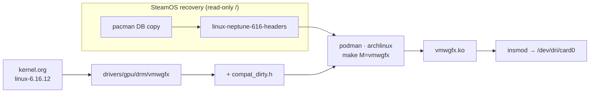
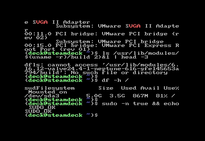
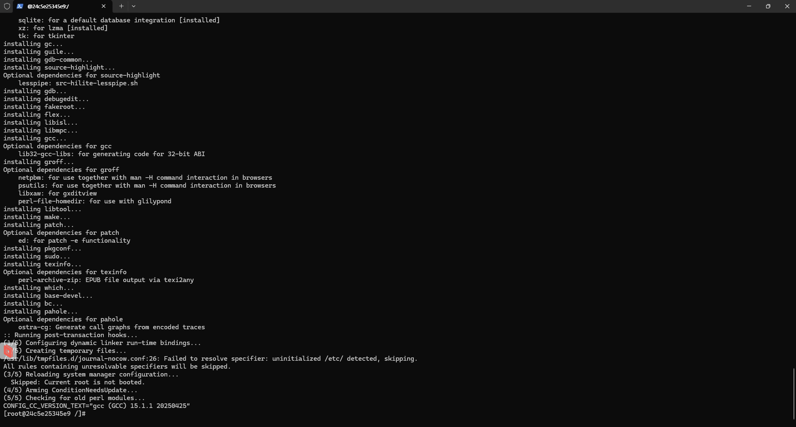
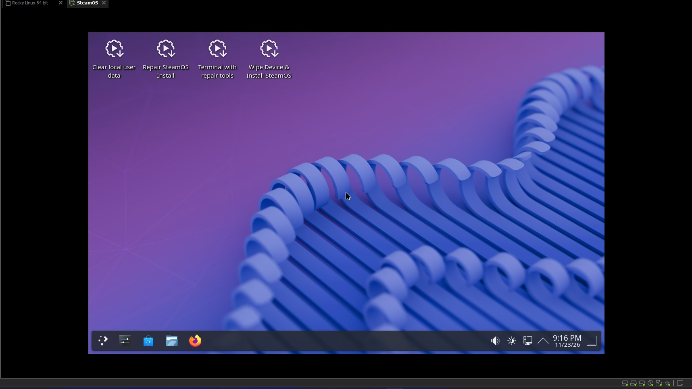

# ステップ 3 · vmwgfx ドライバーのビルド

[English](../README.md) | [한국어](README.ko.md) | **日本語** | [简体中文](README.zh-CN.md) | [Español](README.es.md) | [Français](README.fr.md)

   

Valve のカーネルに含まれていない VMware グラフィックドライバーをビルドして読み込み、リカバリー環境のデスクトップを表示します。

> [!IMPORTANT]
> カーネルモジュールは、ビルドしたカーネルと **完全に同じ** カーネルでしか読み込めません。このガイドのバージョンはすべて SteamOS 3.8.14 に合わせています。別のリリースでは、そのリリースのバージョンで同じ手順を繰り返してください。

## 目次

- [概要](#概要)
- [前提条件](#前提条件)
- [手順](#手順)
  - [3-1. ビルドが可能か確認する](#3-1-ビルドが可能か確認する)
  - [3-2. 作業ディスクを追加する](#3-2-作業ディスクを追加する)
  - [3-3. 一致するカーネルヘッダーを入手する](#3-3-一致するカーネルヘッダーを入手する)
  - [3-4. vmwgfx のソースを入手する](#3-4-vmwgfx-のソースを入手する)
  - [3-5. ビルド用コンテナを起動する](#3-5-ビルド用コンテナを起動する)
  - [3-6. 互換パッチを適用する](#3-6-互換パッチを適用する)
  - [3-7. ビルドする](#3-7-ビルドする)
  - [3-8. ドライバーを読み込む](#3-8-ドライバーを読み込む)
- [確認](#確認)
- [次へ](#次へ)

---

## 概要

SteamOS にはコンパイラーがなく、読み取り専用のルートには空き容量もほとんどありません。そのため、ビルドは別の作業ディスク上の podman コンテナで行います。システム領域は一切変更しません。



## 前提条件

- [ ] [ステップ 2](../../02-Recovery-Boot/README/README.ja.md) 完了 — リカバリー環境への SSH 接続
- [ ] VM からインターネットに接続できること

---

## 手順

### 3-1. ビルドが可能か確認する

```bash
zcat /proc/config.gz | grep -E 'CONFIG_DRM=|VMWGFX|CONFIG_DRM_TTM=|CONFIG_DRM_KMS_HELPER=|MODVERSIONS|MODULE_SIG_FORCE'
ls /usr/lib/modules/$(uname -r)/kernel/drivers/gpu/drm/ | head -20
lspci -k | grep -A3 -i vga
ls /usr/lib/modules/$(uname -r)/build 2>&1 | head -3
df -h /
sudo -n true && echo SUDO_OK
```

<details>
<summary>スクリーンショット</summary>




</details>

| 確認項目 | 結果 | 意味 |
| --- | --- | --- |
| `CONFIG_DRM=y`、`KMS_HELPER=y` | 組み込み | グラフィックの基盤はある |
| `CONFIG_DRM_TTM=m`、`drm_ttm_helper.ko` | モジュール | vmwgfx の依存部品がある |
| `VMWGFX` の行がない | 未ビルド | **ドライバー本体だけが欠けている** |
| `MODVERSIONS is not set` | オフ | 外部ビルドのモジュールが受け入れられる |
| `MODULE_SIG_FORCE is not set` | オフ | 署名なしのモジュールも読み込める |
| VMware SVGA II、ドライバーなし | — | デバイスはあるが、ドライバーがない |
| `build` ディレクトリがない | — | ヘッダーを入手する必要がある |
| `/` の空きが 867 MB | — | **別のディスクでビルドする** |
| `SUDO_OK` | — | パスワードなしで sudo が使える |

### 3-2. 作業ディスクを追加する

電源を切り（`sudo systemctl poweroff`）、**Add → Hard Disk → SATA → Create a new virtual disk → 20 GB** を追加します。再び SATA 0.0 から起動し、SSH で接続します。

```bash
lsblk -o NAME,SIZE,TYPE,MOUNTPOINT
```


> [!CAUTION]
> フォーマットするのは **パーティションのない 20 GB のディスク**（ここでは `sdb`）だけです。`sda` はリカバリーディスクです。

```bash
sudo mkfs.ext4 -F /dev/sdb
sudo mkdir -p /mnt/build
sudo mount /dev/sdb /mnt/build
sudo chown deck:deck /mnt/build
```

### 3-3. 一致するカーネルヘッダーを入手する

```bash
sudo pacman-key --init
sudo pacman-key --populate
uname -r
pacman -Si linux-neptune-616-headers | grep Version
```


カーネル `6.16.12-valve24.4-1-…` とヘッダー `6.16.12.valve24.4-1` が **一致** しています。`pacman -Sy` は読み取り専用エラーで失敗しますが（[T4](../../../04-Troubleshooting/README/README.ja.md#t4)）、ここではむしろ好都合です。イメージに含まれていたパッケージ一覧が、このカーネルに合うヘッダーを指したままだからです。

pacman のデータベースは読み取り専用領域（`/usr/lib/holo/pacmandb`）にあるため、作業ディスクにコピーして **ダウンロードだけ** を行います。

```bash
sudo cp -a "$(pacman-conf DBPath)" /mnt/build/db
mkdir -p /mnt/build/pkg /mnt/build/hdr
sudo pacman --dbpath /mnt/build/db -Sw --noconfirm --cachedir /mnt/build/pkg linux-neptune-616-headers
bsdtar -xf /mnt/build/pkg/linux-neptune-616-headers-*.pkg.tar.zst -C /mnt/build/hdr
export KDIR=/mnt/build/hdr/usr/lib/modules/$(uname -r)/build
ls $KDIR/Makefile $KDIR/.config $KDIR/Module.symvers
```


> [!WARNING]
> `-Sy` で一覧を更新しないでください。新しい一覧は、実行中のカーネルと合わない新しいヘッダーを指します。

### 3-4. vmwgfx のソースを入手する

```bash
cd /mnt/build
curl -LO https://cdn.kernel.org/pub/linux/kernel/v6.x/linux-6.16.12.tar.xz
tar -xf linux-6.16.12.tar.xz linux-6.16.12/drivers/gpu/drm/vmwgfx
export SRC=/mnt/build/linux-6.16.12/drivers/gpu/drm/vmwgfx
```

### 3-5. ビルド用コンテナを起動する

```bash
sudo podman --root /mnt/build/containers --runroot /mnt/build/run \
  run --rm -it -v /mnt/build:/mnt/build -e KDIR="$KDIR" -e SRC="$SRC" \
  docker.io/library/archlinux:latest bash
```

コンテナの中で：

```bash
pacman -Sy --noconfirm base-devel bc pahole
grep CONFIG_CC_VERSION_TEXT $KDIR/.config
```



カーネルは `gcc 15.1.1` でビルドされているので、gcc を使います。

<a id="compat-patch"></a>

### 3-6. 互換パッチを適用する

そのままビルドすると `vmwgfx_page_dirty.c` で止まります（[T5](../../../04-Troubleshooting/README/README.ja.md#t5)）。Valve のカーネルは `CONFIG_MAPPING_DIRTY_HELPERS` を無効にしており、vmwgfx が使う 2 つの関数はこの機能に含まれています。カーネル本体の機能なのでモジュールとして追加できないため、パッチで vmwgfx の中に実装します。

代替実装はページごとに追跡する代わりに、範囲全体を変更済みとして記録し、書き込みの監視をかけ直します。変更を取りこぼさないので正確さは保たれ、転送量が少し増えるだけです。

<details>
<summary><code>compat_dirty.h</code>（[vmware/compat_dirty.h](../../../../vmware/compat_dirty.h) にもあります）</summary>

```bash
cat > $SRC/compat_dirty.h <<'EOF'
#ifndef VMW_COMPAT_DIRTY_H
#define VMW_COMPAT_DIRTY_H
#include <linux/mm.h>
#include <linux/bitops.h>
#ifndef CONFIG_MAPPING_DIRTY_HELPERS
static inline unsigned long
wp_shared_mapping_range(struct address_space *mapping,
			pgoff_t first_index, pgoff_t nr)
{
	unmap_mapping_range(mapping, (loff_t)first_index << PAGE_SHIFT,
			    (loff_t)nr << PAGE_SHIFT, 0);
	return 0;
}

static inline unsigned long
clean_record_shared_mapping_range(struct address_space *mapping,
				  pgoff_t first_index, pgoff_t nr,
				  pgoff_t bitmap_pgoff, unsigned long *bitmap,
				  pgoff_t *start, pgoff_t *end)
{
	pgoff_t first = first_index - bitmap_pgoff;
	pgoff_t i;

	for (i = 0; i < nr; i++)
		__set_bit(first + i, bitmap);
	if (*start > first)
		*start = first;
	if (*end < first + nr)
		*end = first + nr;
	unmap_mapping_range(mapping, (loff_t)first_index << PAGE_SHIFT,
			    (loff_t)nr << PAGE_SHIFT, 0);
	return nr;
}
#endif
#endif
EOF
```

</details>

```bash
sed -i '0,/^#include/s//#include "compat_dirty.h"\n#include/' $SRC/vmwgfx_page_dirty.c
```

### 3-7. ビルドする

```bash
cd $SRC
make -C $KDIR M=$SRC CONFIG_DRM_VMWGFX=m modules -j4
modinfo $SRC/vmwgfx.ko | grep -E 'vermagic|depends'
exit
```


- `warning: the compiler differs…` は無視して構いません。
- **`vermagic` は `uname -r` と一致している必要があります** — ここでは `6.16.12-valve24.4-1-neptune-616-gfe145653a794`。
- `depends: ttm,drm_ttm_helper` は SteamOS に最初から含まれています。

### 3-8. ドライバーを読み込む

```bash
sudo modprobe ttm
sudo modprobe drm_ttm_helper
sudo insmod $SRC/vmwgfx.ko
ls /dev/dri
sudo systemctl restart display-manager
```



モジュールはホストにもコピーしておきます。

```powershell
scp deck@192.168.126.133:/mnt/build/linux-6.16.12/drivers/gpu/drm/vmwgfx/vmwgfx.ko C:\VMs\
```

---

## 確認

- [ ] `ls /dev/dri` に `card0` と `renderD128` が表示される
- [ ] VM の画面にリカバリー環境のデスクトップが表示される

> [!NOTE]
> 再起動するとモジュールは外れます。[ステップ 5](../../05-Desktop-Autostart/README/README.ja.md) で、インストール後のシステムが起動のたびに読み込むようにします。

## 次へ

[ステップ 4 · NVMe への SteamOS インストール →](../../04-Install-SteamOS/README/README.ja.md)
