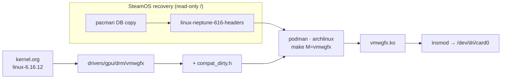

# 3단계 · vmwgfx 드라이버 빌드

[English](../README.md) | **한국어** | [日本語](README.ja.md) | [简体中文](README.zh-CN.md) | [Español](README.es.md) | [Français](README.fr.md)

   

Valve 커널에 빠진 VMware 그래픽 드라이버를 빌드해서 넣고, 복구 환경 데스크톱을 띄웁니다.

> [!IMPORTANT]
> 커널 모듈은 빌드한 커널과 **정확히 같은** 커널에서만 로드됩니다. 이 문서의 버전은 모두 SteamOS 3.8.14 기준입니다. 다른 버전이라면 그 버전에 맞춰 같은 과정을 반복하세요.

## 목차

- [개요](#개요)
- [준비물](#준비물)
- [진행](#진행)
  - [3-1. 빌드가 가능한지 확인](#3-1-빌드가-가능한지-확인)
  - [3-2. 작업 디스크 추가](#3-2-작업-디스크-추가)
  - [3-3. 같은 버전의 커널 헤더 받기](#3-3-같은-버전의-커널-헤더-받기)
  - [3-4. vmwgfx 소스 받기](#3-4-vmwgfx-소스-받기)
  - [3-5. 빌드 컨테이너 시작](#3-5-빌드-컨테이너-시작)
  - [3-6. 호환 패치 적용](#3-6-호환-패치-적용)
  - [3-7. 빌드](#3-7-빌드)
  - [3-8. 드라이버 로드](#3-8-드라이버-로드)
- [확인](#확인)
- [다음 단계](#다음-단계)

---

## 개요

SteamOS에는 컴파일러가 없고, 읽기 전용 루트에는 여유 공간도 거의 없습니다. 그래서 빌드는 별도 작업 디스크 위의 podman 컨테이너에서 진행합니다. 시스템 영역은 전혀 바꾸지 않습니다.



## 준비물

- [ ] [2단계](../../02-Recovery-Boot/README/README.ko.md) 완료 — 복구 환경에 SSH 접속
- [ ] VM에서 인터넷 접속 가능

---

## 진행

### 3-1. 빌드가 가능한지 확인

```bash
zcat /proc/config.gz | grep -E 'CONFIG_DRM=|VMWGFX|CONFIG_DRM_TTM=|CONFIG_DRM_KMS_HELPER=|MODVERSIONS|MODULE_SIG_FORCE'
ls /usr/lib/modules/$(uname -r)/kernel/drivers/gpu/drm/ | head -20
lspci -k | grep -A3 -i vga
ls /usr/lib/modules/$(uname -r)/build 2>&1 | head -3
df -h /
sudo -n true && echo SUDO_OK
```

<details>
<summary>스크린샷</summary>


</details>

| 확인 항목 | 결과 | 의미 |
| --- | --- | --- |
| `CONFIG_DRM=y`, `KMS_HELPER=y` | 내장 | 그래픽 기본 틀은 있습니다 |
| `CONFIG_DRM_TTM=m`, `drm_ttm_helper.ko` | 모듈 | vmwgfx가 의존하는 부품이 있습니다 |
| `VMWGFX` 줄 없음 | 빌드 안 됨 | **드라이버 하나만 빠져 있습니다** |
| `MODVERSIONS is not set` | 꺼짐 | 외부에서 빌드한 모듈이 받아들여집니다 |
| `MODULE_SIG_FORCE is not set` | 꺼짐 | 서명 없는 모듈도 로드됩니다 |
| VMware SVGA II, 드라이버 없음 | — | 장치는 있는데 붙은 드라이버가 없습니다 |
| `build` 폴더 없음 | — | 헤더를 받아야 합니다 |
| `/` 여유 867MB | — | **다른 디스크에서 빌드합니다** |
| `SUDO_OK` | — | 비밀번호 없이 sudo 가능 |

### 3-2. 작업 디스크 추가

전원을 끄고(`sudo systemctl poweroff`) **Add → Hard Disk → SATA → Create a new virtual disk → 20GB** 를 추가합니다. 다시 SATA 0.0으로 부팅해 SSH로 접속합니다.

```bash
lsblk -o NAME,SIZE,TYPE,MOUNTPOINT
```


> [!CAUTION]
> **파티션이 없는 20GB 디스크**(여기서는 `sdb`)만 포맷하세요. `sda` 는 복구 디스크입니다.

```bash
sudo mkfs.ext4 -F /dev/sdb
sudo mkdir -p /mnt/build
sudo mount /dev/sdb /mnt/build
sudo chown deck:deck /mnt/build
```

### 3-3. 같은 버전의 커널 헤더 받기

```bash
sudo pacman-key --init
sudo pacman-key --populate
uname -r
pacman -Si linux-neptune-616-headers | grep Version
```


커널 `6.16.12-valve24.4-1-…` 과 헤더 `6.16.12.valve24.4-1` 이 **일치**합니다. `pacman -Sy` 는 읽기 전용 오류로 실패하는데([T4](../../../04-Troubleshooting/README/README.ko.md#t4)), 여기서는 오히려 다행입니다. 이미지에 들어 있던 패키지 목록이 지금 커널과 맞는 헤더를 그대로 가리키기 때문입니다.

pacman 데이터베이스는 읽기 전용 영역(`/usr/lib/holo/pacmandb`)에 있으므로 작업 디스크로 복사한 뒤 **다운로드만** 합니다.

```bash
sudo cp -a "$(pacman-conf DBPath)" /mnt/build/db
mkdir -p /mnt/build/pkg /mnt/build/hdr
sudo pacman --dbpath /mnt/build/db -Sw --noconfirm --cachedir /mnt/build/pkg linux-neptune-616-headers
bsdtar -xf /mnt/build/pkg/linux-neptune-616-headers-*.pkg.tar.zst -C /mnt/build/hdr
export KDIR=/mnt/build/hdr/usr/lib/modules/$(uname -r)/build
ls $KDIR/Makefile $KDIR/.config $KDIR/Module.symvers
```


> [!WARNING]
> `-Sy` 로 목록을 새로 받지 마세요. 새 목록은 지금 커널과 맞지 않는 더 새 헤더를 가리킵니다.

### 3-4. vmwgfx 소스 받기

```bash
cd /mnt/build
curl -LO https://cdn.kernel.org/pub/linux/kernel/v6.x/linux-6.16.12.tar.xz
tar -xf linux-6.16.12.tar.xz linux-6.16.12/drivers/gpu/drm/vmwgfx
export SRC=/mnt/build/linux-6.16.12/drivers/gpu/drm/vmwgfx
```

### 3-5. 빌드 컨테이너 시작

```bash
sudo podman --root /mnt/build/containers --runroot /mnt/build/run \
  run --rm -it -v /mnt/build:/mnt/build -e KDIR="$KDIR" -e SRC="$SRC" \
  docker.io/library/archlinux:latest bash
```

컨테이너 안에서:

```bash
pacman -Sy --noconfirm base-devel bc pahole
grep CONFIG_CC_VERSION_TEXT $KDIR/.config
```


커널이 `gcc 15.1.1` 로 빌드되었으므로 gcc를 사용합니다.

<a id="compat-patch"></a>

### 3-6. 호환 패치 적용

그대로 빌드하면 `vmwgfx_page_dirty.c` 에서 멈춥니다([T5](../../../04-Troubleshooting/README/README.ko.md#t5)). Valve 커널은 `CONFIG_MAPPING_DIRTY_HELPERS` 를 꺼 두었는데, vmwgfx가 쓰는 함수 두 개가 바로 이 기능에 들어 있습니다. 커널 본체 기능이라 모듈로 넣을 수 없으므로, 패치로 vmwgfx 안에 직접 구현합니다.

대체 구현은 페이지를 하나하나 추적하는 대신 범위 전체를 변경된 것으로 표시하고 쓰기 감시를 다시 겁니다. 변경을 놓치지 않으므로 정확성은 유지되고, 데이터를 조금 더 보내는 비용만 생깁니다.

<details>
<summary><code>compat_dirty.h</code> ([vmware/compat_dirty.h](../../../../vmware/compat_dirty.h) 에도 있음)</summary>

```bash
cat > $SRC/compat_dirty.h <<'EOF'
#ifndef VMW_COMPAT_DIRTY_H
#define VMW_COMPAT_DIRTY_H
#include <linux/mm.h>
#include <linux/bitops.h>
#ifndef CONFIG_MAPPING_DIRTY_HELPERS
static inline unsigned long
wp_shared_mapping_range(struct address_space *mapping,
			pgoff_t first_index, pgoff_t nr)
{
	unmap_mapping_range(mapping, (loff_t)first_index << PAGE_SHIFT,
			    (loff_t)nr << PAGE_SHIFT, 0);
	return 0;
}

static inline unsigned long
clean_record_shared_mapping_range(struct address_space *mapping,
				  pgoff_t first_index, pgoff_t nr,
				  pgoff_t bitmap_pgoff, unsigned long *bitmap,
				  pgoff_t *start, pgoff_t *end)
{
	pgoff_t first = first_index - bitmap_pgoff;
	pgoff_t i;

	for (i = 0; i < nr; i++)
		__set_bit(first + i, bitmap);
	if (*start > first)
		*start = first;
	if (*end < first + nr)
		*end = first + nr;
	unmap_mapping_range(mapping, (loff_t)first_index << PAGE_SHIFT,
			    (loff_t)nr << PAGE_SHIFT, 0);
	return nr;
}
#endif
#endif
EOF
```

</details>

```bash
sed -i '0,/^#include/s//#include "compat_dirty.h"\n#include/' $SRC/vmwgfx_page_dirty.c
```

### 3-7. 빌드

```bash
cd $SRC
make -C $KDIR M=$SRC CONFIG_DRM_VMWGFX=m modules -j4
modinfo $SRC/vmwgfx.ko | grep -E 'vermagic|depends'
exit
```


- `warning: the compiler differs…` 는 무시해도 됩니다.
- **`vermagic` 이 `uname -r` 과 같아야 합니다** — 여기서는 `6.16.12-valve24.4-1-neptune-616-gfe145653a794`.
- `depends: ttm,drm_ttm_helper` 는 SteamOS에 이미 들어 있는 모듈입니다.

### 3-8. 드라이버 로드

```bash
sudo modprobe ttm
sudo modprobe drm_ttm_helper
sudo insmod $SRC/vmwgfx.ko
ls /dev/dri
sudo systemctl restart display-manager
```


모듈 파일은 호스트에도 백업해 둡니다.

```powershell
scp deck@192.168.126.133:/mnt/build/linux-6.16.12/drivers/gpu/drm/vmwgfx/vmwgfx.ko C:\VMs\
```

---

## 확인

- [ ] `ls /dev/dri` 에 `card0` 과 `renderD128` 이 보임
- [ ] VM 화면에 복구 환경 데스크톱이 뜸

> [!NOTE]
> 재부팅하면 모듈이 빠집니다. [5단계](../../05-Desktop-Autostart/README/README.ko.md)에서 설치본이 부팅할 때마다 자동으로 로드하게 만듭니다.

## 다음 단계

[4단계 · NVMe에 SteamOS 설치 →](../../04-Install-SteamOS/README/README.ko.md)
