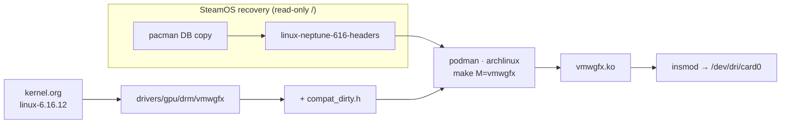
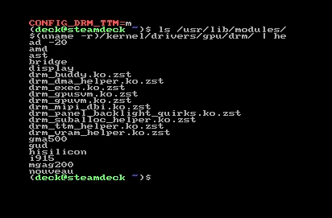

# 第 3 步 · 编译 vmwgfx 驱动

[English](../README.md) | [한국어](README.ko.md) | [日本語](README.ja.md) | **简体中文** | [Español](README.es.md) | [Français](README.fr.md)

   

编译 Valve 内核中缺少的 VMware 显卡驱动并加载，让恢复环境的桌面显示出来。

> [!IMPORTANT]
> 内核模块只能在与编译时 **完全相同** 的内核上加载。本指南中的所有版本都对应 SteamOS 3.8.14。若使用其他版本，请用该版本的对应版本号重复这些步骤。

## 目录

- [概述](#概述)
- [前提条件](#前提条件)
- [步骤](#步骤)
  - [3-1. 确认能否编译](#3-1-确认能否编译)
  - [3-2. 添加工作盘](#3-2-添加工作盘)
  - [3-3. 获取匹配的内核头文件](#3-3-获取匹配的内核头文件)
  - [3-4. 获取 vmwgfx 源码](#3-4-获取-vmwgfx-源码)
  - [3-5. 启动编译容器](#3-5-启动编译容器)
  - [3-6. 应用兼容补丁](#3-6-应用兼容补丁)
  - [3-7. 编译](#3-7-编译)
  - [3-8. 加载驱动](#3-8-加载驱动)
- [验证](#验证)
- [下一步](#下一步)

---

## 概述

SteamOS 没有编译器，只读的根分区也几乎没有空闲空间。因此编译在独立工作盘上的 podman 容器中进行，系统区域不做任何修改。



## 前提条件

- [ ] 已完成 [第 2 步](../../02-Recovery-Boot/README/README.zh-CN.md) — 已通过 SSH 连接到恢复环境
- [ ] 虚拟机可以访问网络

---

## 步骤

### 3-1. 确认能否编译

```bash
zcat /proc/config.gz | grep -E 'CONFIG_DRM=|VMWGFX|CONFIG_DRM_TTM=|CONFIG_DRM_KMS_HELPER=|MODVERSIONS|MODULE_SIG_FORCE'
ls /usr/lib/modules/$(uname -r)/kernel/drivers/gpu/drm/ | head -20
lspci -k | grep -A3 -i vga
ls /usr/lib/modules/$(uname -r)/build 2>&1 | head -3
df -h /
sudo -n true && echo SUDO_OK
```

<details>
<summary>截图</summary>





</details>

| 检查项 | 结果 | 含义 |
| --- | --- | --- |
| `CONFIG_DRM=y`、`KMS_HELPER=y` | 内置 | 图形核心存在 |
| `CONFIG_DRM_TTM=m`、`drm_ttm_helper.ko` | 模块 | vmwgfx 的依赖已具备 |
| 没有 `VMWGFX` 行 | 未编译 | **只缺驱动本身** |
| `MODVERSIONS is not set` | 关闭 | 外部编译的模块可以被接受 |
| `MODULE_SIG_FORCE is not set` | 关闭 | 未签名模块也能加载 |
| VMware SVGA II，无驱动 | — | 设备存在，但没有驱动 |
| 没有 `build` 目录 | — | 需要获取头文件 |
| `/` 只剩 867 MB | — | **在另一块磁盘上编译** |
| `SUDO_OK` | — | sudo 无需密码 |

### 3-2. 添加工作盘

关机（`sudo systemctl poweroff`），然后 **Add → Hard Disk → SATA → Create a new virtual disk → 20 GB**。再次从 SATA 0.0 启动并通过 SSH 连接。

```bash
lsblk -o NAME,SIZE,TYPE,MOUNTPOINT
```


> [!CAUTION]
> 只格式化 **没有分区的 20 GB 磁盘**（这里是 `sdb`）。`sda` 是恢复盘。

```bash
sudo mkfs.ext4 -F /dev/sdb
sudo mkdir -p /mnt/build
sudo mount /dev/sdb /mnt/build
sudo chown deck:deck /mnt/build
```

### 3-3. 获取匹配的内核头文件

```bash
sudo pacman-key --init
sudo pacman-key --populate
uname -r
pacman -Si linux-neptune-616-headers | grep Version
```


内核 `6.16.12-valve24.4-1-…` 与头文件 `6.16.12.valve24.4-1` **一致**。`pacman -Sy` 会因只读错误而失败（[T4](../../../04-Troubleshooting/README/README.zh-CN.md#t4)），这在这里反而是好事：镜像自带的软件包列表仍然指向与当前内核匹配的头文件。

pacman 数据库位于只读区域（`/usr/lib/holo/pacmandb`），因此先复制到工作盘，**只做下载**：

```bash
sudo cp -a "$(pacman-conf DBPath)" /mnt/build/db
mkdir -p /mnt/build/pkg /mnt/build/hdr
sudo pacman --dbpath /mnt/build/db -Sw --noconfirm --cachedir /mnt/build/pkg linux-neptune-616-headers
bsdtar -xf /mnt/build/pkg/linux-neptune-616-headers-*.pkg.tar.zst -C /mnt/build/hdr
export KDIR=/mnt/build/hdr/usr/lib/modules/$(uname -r)/build
ls $KDIR/Makefile $KDIR/.config $KDIR/Module.symvers
```


> [!WARNING]
> 不要用 `-Sy` 刷新列表。新列表会指向与当前内核不匹配的更新的头文件。

### 3-4. 获取 vmwgfx 源码

```bash
cd /mnt/build
curl -LO https://cdn.kernel.org/pub/linux/kernel/v6.x/linux-6.16.12.tar.xz
tar -xf linux-6.16.12.tar.xz linux-6.16.12/drivers/gpu/drm/vmwgfx
export SRC=/mnt/build/linux-6.16.12/drivers/gpu/drm/vmwgfx
```

### 3-5. 启动编译容器

```bash
sudo podman --root /mnt/build/containers --runroot /mnt/build/run \
  run --rm -it -v /mnt/build:/mnt/build -e KDIR="$KDIR" -e SRC="$SRC" \
  docker.io/library/archlinux:latest bash
```

在容器内：

```bash
pacman -Sy --noconfirm base-devel bc pahole
grep CONFIG_CC_VERSION_TEXT $KDIR/.config
```


内核是用 `gcc 15.1.1` 编译的，所以使用 gcc。

<a id="compat-patch"></a>

### 3-6. 应用兼容补丁

直接编译会在 `vmwgfx_page_dirty.c` 处停止（[T5](../../../04-Troubleshooting/README/README.zh-CN.md#t5)）。Valve 的内核关闭了 `CONFIG_MAPPING_DIRTY_HELPERS`，而 vmwgfx 需要的两个函数正属于这个功能。它是内核本体的功能，无法作为模块添加，因此用补丁在 vmwgfx 内部实现它们。

替代实现不逐页跟踪，而是把整个范围标记为已修改并重新开启写入跟踪。不会漏掉任何修改，正确性得以保持，代价只是多传输一些数据。

<details>
<summary><code>compat_dirty.h</code>（也位于 [vmware/compat_dirty.h](../../../../vmware/compat_dirty.h)）</summary>

```bash
cat > $SRC/compat_dirty.h <<'EOF'
#ifndef VMW_COMPAT_DIRTY_H
#define VMW_COMPAT_DIRTY_H
#include <linux/mm.h>
#include <linux/bitops.h>
#ifndef CONFIG_MAPPING_DIRTY_HELPERS
static inline unsigned long
wp_shared_mapping_range(struct address_space *mapping,
			pgoff_t first_index, pgoff_t nr)
{
	unmap_mapping_range(mapping, (loff_t)first_index << PAGE_SHIFT,
			    (loff_t)nr << PAGE_SHIFT, 0);
	return 0;
}

static inline unsigned long
clean_record_shared_mapping_range(struct address_space *mapping,
				  pgoff_t first_index, pgoff_t nr,
				  pgoff_t bitmap_pgoff, unsigned long *bitmap,
				  pgoff_t *start, pgoff_t *end)
{
	pgoff_t first = first_index - bitmap_pgoff;
	pgoff_t i;

	for (i = 0; i < nr; i++)
		__set_bit(first + i, bitmap);
	if (*start > first)
		*start = first;
	if (*end < first + nr)
		*end = first + nr;
	unmap_mapping_range(mapping, (loff_t)first_index << PAGE_SHIFT,
			    (loff_t)nr << PAGE_SHIFT, 0);
	return nr;
}
#endif
#endif
EOF
```

</details>

```bash
sed -i '0,/^#include/s//#include "compat_dirty.h"\n#include/' $SRC/vmwgfx_page_dirty.c
```

### 3-7. 编译

```bash
cd $SRC
make -C $KDIR M=$SRC CONFIG_DRM_VMWGFX=m modules -j4
modinfo $SRC/vmwgfx.ko | grep -E 'vermagic|depends'
exit
```


- `warning: the compiler differs…` 可以忽略。
- **`vermagic` 必须与 `uname -r` 相同** — 这里是 `6.16.12-valve24.4-1-neptune-616-gfe145653a794`。
- `depends: ttm,drm_ttm_helper` 是 SteamOS 自带的模块。

### 3-8. 加载驱动

```bash
sudo modprobe ttm
sudo modprobe drm_ttm_helper
sudo insmod $SRC/vmwgfx.ko
ls /dev/dri
sudo systemctl restart display-manager
```


在主机上也保存一份模块：

```powershell
scp deck@192.168.126.133:/mnt/build/linux-6.16.12/drivers/gpu/drm/vmwgfx/vmwgfx.ko C:\VMs\
```

---

## 验证

- [ ] `ls /dev/dri` 显示 `card0` 和 `renderD128`
- [ ] 虚拟机窗口中出现恢复环境桌面

> [!NOTE]
> 重启后模块会丢失。[第 5 步](../../05-Desktop-Autostart/README/README.zh-CN.md) 会让安装后的系统在每次启动时自动加载它。

## 下一步

[第 4 步 · 将 SteamOS 安装到 NVMe →](../../04-Install-SteamOS/README/README.zh-CN.md)
