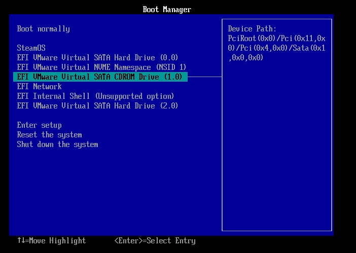

# Paso 4 · Instalar SteamOS en NVMe

[English](../README.md) | [한국어](README.ko.md) | [日本語](README.ja.md) | [简体中文](README.zh-CN.md) | **Español** | [Français](README.fr.md)

  

Ejecuta el instalador de Valve desde el entorno de recuperación y escribe SteamOS en el disco NVMe de la VM.

## Índice

- [Descripción general](#descripción-general)
- [Requisitos previos](#requisitos-previos)
- [Pasos](#pasos)
  - [4-1. Hacer una copia del instalador apta para VMware](#4-1-hacer-una-copia-del-instalador-apta-para-vmware)
  - [4-2. Ejecutarlo desde la terminal de la VM](#4-2-ejecutarlo-desde-la-terminal-de-la-vm)
  - [4-3. El último *Proceed* reinicia](#4-3-el-último-proceed-reinicia)
- [Verificación](#verificación)
- [Siguiente](#siguiente)

---

## Descripción general

El acceso directo **Wipe Device & Install SteamOS** se cierra justo después de *Proceed* y no instala nada. Al ejecutar el script a mano aparecen tres bloqueos distintos:

| # | Síntoma | Causa | Solución |
| --- | --- | --- | --- |
| 1 | `!! Please run as root.` | Necesita root | Ejecutar con `sudo` ([T6](../../../04-Troubleshooting/README/README.es.md#t6)) |
| 2 | `zenity … cannot open display` | Muestra un diálogo de confirmación | Ejecutar desde la **terminal de la propia VM**, no por SSH |
| 3 | `nvme format` → `Invalid Command Opcode` | El NVMe virtual de VMware no implementa el comando de formateo | Saltar solo ese paso en una copia del script ([T7](../../../04-Troubleshooting/README/README.es.md#t7)) |

## Requisitos previos

- [ ] [Paso 3](../../03-vmwgfx-Driver/README/README.es.md) completado — escritorio de recuperación visible, disco de trabajo montado en `/mnt/build`

---

## Pasos

### 4-1. Hacer una copia del instalador apta para VMware

Por SSH:

```bash
cp ~/tools/repair_device.sh ~/tools/repair_device_vm.sh
sed -i 's/nvme format/true nvme format/' ~/tools/repair_device_vm.sh
chmod +x ~/tools/repair_device_vm.sh
diff ~/tools/repair_device.sh ~/tools/repair_device_vm.sh
```

`true` termina con éxito sean cuales sean los argumentos, así que solo se omite el formateo por hardware. Ese paso está pensado para el SSD físico de la Steam Deck; un disco virtual vacío no lo necesita. La copia se queda en `tools/` porque el script carga archivos vecinos.

### 4-2. Ejecutarlo desde la terminal de la VM

Haz doble clic en **Terminal with repair tools** en el escritorio de recuperación.


```bash
sudo ~/tools/repair_device_vm.sh all 2>&1 | tee /mnt/build/install.log
```

> [!TIP]
> `tee` guarda el registro en el disco de trabajo. Si la ventana se cierra, léelo por SSH con `tail -30 /mnt/build/install.log`.


| Línea del registro | Significado |
| --- | --- |
| `mkfs.ext4 … nvme0n1p8` | Particiones creadas y formateadas |
| `Skipping update due to unsupported hardware revision` | Actualización de BIOS omitida — normal en una VM |
| `Device does not look like a Steam Deck…` | Firmware del controlador omitido — normal |
| `fsfreeze -f /` | El origen se congela durante la copia; la VM puede parecer bloqueada un momento |
| `Imaging OS partition A`, `dd … sda3 → nvme0n1p4` | Copiando la imagen del sistema SteamOS |

El sistema instalado es una copia del sistema de la imagen de recuperación, así que el **kernel es idéntico** y el módulo del Paso 3 funciona sin cambios.

### 4-3. El último *Proceed* reinicia

El diálogo final significa "instalación terminada, reiniciar". La VM arranca la nueva entrada **SteamOS**, que muestra una pantalla negra porque allí aún no está el controlador. Es lo esperado.



| Entrada | Qué es |
| --- | --- |
| **SteamOS** | Creada por el instalador (NVMe) |
| SATA Hard Drive (0.0) | Disco de recuperación |
| SATA Hard Drive (2.0) | Disco de trabajo (no arrancable) |

---

## Verificación

- [ ] `install.log` termina con `Creating Boot… SteamOS`
- [ ] Boot Manager muestra una entrada **SteamOS**

Apaga y arranca de nuevo **SATA Hard Drive (0.0)** para continuar.

## Siguiente

[Paso 5 · Inicio automático del escritorio →](../../05-Desktop-Autostart/README/README.es.md)
