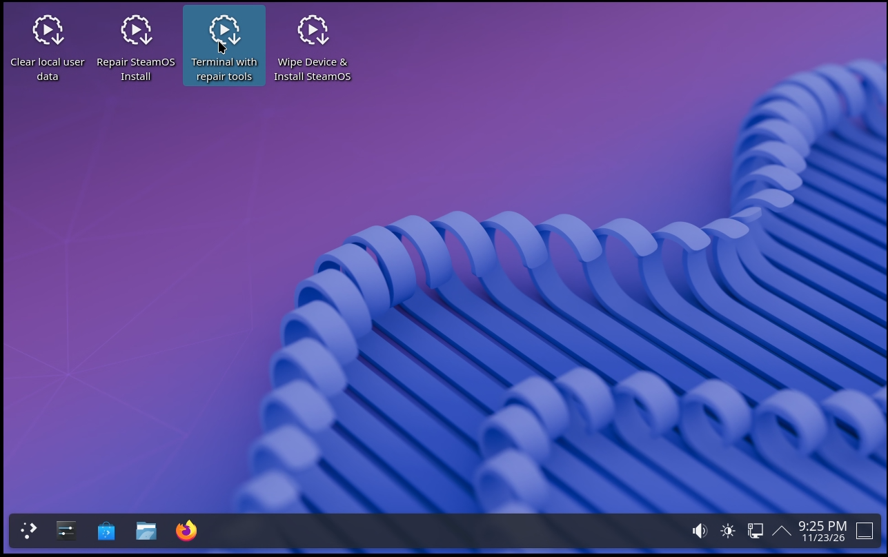
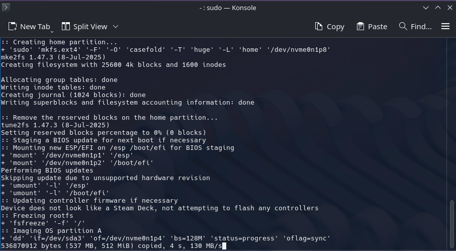

# 第 4 步 · 将 SteamOS 安装到 NVMe

[English](../README.md) | [한국어](README.ko.md) | [日本語](README.ja.md) | **简体中文** | [Español](README.es.md) | [Français](README.fr.md)

  

在恢复环境中运行 Valve 的安装脚本，把 SteamOS 写入虚拟机的 NVMe 磁盘。

## 目录

- [概述](#概述)
- [前提条件](#前提条件)
- [步骤](#步骤)
  - [4-1. 制作适用于 VMware 的安装脚本副本](#4-1-制作适用于-vmware-的安装脚本副本)
  - [4-2. 在虚拟机的终端中运行](#4-2-在虚拟机的终端中运行)
  - [4-3. 最后的 *Proceed* 会重启](#4-3-最后的-proceed-会重启)
- [验证](#验证)
- [下一步](#下一步)

---

## 概述

桌面上的 **Wipe Device & Install SteamOS** 在点击 *Proceed* 后窗口立即关闭，什么也没有安装。手动运行脚本后会发现三个不同的问题：

| # | 现象 | 原因 | 解决方法 |
| --- | --- | --- | --- |
| 1 | `!! Please run as root.` | 需要 root 权限 | 用 `sudo` 运行（[T6](../../../04-Troubleshooting/README/README.zh-CN.md#t6)） |
| 2 | `zenity … cannot open display` | 需要在屏幕上显示确认对话框 | 在 **虚拟机自己的终端** 中运行，而不是 SSH |
| 3 | `nvme format` → `Invalid Command Opcode` | VMware 虚拟 NVMe 不支持格式化命令 | 在脚本副本中跳过这一步（[T7](../../../04-Troubleshooting/README/README.zh-CN.md#t7)） |

## 前提条件

- [ ] 已完成 [第 3 步](../../03-vmwgfx-Driver/README/README.zh-CN.md) — 恢复环境桌面已显示，工作盘挂载在 `/mnt/build`

---

## 步骤

### 4-1. 制作适用于 VMware 的安装脚本副本

通过 SSH：

```bash
cp ~/tools/repair_device.sh ~/tools/repair_device_vm.sh
sed -i 's/nvme format/true nvme format/' ~/tools/repair_device_vm.sh
chmod +x ~/tools/repair_device_vm.sh
diff ~/tools/repair_device.sh ~/tools/repair_device_vm.sh
```

无论后面跟什么参数，`true` 都会成功结束，因此只会跳过硬件格式化。这一步是为 Steam Deck 的实体 SSD 准备的，空的虚拟磁盘不需要。脚本会加载同目录下的其他文件，所以副本也放在 `tools/` 中。

### 4-2. 在虚拟机的终端中运行

双击恢复环境桌面上的 **Terminal with repair tools**。



```bash
sudo ~/tools/repair_device_vm.sh all 2>&1 | tee /mnt/build/install.log
```

> [!TIP]
> `tee` 会把日志保存在工作盘上。即使窗口关闭，也可以通过 SSH 用 `tail -30 /mnt/build/install.log` 查看。



| 日志 | 含义 |
| --- | --- |
| `mkfs.ext4 … nvme0n1p8` | 分区已创建并格式化 |
| `Skipping update due to unsupported hardware revision` | 跳过 BIOS 更新 — 虚拟机中正常 |
| `Device does not look like a Steam Deck…` | 跳过控制器固件 — 正常 |
| `fsfreeze -f /` | 复制期间冻结源系统，虚拟机可能短暂像卡住一样 |
| `Imaging OS partition A`、`dd … sda3 → nvme0n1p4` | 正在复制 SteamOS 系统镜像 |

安装后的系统是恢复镜像系统的完整副本，因此 **内核完全相同**，第 3 步编译的模块可以直接使用。

### 4-3. 最后的 *Proceed* 会重启

最后的对话框表示"安装完成，重启"。虚拟机会从新建的 **SteamOS** 启动项启动，但那里还没有驱动，所以会黑屏。这是预期结果。


| 项目 | 说明 |
| --- | --- |
| **SteamOS** | 安装脚本创建（NVMe） |
| SATA Hard Drive (0.0) | 恢复盘 |
| SATA Hard Drive (2.0) | 工作盘（不可启动） |

---

## 验证

- [ ] `install.log` 以 `Creating Boot… SteamOS` 结尾
- [ ] Boot Manager 中出现 **SteamOS** 启动项

关机后再次从 **SATA Hard Drive (0.0)** 启动，继续下一步。

## 下一步

[第 5 步 · 桌面自动启动 →](../../05-Desktop-Autostart/README/README.zh-CN.md)
