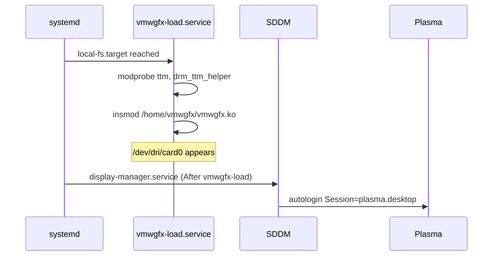
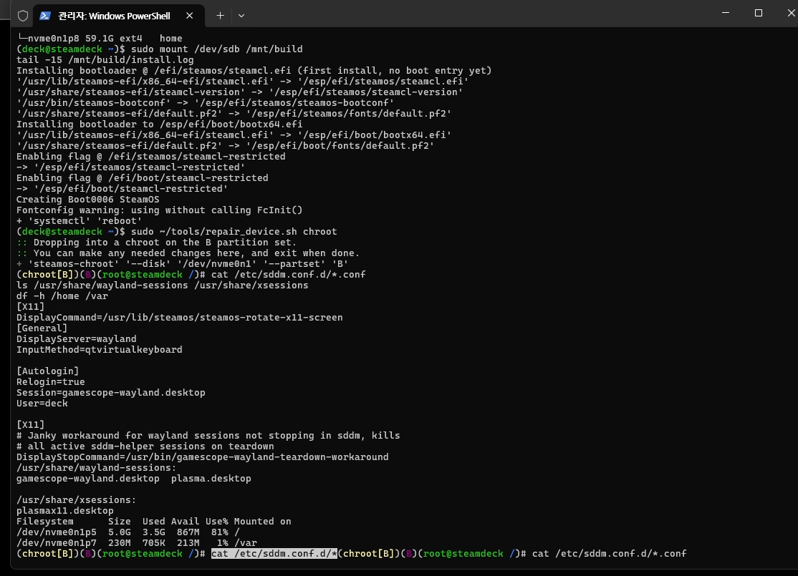
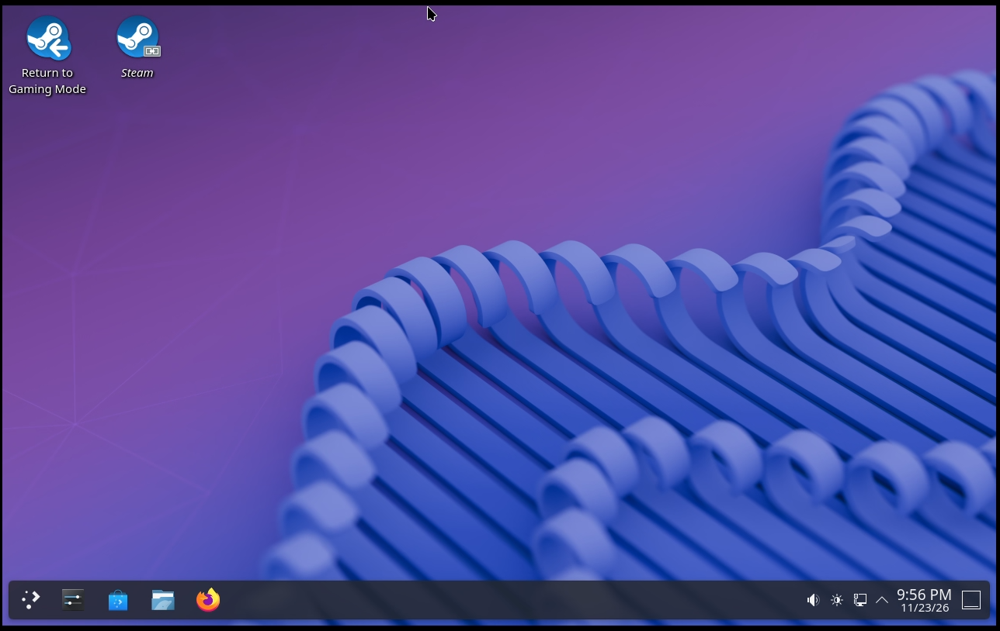

# Step 5 · Desktop autostart

**English** | [한국어](README/README.ko.md) | [日本語](README/README.ja.md) | [简体中文](README/README.zh-CN.md) | [Español](README/README.es.md) | [Français](README/README.fr.md)

  

Make the installed SteamOS load the vmwgfx driver on every boot and log in to Desktop Mode instead of Game Mode.

## Contents

- [Overview](#overview)
- [Prerequisites](#prerequisites)
- [Steps](#steps)
  - [5-1. Enter the installed system](#5-1-enter-the-installed-system)
  - [5-2. Driver autoload and desktop autologin (set B)](#5-2-driver-autoload-and-desktop-autologin-set-b)
  - [5-3. Repeat for set A](#5-3-repeat-for-set-a)
  - [5-4. Put the driver on the shared home partition](#5-4-put-the-driver-on-the-shared-home-partition)
  - [5-5. Boot the installed system](#5-5-boot-the-installed-system)
- [Verification](#verification)
- [Next](#next)

---

## Overview

The installed system shows a black screen for two reasons:

1. The vmwgfx driver is not there.
2. Autologin targets **Game Mode** (`gamescope-wayland.desktop`), which cannot run in VMware.

Both are fixed with files in `/etc` and `/home` only — the read-only system stays untouched.



## Prerequisites

- [ ] [Step 4](../04-Install-SteamOS/README.md) completed — SteamOS installed on NVMe
- [ ] Booted into the **recovery** disk (SATA 0.0) with SSH

---

## Steps

### 5-1. Enter the installed system

```bash
sudo mount /dev/sdb /mnt/build            # work disk again (check with lsblk)
tail -15 /mnt/build/install.log
sudo ~/tools/repair_device.sh chroot
```

Inside the chroot, inspect the current session setup:

```bash
cat /etc/sddm.conf.d/*.conf
ls /usr/share/wayland-sessions /usr/share/xsessions
df -h /home /var
```




| Check | Result |
| --- | --- |
| Installation | `Creating Boot0006 SteamOS` — finished |
| Autologin | `Session=gamescope-wayland.desktop` — Game Mode |
| Desktop session name | **`plasma.desktop`** |
| chroot target | Partition set **B** |

> [!IMPORTANT]
> SteamOS keeps two copies of the system (A and B) and switches between them on update. Apply the same settings to **both**.

### 5-2. Driver autoload and desktop autologin (set B)

Paste inside the chroot:

```bash
cat > /etc/systemd/system/vmwgfx-load.service <<'EOF'
[Unit]
Description=Load custom vmwgfx driver for VMware
DefaultDependencies=no
ConditionVirtualization=vmware
RequiresMountsFor=/home/vmwgfx
After=local-fs.target
Before=display-manager.service

[Service]
Type=oneshot
RemainAfterExit=yes
ExecStart=/usr/bin/modprobe ttm
ExecStart=/usr/bin/modprobe drm_ttm_helper
ExecStart=-/usr/bin/insmod /home/vmwgfx/vmwgfx.ko

[Install]
WantedBy=multi-user.target
EOF
systemctl enable vmwgfx-load.service

cat > /etc/sddm.conf.d/zzz-vmware-desktop.conf <<'EOF'
[Autologin]
Relogin=true
Session=plasma.desktop
User=deck
EOF
systemctl enable sshd
passwd deck
exit
```

| File | Role |
| --- | --- |
| `vmwgfx-load.service` | Loads the driver before the display manager. Runs only on VMware (`ConditionVirtualization`); a failure never blocks boot (`-insmod`) |
| `zzz-vmware-desktop.conf` | Autologin to Plasma. The `zzz` prefix sorts last, so it overrides the stock config |
| `sshd`, `passwd` | SSH access to the installed system |

The same files are in [vmware/](../../../vmware).

### 5-3. Repeat for set A

```bash
sudo steamos-chroot --disk /dev/nvme0n1 --partset A
# paste the 5-2 block again, then exit
```

### 5-4. Put the driver on the shared home partition

Both A and B mount the same home partition (`nvme0n1p8`), where the module becomes `/home/vmwgfx/vmwgfx.ko`.

```bash
sudo mkdir -p /mnt/nvhome
sudo mount /dev/nvme0n1p8 /mnt/nvhome
sudo mkdir -p /mnt/nvhome/vmwgfx
sudo cp /mnt/build/linux-6.16.12/drivers/gpu/drm/vmwgfx/vmwgfx.ko /mnt/nvhome/vmwgfx/
ls -lh /mnt/nvhome/vmwgfx
sudo umount /mnt/nvhome
```

> [!WARNING]
> Skipping this leaves the installed system black with `insmod: … No such file or directory` ([T8](../../04-Troubleshooting/README.md#t8)).

### 5-5. Boot the installed system

```bash
sudo systemctl poweroff
```

Choose **Boot Manager → SteamOS**. The desktop takes **1–2 minutes** to appear.



"Return to Gaming Mode" and "Steam" icons on the desktop confirm this is the NVMe installation.

> [!CAUTION]
> Do not click **Return to Gaming Mode** in VMware ([T15](../../04-Troubleshooting/README.md#t15)).

---

## Verification

- [ ] The desktop appears without any manual step after a reboot
- [ ] `systemctl status vmwgfx-load.service` is `active (exited)` and `ls /dev/dri` lists `card0`

> [!TIP]
> This is the clean baseline for testing. After adding your SSH key in [Step 6](../06-Run-Unattended/README.md), snapshot it as `clean-install`.

## Next

[Step 6 · Run SteamOS-Unattended →](../06-Run-Unattended/README.md)
