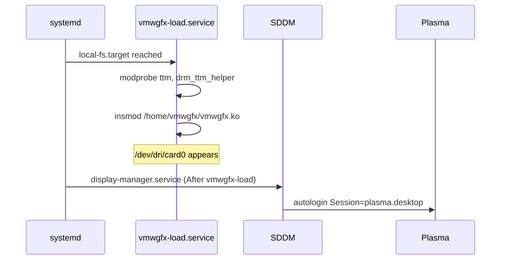

# Paso 5 · Inicio automático del escritorio

[English](../README.md) | [한국어](README.ko.md) | [日本語](README.ja.md) | [简体中文](README.zh-CN.md) | **Español** | [Français](README.fr.md)

  

Haz que el SteamOS instalado cargue el controlador vmwgfx en cada arranque e inicie sesión en el modo escritorio en lugar del modo juego.

## Índice

- [Descripción general](#descripción-general)
- [Requisitos previos](#requisitos-previos)
- [Pasos](#pasos)
  - [5-1. Entrar en el sistema instalado](#5-1-entrar-en-el-sistema-instalado)
  - [5-2. Carga automática del controlador e inicio en el escritorio (conjunto B)](#5-2-carga-automática-del-controlador-e-inicio-en-el-escritorio-conjunto-b)
  - [5-3. Repetir para el conjunto A](#5-3-repetir-para-el-conjunto-a)
  - [5-4. Poner el controlador en la partición home compartida](#5-4-poner-el-controlador-en-la-partición-home-compartida)
  - [5-5. Arrancar el sistema instalado](#5-5-arrancar-el-sistema-instalado)
- [Verificación](#verificación)
- [Siguiente](#siguiente)

---

## Descripción general

El sistema instalado muestra una pantalla negra por dos motivos:

1. El controlador vmwgfx no está.
2. El inicio de sesión automático apunta al **modo juego** (`gamescope-wayland.desktop`), que no puede ejecutarse en VMware.

Ambos se arreglan solo con archivos en `/etc` y `/home`; el sistema de solo lectura no se toca.



## Requisitos previos

- [ ] [Paso 4](../../04-Install-SteamOS/README/README.es.md) completado — SteamOS instalado en NVMe
- [ ] Arrancado desde el disco de **recuperación** (SATA 0.0) con SSH

---

## Pasos

### 5-1. Entrar en el sistema instalado

```bash
sudo mount /dev/sdb /mnt/build            # work disk again (check with lsblk)
tail -15 /mnt/build/install.log
sudo ~/tools/repair_device.sh chroot
```

Dentro del chroot, revisa la configuración de sesión actual:

```bash
cat /etc/sddm.conf.d/*.conf
ls /usr/share/wayland-sessions /usr/share/xsessions
df -h /home /var
```


| Comprobación | Resultado |
| --- | --- |
| Instalación | `Creating Boot0006 SteamOS` — terminada |
| Inicio automático | `Session=gamescope-wayland.desktop` — modo juego |
| Nombre de la sesión de escritorio | **`plasma.desktop`** |
| Destino del chroot | Conjunto de particiones **B** |

> [!IMPORTANT]
> SteamOS guarda dos copias del sistema (A y B) y alterna entre ellas al actualizar. Aplica los mismos ajustes a **ambas**.

### 5-2. Carga automática del controlador e inicio en el escritorio (conjunto B)

Pega dentro del chroot:

```bash
cat > /etc/systemd/system/vmwgfx-load.service <<'EOF'
[Unit]
Description=Load custom vmwgfx driver for VMware
DefaultDependencies=no
ConditionVirtualization=vmware
RequiresMountsFor=/home/vmwgfx
After=local-fs.target
Before=display-manager.service

[Service]
Type=oneshot
RemainAfterExit=yes
ExecStart=/usr/bin/modprobe ttm
ExecStart=/usr/bin/modprobe drm_ttm_helper
ExecStart=-/usr/bin/insmod /home/vmwgfx/vmwgfx.ko

[Install]
WantedBy=multi-user.target
EOF
systemctl enable vmwgfx-load.service

cat > /etc/sddm.conf.d/zzz-vmware-desktop.conf <<'EOF'
[Autologin]
Relogin=true
Session=plasma.desktop
User=deck
EOF
systemctl enable sshd
passwd deck
exit
```

| Archivo | Función |
| --- | --- |
| `vmwgfx-load.service` | Carga el controlador antes del gestor de pantalla. Solo se ejecuta en VMware (`ConditionVirtualization`); un fallo nunca bloquea el arranque (`-insmod`) |
| `zzz-vmware-desktop.conf` | Inicio automático en Plasma. El prefijo `zzz` se lee al final y sustituye la configuración de serie |
| `sshd`, `passwd` | Acceso SSH al sistema instalado |

Los mismos archivos están en [vmware/](../../../../vmware).

### 5-3. Repetir para el conjunto A

```bash
sudo steamos-chroot --disk /dev/nvme0n1 --partset A
# paste the 5-2 block again, then exit
```

### 5-4. Poner el controlador en la partición home compartida

A y B montan la misma partición home (`nvme0n1p8`), donde el módulo queda en `/home/vmwgfx/vmwgfx.ko`.

```bash
sudo mkdir -p /mnt/nvhome
sudo mount /dev/nvme0n1p8 /mnt/nvhome
sudo mkdir -p /mnt/nvhome/vmwgfx
sudo cp /mnt/build/linux-6.16.12/drivers/gpu/drm/vmwgfx/vmwgfx.ko /mnt/nvhome/vmwgfx/
ls -lh /mnt/nvhome/vmwgfx
sudo umount /mnt/nvhome
```

> [!WARNING]
> Si te saltas esto, el sistema instalado queda en negro con `insmod: … No such file or directory` ([T8](../../../04-Troubleshooting/README/README.es.md#t8)).

### 5-5. Arrancar el sistema instalado

```bash
sudo systemctl poweroff
```

Elige **Boot Manager → SteamOS**. El escritorio tarda **1–2 minutos** en aparecer.


Los iconos "Return to Gaming Mode" y "Steam" del escritorio confirman que es la instalación en NVMe.

> [!CAUTION]
> No pulses **Return to Gaming Mode** en VMware ([T15](../../../04-Troubleshooting/README/README.es.md#t15)).

---

## Verificación

- [ ] El escritorio aparece sin ningún paso manual tras reiniciar
- [ ] `systemctl status vmwgfx-load.service` está `active (exited)` y `ls /dev/dri` muestra `card0`

> [!TIP]
> Esta es la base limpia para las pruebas. Tras añadir tu clave SSH en el [Paso 6](../../06-Run-Unattended/README/README.es.md), guárdala como instantánea `clean-install`.

## Siguiente

[Paso 6 · Ejecutar SteamOS-Unattended →](../../06-Run-Unattended/README/README.es.md)
