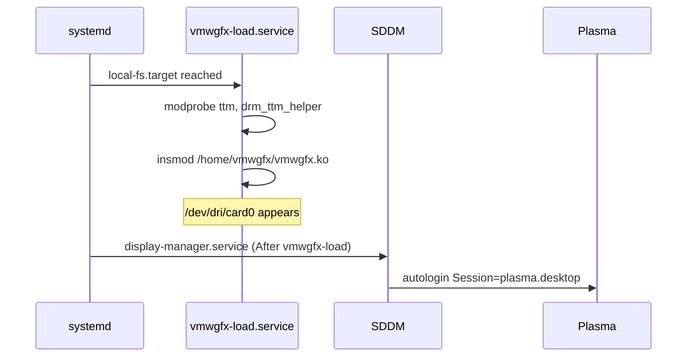

# Étape 5 · Démarrage automatique du bureau

[English](../README.md) | [한국어](README.ko.md) | [日本語](README.ja.md) | [简体中文](README.zh-CN.md) | [Español](README.es.md) | **Français**

  

Faire charger le pilote vmwgfx au SteamOS installé à chaque démarrage, et ouvrir une session en mode bureau plutôt qu'en mode jeu.

## Sommaire

- [Vue d'ensemble](#vue-densemble)
- [Prérequis](#prérequis)
- [Étapes](#étapes)
  - [5-1. Entrer dans le système installé](#5-1-entrer-dans-le-système-installé)
  - [5-2. Chargement auto du pilote et connexion au bureau (jeu B)](#5-2-chargement-auto-du-pilote-et-connexion-au-bureau-jeu-b)
  - [5-3. Répéter pour le jeu A](#5-3-répéter-pour-le-jeu-a)
  - [5-4. Placer le pilote sur la partition home partagée](#5-4-placer-le-pilote-sur-la-partition-home-partagée)
  - [5-5. Démarrer le système installé](#5-5-démarrer-le-système-installé)
- [Vérification](#vérification)
- [Suite](#suite)

---

## Vue d'ensemble

Le système installé affiche un écran noir pour deux raisons :

1. Le pilote vmwgfx est absent.
2. La connexion automatique vise le **mode jeu** (`gamescope-wayland.desktop`), qui ne peut pas fonctionner dans VMware.

Les deux se règlent uniquement avec des fichiers dans `/etc` et `/home` ; le système en lecture seule reste intact.



## Prérequis

- [ ] [Étape 4](../../04-Install-SteamOS/README/README.fr.md) terminée — SteamOS installé sur le NVMe
- [ ] Démarré sur le disque de **récupération** (SATA 0.0) avec SSH

---

## Étapes

### 5-1. Entrer dans le système installé

```bash
sudo mount /dev/sdb /mnt/build            # work disk again (check with lsblk)
tail -15 /mnt/build/install.log
sudo ~/tools/repair_device.sh chroot
```

Dans le chroot, examinez la configuration de session actuelle :

```bash
cat /etc/sddm.conf.d/*.conf
ls /usr/share/wayland-sessions /usr/share/xsessions
df -h /home /var
```


| Vérification | Résultat |
| --- | --- |
| Installation | `Creating Boot0006 SteamOS` — terminée |
| Connexion automatique | `Session=gamescope-wayland.desktop` — mode jeu |
| Nom de la session bureau | **`plasma.desktop`** |
| Cible du chroot | Jeu de partitions **B** |

> [!IMPORTANT]
> SteamOS conserve deux copies du système (A et B) et bascule de l'une à l'autre à chaque mise à jour. Appliquez les mêmes réglages aux **deux**.

### 5-2. Chargement auto du pilote et connexion au bureau (jeu B)

Collez dans le chroot :

```bash
cat > /etc/systemd/system/vmwgfx-load.service <<'EOF'
[Unit]
Description=Load custom vmwgfx driver for VMware
DefaultDependencies=no
ConditionVirtualization=vmware
RequiresMountsFor=/home/vmwgfx
After=local-fs.target
Before=display-manager.service

[Service]
Type=oneshot
RemainAfterExit=yes
ExecStart=/usr/bin/modprobe ttm
ExecStart=/usr/bin/modprobe drm_ttm_helper
ExecStart=-/usr/bin/insmod /home/vmwgfx/vmwgfx.ko

[Install]
WantedBy=multi-user.target
EOF
systemctl enable vmwgfx-load.service

cat > /etc/sddm.conf.d/zzz-vmware-desktop.conf <<'EOF'
[Autologin]
Relogin=true
Session=plasma.desktop
User=deck
EOF
systemctl enable sshd
passwd deck
exit
```

| Fichier | Rôle |
| --- | --- |
| `vmwgfx-load.service` | Charge le pilote avant le gestionnaire d'affichage. Ne s'exécute que sous VMware (`ConditionVirtualization`) ; un échec ne bloque jamais le démarrage (`-insmod`) |
| `zzz-vmware-desktop.conf` | Connexion automatique à Plasma. Le préfixe `zzz` est lu en dernier et remplace la configuration d'origine |
| `sshd`, `passwd` | Accès SSH au système installé |

Les mêmes fichiers sont dans [vmware/](../../../../vmware).

### 5-3. Répéter pour le jeu A

```bash
sudo steamos-chroot --disk /dev/nvme0n1 --partset A
# paste the 5-2 block again, then exit
```

### 5-4. Placer le pilote sur la partition home partagée

A et B montent la même partition home (`nvme0n1p8`), où le module devient `/home/vmwgfx/vmwgfx.ko`.

```bash
sudo mkdir -p /mnt/nvhome
sudo mount /dev/nvme0n1p8 /mnt/nvhome
sudo mkdir -p /mnt/nvhome/vmwgfx
sudo cp /mnt/build/linux-6.16.12/drivers/gpu/drm/vmwgfx/vmwgfx.ko /mnt/nvhome/vmwgfx/
ls -lh /mnt/nvhome/vmwgfx
sudo umount /mnt/nvhome
```

> [!WARNING]
> Sans cette étape, le système installé reste noir avec `insmod: … No such file or directory` ([T8](../../../04-Troubleshooting/README/README.fr.md#t8)).

### 5-5. Démarrer le système installé

```bash
sudo systemctl poweroff
```

Choisissez **Boot Manager → SteamOS**. Le bureau met **1 à 2 minutes** à apparaître.


Les icônes « Return to Gaming Mode » et « Steam » sur le bureau confirment qu'il s'agit de l'installation NVMe.

> [!CAUTION]
> Ne cliquez pas sur **Return to Gaming Mode** dans VMware ([T15](../../../04-Troubleshooting/README/README.fr.md#t15)).

---

## Vérification

- [ ] Le bureau apparaît sans intervention après un redémarrage
- [ ] `systemctl status vmwgfx-load.service` est `active (exited)` et `ls /dev/dri` affiche `card0`

> [!TIP]
> C'est l'état de référence pour les tests. Après avoir ajouté votre clé SSH à l'[étape 6](../../06-Run-Unattended/README/README.fr.md), enregistrez-le en instantané `clean-install`.

## Suite

[Étape 6 · Lancer SteamOS-Unattended →](../../06-Run-Unattended/README/README.fr.md)
