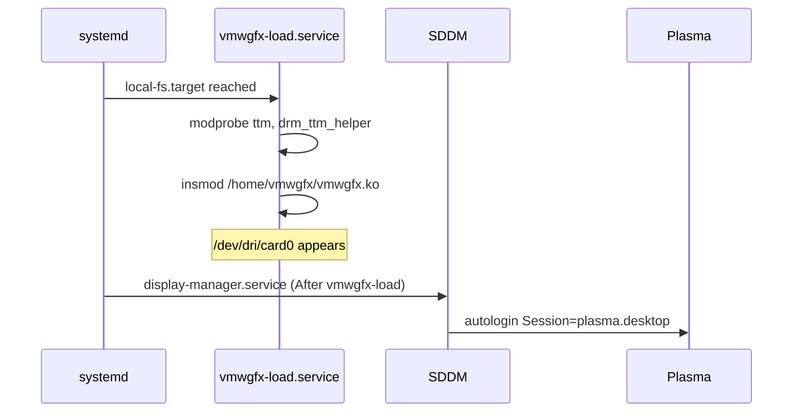

# ステップ 5 · デスクトップの自動起動

[English](../README.md) | [한국어](README.ko.md) | **日本語** | [简体中文](README.zh-CN.md) | [Español](README.es.md) | [Français](README.fr.md)

  

インストール後の SteamOS が起動のたびに vmwgfx ドライバーを読み込み、ゲームモードではなくデスクトップモードにログインするようにします。

## 目次

- [概要](#概要)
- [前提条件](#前提条件)
- [手順](#手順)
  - [5-1. インストール後のシステムに入る](#5-1-インストール後のシステムに入る)
  - [5-2. ドライバーの自動読み込みとデスクトップ自動ログイン（セット B）](#5-2-ドライバーの自動読み込みとデスクトップ自動ログインセット-b)
  - [5-3. セット A でも繰り返す](#5-3-セット-a-でも繰り返す)
  - [5-4. ドライバーを共有の home パーティションに置く](#5-4-ドライバーを共有の-home-パーティションに置く)
  - [5-5. インストール後のシステムを起動する](#5-5-インストール後のシステムを起動する)
- [確認](#確認)
- [次へ](#次へ)

---

## 概要

インストール後のシステムが黒い画面になる理由は 2 つです。

1. vmwgfx ドライバーがない。
2. 自動ログイン先が **ゲームモード**（`gamescope-wayland.desktop`）で、VMware では動作しない。

どちらも `/etc` と `/home` のファイルだけで解決し、読み取り専用のシステムには触れません。



## 前提条件

- [ ] [ステップ 4](../../04-Install-SteamOS/README/README.ja.md) 完了 — NVMe に SteamOS がインストール済み
- [ ] **リカバリー** ディスク（SATA 0.0）から起動し、SSH で接続していること

---

## 手順

### 5-1. インストール後のシステムに入る

```bash
sudo mount /dev/sdb /mnt/build            # work disk again (check with lsblk)
tail -15 /mnt/build/install.log
sudo ~/tools/repair_device.sh chroot
```

chroot の中で、現在のセッション設定を確認します。

```bash
cat /etc/sddm.conf.d/*.conf
ls /usr/share/wayland-sessions /usr/share/xsessions
df -h /home /var
```


| 確認 | 結果 |
| --- | --- |
| インストール | `Creating Boot0006 SteamOS` — 完了 |
| 自動ログイン | `Session=gamescope-wayland.desktop` — ゲームモード |
| デスクトップセッション名 | **`plasma.desktop`** |
| chroot 対象 | パーティションセット **B** |

> [!IMPORTANT]
> SteamOS はシステムを 2 組（A と B）持ち、アップデートのたびに切り替えます。同じ設定を **両方** に適用してください。

### 5-2. ドライバーの自動読み込みとデスクトップ自動ログイン（セット B）

chroot の中に貼り付けます。

```bash
cat > /etc/systemd/system/vmwgfx-load.service <<'EOF'
[Unit]
Description=Load custom vmwgfx driver for VMware
DefaultDependencies=no
ConditionVirtualization=vmware
RequiresMountsFor=/home/vmwgfx
After=local-fs.target
Before=display-manager.service

[Service]
Type=oneshot
RemainAfterExit=yes
ExecStart=/usr/bin/modprobe ttm
ExecStart=/usr/bin/modprobe drm_ttm_helper
ExecStart=-/usr/bin/insmod /home/vmwgfx/vmwgfx.ko

[Install]
WantedBy=multi-user.target
EOF
systemctl enable vmwgfx-load.service

cat > /etc/sddm.conf.d/zzz-vmware-desktop.conf <<'EOF'
[Autologin]
Relogin=true
Session=plasma.desktop
User=deck
EOF
systemctl enable sshd
passwd deck
exit
```

| ファイル | 役割 |
| --- | --- |
| `vmwgfx-load.service` | ディスプレイマネージャーより先にドライバーを読み込む。VMware でのみ実行（`ConditionVirtualization`）、失敗しても起動を妨げない（`-insmod`） |
| `zzz-vmware-desktop.conf` | Plasma に自動ログイン。`zzz` で始まるので最後に読まれ、標準設定より優先される |
| `sshd`、`passwd` | インストール後のシステムに SSH で接続できるようにする |

同じファイルが [vmware/](../../../../vmware) にあります。

### 5-3. セット A でも繰り返す

```bash
sudo steamos-chroot --disk /dev/nvme0n1 --partset A
# paste the 5-2 block again, then exit
```

### 5-4. ドライバーを共有の home パーティションに置く

A と B は同じ home パーティション（`nvme0n1p8`）をマウントし、モジュールのパスは `/home/vmwgfx/vmwgfx.ko` になります。

```bash
sudo mkdir -p /mnt/nvhome
sudo mount /dev/nvme0n1p8 /mnt/nvhome
sudo mkdir -p /mnt/nvhome/vmwgfx
sudo cp /mnt/build/linux-6.16.12/drivers/gpu/drm/vmwgfx/vmwgfx.ko /mnt/nvhome/vmwgfx/
ls -lh /mnt/nvhome/vmwgfx
sudo umount /mnt/nvhome
```

> [!WARNING]
> この手順を飛ばすと、インストール後のシステムが `insmod: … No such file or directory` で黒い画面のままになります（[T8](../../../04-Troubleshooting/README/README.ja.md#t8)）。

### 5-5. インストール後のシステムを起動する

```bash
sudo systemctl poweroff
```

**Boot Manager → SteamOS** を選びます。デスクトップの表示まで **1〜2 分** かかります。


デスクトップの「Return to Gaming Mode」と「Steam」のアイコンが、NVMe のインストールである目印です。

> [!CAUTION]
> VMware では **Return to Gaming Mode** をクリックしないでください（[T15](../../../04-Troubleshooting/README/README.ja.md#t15)）。

---

## 確認

- [ ] 再起動後、何も操作せずにデスクトップが表示される
- [ ] `systemctl status vmwgfx-load.service` が `active (exited)` で、`ls /dev/dri` に `card0` がある

> [!TIP]
> これがテストの基準状態です。[ステップ 6](../../06-Run-Unattended/README/README.ja.md) で SSH 鍵を登録した後、`clean-install` としてスナップショットを取ってください。

## 次へ

[ステップ 6 · SteamOS-Unattended の実行 →](../../06-Run-Unattended/README/README.ja.md)
