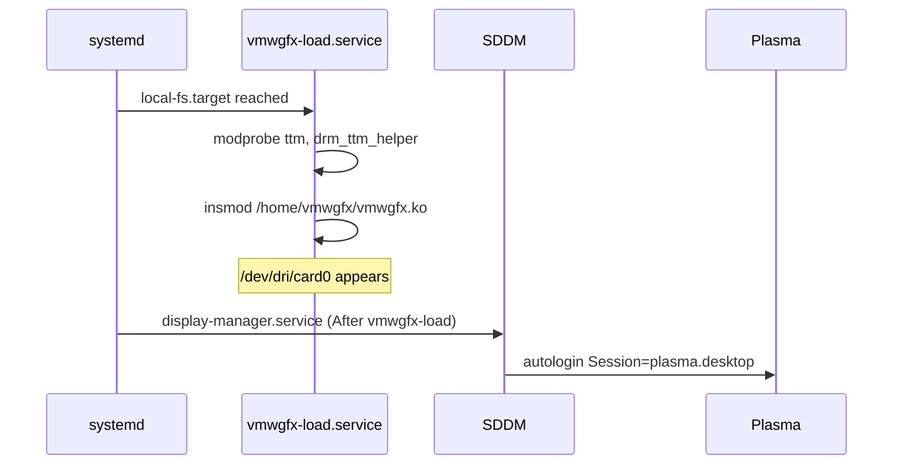
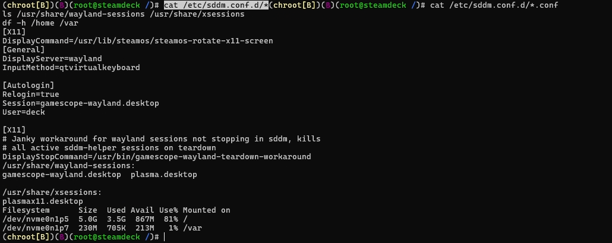

# 5단계 · 데스크톱 자동 실행

[English](../README.md) | **한국어** | [日本語](README.ja.md) | [简体中文](README.zh-CN.md) | [Español](README.es.md) | [Français](README.fr.md)

  

설치된 SteamOS가 부팅할 때마다 vmwgfx 드라이버를 로드하고, 게임 모드 대신 데스크톱 모드로 로그인하게 만듭니다.

## 목차

- [개요](#개요)
- [준비물](#준비물)
- [진행](#진행)
  - [5-1. 설치본 안으로 들어가기](#5-1-설치본-안으로-들어가기)
  - [5-2. 드라이버 자동 로드와 데스크톱 자동 로그인 (B 세트)](#5-2-드라이버-자동-로드와-데스크톱-자동-로그인-b-세트)
  - [5-3. A 세트에도 반복](#5-3-a-세트에도-반복)
  - [5-4. 드라이버를 공용 home 파티션에 넣기](#5-4-드라이버를-공용-home-파티션에-넣기)
  - [5-5. 설치본으로 부팅](#5-5-설치본으로-부팅)
- [확인](#확인)
- [다음 단계](#다음-단계)

---

## 개요

설치본이 검은 화면인 이유는 두 가지입니다.

1. vmwgfx 드라이버가 없습니다.
2. 자동 로그인 대상이 **게임 모드**(`gamescope-wayland.desktop`)인데, 게임 모드는 VMware에서 실행되지 않습니다.

둘 다 `/etc` 와 `/home` 의 파일만으로 해결합니다. 읽기 전용 시스템은 건드리지 않습니다.



## 준비물

- [ ] [4단계](../../04-Install-SteamOS/README/README.ko.md) 완료 — NVMe에 SteamOS 설치됨
- [ ] **복구** 디스크(SATA 0.0)로 부팅해 SSH 접속한 상태

---

## 진행

### 5-1. 설치본 안으로 들어가기

```bash
sudo mount /dev/sdb /mnt/build            # work disk again (check with lsblk)
tail -15 /mnt/build/install.log
sudo ~/tools/repair_device.sh chroot
```

chroot 안에서 현재 세션 설정을 확인합니다.

```bash
cat /etc/sddm.conf.d/*.conf
ls /usr/share/wayland-sessions /usr/share/xsessions
df -h /home /var
```




| 확인 | 결과 |
| --- | --- |
| 설치 | `Creating Boot0006 SteamOS` — 완료 |
| 자동 로그인 | `Session=gamescope-wayland.desktop` — 게임 모드 |
| 데스크톱 세션 이름 | **`plasma.desktop`** |
| chroot 대상 | 파티션 세트 **B** |

> [!IMPORTANT]
> SteamOS는 시스템을 두 벌(A, B) 두고 업데이트 때 번갈아 씁니다. 같은 설정을 **양쪽 모두**에 넣으세요.

### 5-2. 드라이버 자동 로드와 데스크톱 자동 로그인 (B 세트)

chroot 안에서 붙여 넣습니다.

```bash
cat > /etc/systemd/system/vmwgfx-load.service <<'EOF'
[Unit]
Description=Load custom vmwgfx driver for VMware
DefaultDependencies=no
ConditionVirtualization=vmware
RequiresMountsFor=/home/vmwgfx
After=local-fs.target
Before=display-manager.service

[Service]
Type=oneshot
RemainAfterExit=yes
ExecStart=/usr/bin/modprobe ttm
ExecStart=/usr/bin/modprobe drm_ttm_helper
ExecStart=-/usr/bin/insmod /home/vmwgfx/vmwgfx.ko

[Install]
WantedBy=multi-user.target
EOF
systemctl enable vmwgfx-load.service

cat > /etc/sddm.conf.d/zzz-vmware-desktop.conf <<'EOF'
[Autologin]
Relogin=true
Session=plasma.desktop
User=deck
EOF
systemctl enable sshd
passwd deck
exit
```

| 파일 | 역할 |
| --- | --- |
| `vmwgfx-load.service` | 화면 관리자보다 먼저 드라이버를 로드합니다. VMware에서만 실행되고(`ConditionVirtualization`), 실패해도 부팅을 막지 않습니다(`-insmod`) |
| `zzz-vmware-desktop.conf` | Plasma로 자동 로그인합니다. `zzz` 로 시작해 마지막에 읽히므로 기본 설정보다 우선합니다 |
| `sshd`, `passwd` | 설치본에 SSH로 접속할 수 있게 합니다 |

같은 파일이 [vmware/](../../../../vmware) 폴더에 있습니다.

### 5-3. A 세트에도 반복

```bash
sudo steamos-chroot --disk /dev/nvme0n1 --partset A
# paste the 5-2 block again, then exit
```

### 5-4. 드라이버를 공용 home 파티션에 넣기

A와 B는 같은 home 파티션(`nvme0n1p8`)을 쓰며, 설치본에서 모듈 경로는 `/home/vmwgfx/vmwgfx.ko` 가 됩니다.

```bash
sudo mkdir -p /mnt/nvhome
sudo mount /dev/nvme0n1p8 /mnt/nvhome
sudo mkdir -p /mnt/nvhome/vmwgfx
sudo cp /mnt/build/linux-6.16.12/drivers/gpu/drm/vmwgfx/vmwgfx.ko /mnt/nvhome/vmwgfx/
ls -lh /mnt/nvhome/vmwgfx
sudo umount /mnt/nvhome
```

> [!WARNING]
> 이 단계를 빠뜨리면 설치본이 `insmod: … No such file or directory` 와 함께 검은 화면이 됩니다([T8](../../../04-Troubleshooting/README/README.ko.md#t8)).

### 5-5. 설치본으로 부팅

```bash
sudo systemctl poweroff
```

**Boot Manager → SteamOS** 를 고릅니다. 데스크톱이 뜨기까지 **1~2분** 걸립니다.


바탕화면의 "Return to Gaming Mode" 와 "Steam" 아이콘이 NVMe 설치본이라는 표시입니다.

> [!CAUTION]
> VMware에서는 **Return to Gaming Mode** 를 누르지 마세요([T15](../../../04-Troubleshooting/README/README.ko.md#t15)).

---

## 확인

- [ ] 재부팅 후 아무 조작 없이 데스크톱이 뜸
- [ ] `systemctl status vmwgfx-load.service` 가 `active (exited)` 이고 `ls /dev/dri` 에 `card0` 이 있음

> [!TIP]
> 이 상태가 테스트의 기준점입니다. [6단계](../../06-Run-Unattended/README/README.ko.md)에서 SSH 키를 넣은 뒤 `clean-install` 스냅샷으로 저장하세요.

## 다음 단계

[6단계 · SteamOS-Unattended 실행 →](../../06-Run-Unattended/README/README.ko.md)
