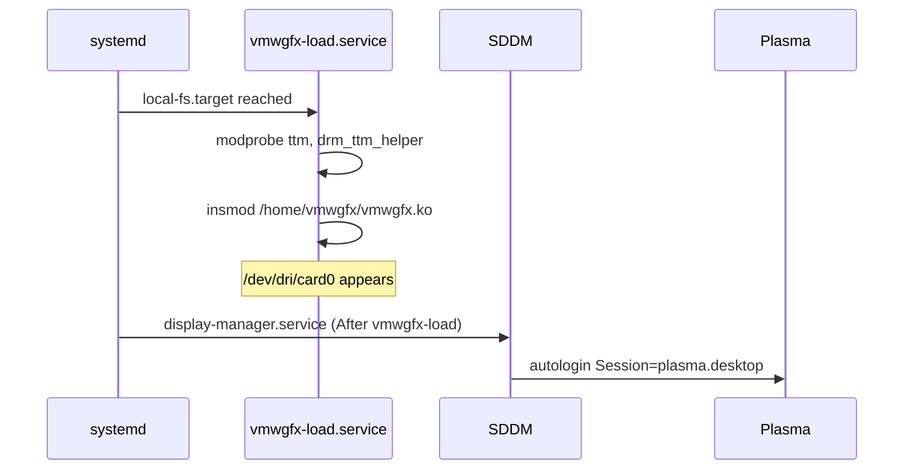

# 第 5 步 · 桌面自动启动

[English](../README.md) | [한국어](README.ko.md) | [日本語](README.ja.md) | **简体中文** | [Español](README.es.md) | [Français](README.fr.md)

  

让安装后的 SteamOS 在每次启动时加载 vmwgfx 驱动，并登录桌面模式而不是游戏模式。

## 目录

- [概述](#概述)
- [前提条件](#前提条件)
- [步骤](#步骤)
  - [5-1. 进入安装后的系统](#5-1-进入安装后的系统)
  - [5-2. 驱动自动加载与桌面自动登录（B 组）](#5-2-驱动自动加载与桌面自动登录b-组)
  - [5-3. 对 A 组重复操作](#5-3-对-a-组重复操作)
  - [5-4. 把驱动放到共享的 home 分区](#5-4-把驱动放到共享的-home-分区)
  - [5-5. 启动安装后的系统](#5-5-启动安装后的系统)
- [验证](#验证)
- [下一步](#下一步)

---

## 概述

安装后的系统黑屏有两个原因：

1. 没有 vmwgfx 驱动。
2. 自动登录的目标是 **游戏模式**（`gamescope-wayland.desktop`），而它无法在 VMware 中运行。

两者都只用 `/etc` 和 `/home` 中的文件解决，只读系统保持不变。



## 前提条件

- [ ] 已完成 [第 4 步](../../04-Install-SteamOS/README/README.zh-CN.md) — SteamOS 已安装到 NVMe
- [ ] 已从 **恢复** 盘（SATA 0.0）启动并通过 SSH 连接

---

## 步骤

### 5-1. 进入安装后的系统

```bash
sudo mount /dev/sdb /mnt/build            # work disk again (check with lsblk)
tail -15 /mnt/build/install.log
sudo ~/tools/repair_device.sh chroot
```

在 chroot 中查看当前的会话设置：

```bash
cat /etc/sddm.conf.d/*.conf
ls /usr/share/wayland-sessions /usr/share/xsessions
df -h /home /var
```


| 检查项 | 结果 |
| --- | --- |
| 安装 | `Creating Boot0006 SteamOS` — 已完成 |
| 自动登录 | `Session=gamescope-wayland.desktop` — 游戏模式 |
| 桌面会话名称 | **`plasma.desktop`** |
| chroot 目标 | 分区组 **B** |

> [!IMPORTANT]
> SteamOS 保留两套系统（A 和 B），更新时在两者之间切换。请把相同的设置应用到 **两套** 上。

### 5-2. 驱动自动加载与桌面自动登录（B 组）

在 chroot 中粘贴：

```bash
cat > /etc/systemd/system/vmwgfx-load.service <<'EOF'
[Unit]
Description=Load custom vmwgfx driver for VMware
DefaultDependencies=no
ConditionVirtualization=vmware
RequiresMountsFor=/home/vmwgfx
After=local-fs.target
Before=display-manager.service

[Service]
Type=oneshot
RemainAfterExit=yes
ExecStart=/usr/bin/modprobe ttm
ExecStart=/usr/bin/modprobe drm_ttm_helper
ExecStart=-/usr/bin/insmod /home/vmwgfx/vmwgfx.ko

[Install]
WantedBy=multi-user.target
EOF
systemctl enable vmwgfx-load.service

cat > /etc/sddm.conf.d/zzz-vmware-desktop.conf <<'EOF'
[Autologin]
Relogin=true
Session=plasma.desktop
User=deck
EOF
systemctl enable sshd
passwd deck
exit
```

| 文件 | 作用 |
| --- | --- |
| `vmwgfx-load.service` | 在显示管理器之前加载驱动。仅在 VMware 中运行（`ConditionVirtualization`），失败也不会阻止启动（`-insmod`） |
| `zzz-vmware-desktop.conf` | 自动登录 Plasma。以 `zzz` 开头所以最后读取，优先于默认配置 |
| `sshd`、`passwd` | 可以通过 SSH 访问安装后的系统 |

相同的文件位于 [vmware/](../../../../vmware)。

### 5-3. 对 A 组重复操作

```bash
sudo steamos-chroot --disk /dev/nvme0n1 --partset A
# paste the 5-2 block again, then exit
```

### 5-4. 把驱动放到共享的 home 分区

A 和 B 挂载同一个 home 分区（`nvme0n1p8`），模块路径为 `/home/vmwgfx/vmwgfx.ko`。

```bash
sudo mkdir -p /mnt/nvhome
sudo mount /dev/nvme0n1p8 /mnt/nvhome
sudo mkdir -p /mnt/nvhome/vmwgfx
sudo cp /mnt/build/linux-6.16.12/drivers/gpu/drm/vmwgfx/vmwgfx.ko /mnt/nvhome/vmwgfx/
ls -lh /mnt/nvhome/vmwgfx
sudo umount /mnt/nvhome
```

> [!WARNING]
> 跳过这一步，安装后的系统会因 `insmod: … No such file or directory` 而黑屏（[T8](../../../04-Troubleshooting/README/README.zh-CN.md#t8)）。

### 5-5. 启动安装后的系统

```bash
sudo systemctl poweroff
```

选择 **Boot Manager → SteamOS**。桌面出现需要 **1～2 分钟**。


桌面上的 "Return to Gaming Mode" 和 "Steam" 图标说明这是 NVMe 上的安装。

> [!CAUTION]
> 在 VMware 中不要点击 **Return to Gaming Mode**（[T15](../../../04-Troubleshooting/README/README.zh-CN.md#t15)）。

---

## 验证

- [ ] 重启后无需任何操作即可显示桌面
- [ ] `systemctl status vmwgfx-load.service` 为 `active (exited)`，`ls /dev/dri` 中有 `card0`

> [!TIP]
> 这是测试的基准状态。在 [第 6 步](../../06-Run-Unattended/README/README.zh-CN.md) 添加 SSH 密钥后，将其保存为 `clean-install` 快照。

## 下一步

[第 6 步 · 运行 SteamOS-Unattended →](../../06-Run-Unattended/README/README.zh-CN.md)
