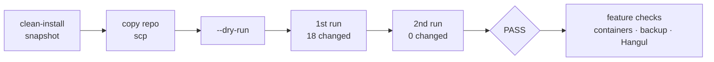

# Step 6 · Run SteamOS-Unattended

**English** | [한국어](README/README.ko.md) | [日本語](README/README.ja.md) | [简体中文](README/README.zh-CN.md) | [Español](README/README.es.md) | [Français](README/README.fr.md)

  

Run the script on a clean SteamOS, prove that a second run changes nothing (idempotency), then check every feature for real.

> [!TIP]
> **On a real Steam Deck** you only need this one line in Konsole (Desktop Mode). Add `--dry-run` first to preview.
>
> ```bash
> curl -fsSL https://raw.githubusercontent.com/jongwooish/SteamOS-Unattended/main/install.sh | bash -s -- --profile full
> ```

## Contents

- [Overview](#overview)
- [Prerequisites](#prerequisites)
- [Steps](#steps)
  - [6-1. Check the connection](#6-1-check-the-connection)
  - [6-2. Register an SSH key and take a snapshot](#6-2-register-an-ssh-key-and-take-a-snapshot)
  - [6-3. Get the repository](#6-3-get-the-repository)
  - [6-4. Automated test (with snapshot)](#6-4-automated-test-with-snapshot)
  - [6-5. Manual run (without snapshot)](#6-5-manual-run-without-snapshot)
  - [6-6. Feature checks](#6-6-feature-checks)
  - [6-7. Hangul input](#6-7-hangul-input)
- [Verification](#verification)
- [Next](#next)

---

## Overview

The rest of this page uses the VMware test VM from Steps 1–5, driven from **Windows PowerShell** on the host.



> [!IMPORTANT]
> Every command below runs at the `PS C:\…>` prompt. If you see `(deck@steamdeck ~)$`, you are inside the VM — type `exit` first ([T12](../../04-Troubleshooting/README.md#t12)).

## Prerequisites

- [ ] [Step 5](../05-Desktop-Autostart/README.md) completed — the installed system boots to the desktop
- [ ] The VM IP address (`ip -4 a` in the VM). This guide uses `192.168.126.133`
- [ ] Git or the repository ZIP on the host

---

## Steps

### 6-1. Check the connection

```powershell
ssh deck@192.168.126.133 "cat /etc/os-release | grep VERSION_ID; uname -r"
```


### 6-2. Register an SSH key and take a snapshot

The automated test must never stop for a password.

```powershell
ssh-keygen -t ed25519
type $env:USERPROFILE\.ssh\id_ed25519.pub | ssh deck@192.168.126.133 "mkdir -p ~/.ssh && chmod 700 ~/.ssh && cat >> ~/.ssh/authorized_keys && chmod 600 ~/.ssh/authorized_keys"
ssh -o BatchMode=yes deck@192.168.126.133 "echo KEY_OK"
```


`KEY_OK` without a password prompt means success. Save this state as the `clean-install` snapshot:

```powershell
$vmrun = "C:\Program Files (x86)\VMware\VMware Workstation\vmrun.exe"
$vmx   = "D:\VMs\SteamOS\SteamOS.vmx"   # your own path
& $vmrun -T ws snapshot $vmx clean-install
& $vmrun -T ws listSnapshots $vmx
```

> [!NOTE]
> Find the exact `.vmx` path with `& $vmrun list` (running VMs) — see [T10](../../04-Troubleshooting/README.md#t10).

### 6-3. Get the repository

```powershell
git clone https://github.com/jongwooish/SteamOS-Unattended.git C:\VMs\steamos-unattended
```

<details>
<summary>Downloaded as ZIP instead</summary>

```powershell
Expand-Archive -Path "$env:USERPROFILE\Downloads\SteamOS-Unattended-main.zip" -DestinationPath C:\VMs -Force
Rename-Item C:\VMs\SteamOS-Unattended-main steamos-unattended
dir C:\VMs\steamos-unattended
```


</details>

### 6-4. Automated test (with snapshot)

```powershell
cd C:\VMs\steamos-unattended
powershell -ExecutionPolicy Bypass -File .\tests\vm-test.ps1 -Vmx $vmx
```

[`tests/vm-test.ps1`](../../../tests/vm-test.ps1) reverts the snapshot, waits for SSH, copies the repository, runs `--dry-run`, the first run and a second run, and prints **PASS** when the last run reports 0 changes.

<a id="manual-run"></a>

### 6-5. Manual run (without snapshot)

```powershell
ssh deck@192.168.126.133 "rm -rf ~/steamos-unattended"
scp -r C:\VMs\steamos-unattended deck@192.168.126.133:~/steamos-unattended
ssh deck@192.168.126.133 "chmod +x ~/steamos-unattended/install.sh ~/steamos-unattended/modules/*.sh ~/steamos-unattended/lib/*.sh"

ssh -t deck@192.168.126.133 "cd ~/steamos-unattended && ./install.sh --profile full --dry-run"
ssh -t deck@192.168.126.133 "cd ~/steamos-unattended && ./install.sh --profile full"
```

**First run — 18 changed, 0 failed**


`flathub (--user)` is already done because SteamOS ships with the user-level Flathub remote. The final module, `60-etc-keep`, asks for the deck password once.

**Second run — 0 changed (idempotent)**

```powershell
ssh -t deck@192.168.126.133 "cd ~/steamos-unattended && ./install.sh --profile full"
```


Every item reports already done, and sudo is not requested at all.

### 6-6. Feature checks

```powershell
ssh deck@192.168.126.133 "distrobox enter netkit -- nmap --version | head -1; distrobox enter devbox -- git --version; systemctl --user list-timers su-backup.timer --no-pager; ~/.local/bin/su-backup; ls ~/Backups"
```


| Check | Result |
| --- | --- |
| `netkit` container | `Nmap version 7.95` |
| `devbox` container | `git version 2.56.1` |
| Manual backup | `…tar.gz (36K)` created |
| Scheduled backup | Timer `LAST 00:02:29` matches `backup-…-000229.tar.gz` → **ran on its own at midnight** |

> [!NOTE]
> The `Starting container… [ OK ]` lines on the first `distrobox enter` are distrobox's one-time initialization.

### 6-7. Hangul input

The input method applies from the **next login**. Log out from the Start menu, log back in, then press **Ctrl+Space** in the Firefox address bar and type.


The fcitx5 icon in the system tray means the input method is running.

> [!WARNING]
> Seeing Korean text on screen is not the same as being able to type it ([T13](../../04-Troubleshooting/README.md#t13)).

---

## Verification

- [ ] The first run ends with `failed 0`
- [ ] The second run ends with `changed 0` and no sudo prompt
- [ ] `nmap` and `git` run inside their containers
- [ ] `~/Backups` contains a backup created by the timer
- [ ] Ctrl+Space switches to Hangul and Korean can be typed

> [!TIP]
> To test again from scratch, revert to `clean-install`: `& $vmrun -T ws revertToSnapshot $vmx clean-install`.

## Next

Configuration is complete. If something went wrong, see [Troubleshooting](../../04-Troubleshooting/README.md); to understand why each file lives where it does, read [Filesystem](../../05-Filesystem/README.md).
