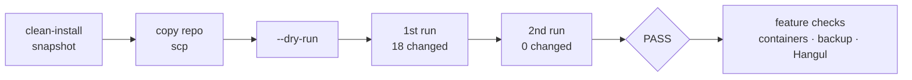

# Paso 6 · Ejecutar SteamOS-Unattended

[English](../README.md) | [한국어](README.ko.md) | [日本語](README.ja.md) | [简体中文](README.zh-CN.md) | **Español** | [Français](README.fr.md)

  

Ejecuta el script en un SteamOS limpio, demuestra que una segunda ejecución no cambia nada (idempotencia) y comprueba de verdad cada función.

> [!TIP]
> **En una Steam Deck real** basta con esta línea en Konsole (modo escritorio). Añade primero `--dry-run` para previsualizar.
>
> ```bash
> curl -fsSL https://raw.githubusercontent.com/jongwooish/SteamOS-Unattended/main/install.sh | bash -s -- --profile full
> ```

## Índice

- [Descripción general](#descripción-general)
- [Requisitos previos](#requisitos-previos)
- [Pasos](#pasos)
  - [6-1. Comprobar la conexión](#6-1-comprobar-la-conexión)
  - [6-2. Registrar una clave SSH y crear una instantánea](#6-2-registrar-una-clave-ssh-y-crear-una-instantánea)
  - [6-3. Obtener el repositorio](#6-3-obtener-el-repositorio)
  - [6-4. Prueba automática (con instantánea)](#6-4-prueba-automática-con-instantánea)
  - [6-5. Ejecución manual (sin instantánea)](#6-5-ejecución-manual-sin-instantánea)
  - [6-6. Comprobación de funciones](#6-6-comprobación-de-funciones)
  - [6-7. Entrada en hangul](#6-7-entrada-en-hangul)
- [Verificación](#verificación)
- [Siguiente](#siguiente)

---

## Descripción general

El resto de esta página usa la VM de prueba de VMware de los pasos 1–5, manejada desde **Windows PowerShell** en el anfitrión.



> [!IMPORTANT]
> Todos los comandos se ejecutan en el prompt `PS C:\…>`. Si ves `(deck@steamdeck ~)$`, estás dentro de la VM: escribe primero `exit` ([T12](../../../04-Troubleshooting/README/README.es.md#t12)).

## Requisitos previos

- [ ] [Paso 5](../../05-Desktop-Autostart/README/README.es.md) completado — el sistema instalado arranca al escritorio
- [ ] La IP de la VM (`ip -4 a` en la VM). Esta guía usa `192.168.126.133`
- [ ] Git o el ZIP del repositorio en el anfitrión

---

## Pasos

### 6-1. Comprobar la conexión

```powershell
ssh deck@192.168.126.133 "cat /etc/os-release | grep VERSION_ID; uname -r"
```


### 6-2. Registrar una clave SSH y crear una instantánea

La prueba automática nunca debe detenerse a pedir una contraseña.

```powershell
ssh-keygen -t ed25519
type $env:USERPROFILE\.ssh\id_ed25519.pub | ssh deck@192.168.126.133 "mkdir -p ~/.ssh && chmod 700 ~/.ssh && cat >> ~/.ssh/authorized_keys && chmod 600 ~/.ssh/authorized_keys"
ssh -o BatchMode=yes deck@192.168.126.133 "echo KEY_OK"
```


`KEY_OK` sin pedir contraseña significa éxito. Guarda este estado como la instantánea `clean-install`:

```powershell
$vmrun = "C:\Program Files (x86)\VMware\VMware Workstation\vmrun.exe"
$vmx   = "D:\VMs\SteamOS\SteamOS.vmx"   # your own path
& $vmrun -T ws snapshot $vmx clean-install
& $vmrun -T ws listSnapshots $vmx
```

> [!NOTE]
> Encuentra la ruta exacta del `.vmx` con `& $vmrun list` (VMs en ejecución); consulta [T10](../../../04-Troubleshooting/README/README.es.md#t10).

### 6-3. Obtener el repositorio

```powershell
git clone https://github.com/jongwooish/SteamOS-Unattended.git C:\VMs\steamos-unattended
```

<details>
<summary>Si lo descargaste como ZIP</summary>

```powershell
Expand-Archive -Path "$env:USERPROFILE\Downloads\SteamOS-Unattended-main.zip" -DestinationPath C:\VMs -Force
Rename-Item C:\VMs\SteamOS-Unattended-main steamos-unattended
dir C:\VMs\steamos-unattended
```


</details>

### 6-4. Prueba automática (con instantánea)

```powershell
cd C:\VMs\steamos-unattended
powershell -ExecutionPolicy Bypass -File .\tests\vm-test.ps1 -Vmx $vmx
```

[`tests/vm-test.ps1`](../../../../tests/vm-test.ps1) restaura la instantánea, espera a SSH, copia el repositorio, ejecuta `--dry-run`, la primera y la segunda ejecución, e imprime **PASS** cuando la última informa 0 cambios.

<a id="manual-run"></a>

### 6-5. Ejecución manual (sin instantánea)

```powershell
ssh deck@192.168.126.133 "rm -rf ~/steamos-unattended"
scp -r C:\VMs\steamos-unattended deck@192.168.126.133:~/steamos-unattended
ssh deck@192.168.126.133 "chmod +x ~/steamos-unattended/install.sh ~/steamos-unattended/modules/*.sh ~/steamos-unattended/lib/*.sh"

ssh -t deck@192.168.126.133 "cd ~/steamos-unattended && ./install.sh --profile full --dry-run"
ssh -t deck@192.168.126.133 "cd ~/steamos-unattended && ./install.sh --profile full"
```

**Primera ejecución — 18 cambios, 0 fallos**


`flathub (--user)` aparece como ya hecho porque SteamOS incluye de serie el remoto Flathub de usuario. El último módulo, `60-etc-keep`, pide la contraseña de deck una vez.

**Segunda ejecución — 0 cambios (idempotente)**

```powershell
ssh -t deck@192.168.126.133 "cd ~/steamos-unattended && ./install.sh --profile full"
```


Todos los elementos aparecen como ya hechos y no se pide sudo en absoluto.

### 6-6. Comprobación de funciones

```powershell
ssh deck@192.168.126.133 "distrobox enter netkit -- nmap --version | head -1; distrobox enter devbox -- git --version; systemctl --user list-timers su-backup.timer --no-pager; ~/.local/bin/su-backup; ls ~/Backups"
```


| Comprobación | Resultado |
| --- | --- |
| Contenedor `netkit` | `Nmap version 7.95` |
| Contenedor `devbox` | `git version 2.56.1` |
| Copia manual | Se crea `…tar.gz (36K)` |
| Copia programada | El temporizador `LAST 00:02:29` coincide con `backup-…-000229.tar.gz` → **se ejecutó sola a medianoche** |

> [!NOTE]
> Las líneas `Starting container… [ OK ]` del primer `distrobox enter` son la inicialización única de distrobox.

### 6-7. Entrada en hangul

El método de entrada se aplica desde el **siguiente inicio de sesión**. Cierra sesión desde el menú Inicio, vuelve a entrar, pulsa **Ctrl+Space** en la barra de direcciones de Firefox y escribe.


El icono de fcitx5 en la bandeja del sistema indica que el método de entrada está activo.

> [!WARNING]
> *Ver* texto coreano en pantalla no es lo mismo que poder *escribirlo* ([T13](../../../04-Troubleshooting/README/README.es.md#t13)).

---

## Verificación

- [ ] La primera ejecución termina con `failed 0`
- [ ] La segunda termina con `changed 0` y sin pedir sudo
- [ ] `nmap` y `git` funcionan dentro de sus contenedores
- [ ] `~/Backups` contiene una copia creada por el temporizador
- [ ] Ctrl+Space cambia a hangul y se puede escribir coreano

> [!TIP]
> Para volver a probar desde cero, restaura `clean-install`: `& $vmrun -T ws revertToSnapshot $vmx clean-install`.

## Siguiente

La configuración está completa. Si algo falla, consulta [Solución de problemas](../../../04-Troubleshooting/README/README.es.md); para entender por qué cada archivo está donde está, lee [Sistema de archivos](../../../05-Filesystem/README/README.es.md).
