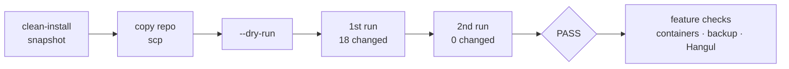

# Étape 6 · Lancer SteamOS-Unattended

[English](../README.md) | [한국어](README.ko.md) | [日本語](README.ja.md) | [简体中文](README.zh-CN.md) | [Español](README.es.md) | **Français**

  

Lancer le script sur un SteamOS propre, prouver qu'une deuxième exécution ne change rien (idempotence), puis vérifier réellement chaque fonction.

> [!TIP]
> **Sur un vrai Steam Deck**, cette seule ligne suffit dans Konsole (mode bureau). Ajoutez d'abord `--dry-run` pour prévisualiser.
>
> ```bash
> curl -fsSL https://raw.githubusercontent.com/jongwooish/SteamOS-Unattended/main/install.sh | bash -s -- --profile full
> ```

## Sommaire

- [Vue d'ensemble](#vue-densemble)
- [Prérequis](#prérequis)
- [Étapes](#étapes)
  - [6-1. Vérifier la connexion](#6-1-vérifier-la-connexion)
  - [6-2. Enregistrer une clé SSH et prendre un instantané](#6-2-enregistrer-une-clé-ssh-et-prendre-un-instantané)
  - [6-3. Récupérer le dépôt](#6-3-récupérer-le-dépôt)
  - [6-4. Test automatique (avec instantané)](#6-4-test-automatique-avec-instantané)
  - [6-5. Exécution manuelle (sans instantané)](#6-5-exécution-manuelle-sans-instantané)
  - [6-6. Vérification des fonctions](#6-6-vérification-des-fonctions)
  - [6-7. Saisie en hangeul](#6-7-saisie-en-hangeul)
- [Vérification](#vérification)
- [Suite](#suite)

---

## Vue d'ensemble

La suite de cette page utilise la VM de test VMware des étapes 1 à 5, pilotée depuis **Windows PowerShell** sur l'hôte.



> [!IMPORTANT]
> Toutes les commandes s'exécutent à l'invite `PS C:\…>`. Si vous voyez `(deck@steamdeck ~)$`, vous êtes dans la VM : tapez d'abord `exit` ([T12](../../../04-Troubleshooting/README/README.fr.md#t12)).

## Prérequis

- [ ] [Étape 5](../../05-Desktop-Autostart/README/README.fr.md) terminée — le système installé démarre sur le bureau
- [ ] L'adresse IP de la VM (`ip -4 a` dans la VM). Ce guide utilise `192.168.126.133`
- [ ] Git ou le ZIP du dépôt sur l'hôte

---

## Étapes

### 6-1. Vérifier la connexion

```powershell
ssh deck@192.168.126.133 "cat /etc/os-release | grep VERSION_ID; uname -r"
```


### 6-2. Enregistrer une clé SSH et prendre un instantané

Le test automatique ne doit jamais s'arrêter pour demander un mot de passe.

```powershell
ssh-keygen -t ed25519
type $env:USERPROFILE\.ssh\id_ed25519.pub | ssh deck@192.168.126.133 "mkdir -p ~/.ssh && chmod 700 ~/.ssh && cat >> ~/.ssh/authorized_keys && chmod 600 ~/.ssh/authorized_keys"
ssh -o BatchMode=yes deck@192.168.126.133 "echo KEY_OK"
```


`KEY_OK` sans demande de mot de passe signifie que tout est bon. Enregistrez cet état comme instantané `clean-install` :

```powershell
$vmrun = "C:\Program Files (x86)\VMware\VMware Workstation\vmrun.exe"
$vmx   = "D:\VMs\SteamOS\SteamOS.vmx"   # your own path
& $vmrun -T ws snapshot $vmx clean-install
& $vmrun -T ws listSnapshots $vmx
```

> [!NOTE]
> Trouvez le chemin exact du `.vmx` avec `& $vmrun list` (VM en cours d'exécution) ; voir [T10](../../../04-Troubleshooting/README/README.fr.md#t10).

### 6-3. Récupérer le dépôt

```powershell
git clone https://github.com/jongwooish/SteamOS-Unattended.git C:\VMs\steamos-unattended
```

<details>
<summary>Téléchargé en ZIP</summary>

```powershell
Expand-Archive -Path "$env:USERPROFILE\Downloads\SteamOS-Unattended-main.zip" -DestinationPath C:\VMs -Force
Rename-Item C:\VMs\SteamOS-Unattended-main steamos-unattended
dir C:\VMs\steamos-unattended
```


</details>

### 6-4. Test automatique (avec instantané)

```powershell
cd C:\VMs\steamos-unattended
powershell -ExecutionPolicy Bypass -File .\tests\vm-test.ps1 -Vmx $vmx
```

[`tests/vm-test.ps1`](../../../../tests/vm-test.ps1) restaure l'instantané, attend SSH, copie le dépôt, lance `--dry-run`, la première puis la deuxième exécution, et affiche **PASS** quand la dernière indique 0 changement.

<a id="manual-run"></a>

### 6-5. Exécution manuelle (sans instantané)

```powershell
ssh deck@192.168.126.133 "rm -rf ~/steamos-unattended"
scp -r C:\VMs\steamos-unattended deck@192.168.126.133:~/steamos-unattended
ssh deck@192.168.126.133 "chmod +x ~/steamos-unattended/install.sh ~/steamos-unattended/modules/*.sh ~/steamos-unattended/lib/*.sh"

ssh -t deck@192.168.126.133 "cd ~/steamos-unattended && ./install.sh --profile full --dry-run"
ssh -t deck@192.168.126.133 "cd ~/steamos-unattended && ./install.sh --profile full"
```

**Première exécution — 18 changements, 0 échec**


`flathub (--user)` est déjà fait, car SteamOS fournit d'origine le dépôt Flathub utilisateur. Le dernier module, `60-etc-keep`, demande une fois le mot de passe de deck.

**Deuxième exécution — 0 changement (idempotent)**

```powershell
ssh -t deck@192.168.126.133 "cd ~/steamos-unattended && ./install.sh --profile full"
```


Tous les éléments sont déjà faits, et sudo n'est pas demandé du tout.

### 6-6. Vérification des fonctions

```powershell
ssh deck@192.168.126.133 "distrobox enter netkit -- nmap --version | head -1; distrobox enter devbox -- git --version; systemctl --user list-timers su-backup.timer --no-pager; ~/.local/bin/su-backup; ls ~/Backups"
```


| Vérification | Résultat |
| --- | --- |
| Conteneur `netkit` | `Nmap version 7.95` |
| Conteneur `devbox` | `git version 2.56.1` |
| Sauvegarde manuelle | `…tar.gz (36K)` créé |
| Sauvegarde planifiée | Le minuteur `LAST 00:02:29` correspond à `backup-…-000229.tar.gz` → **lancée seule à minuit** |

> [!NOTE]
> Les lignes `Starting container… [ OK ]` au premier `distrobox enter` correspondent à l'initialisation unique de distrobox.

### 6-7. Saisie en hangeul

La méthode de saisie s'applique à la **prochaine connexion**. Déconnectez-vous depuis le menu Démarrer, reconnectez-vous, puis appuyez sur **Ctrl+Space** dans la barre d'adresse de Firefox et tapez.


L'icône fcitx5 dans la zone de notification indique que la méthode de saisie fonctionne.

> [!WARNING]
> *Voir* du coréen à l'écran n'est pas la même chose que pouvoir le *taper* ([T13](../../../04-Troubleshooting/README/README.fr.md#t13)).

---

## Vérification

- [ ] La première exécution se termine par `failed 0`
- [ ] La deuxième se termine par `changed 0` sans demander sudo
- [ ] `nmap` et `git` fonctionnent dans leurs conteneurs
- [ ] `~/Backups` contient une sauvegarde créée par le minuteur
- [ ] Ctrl+Space bascule en hangeul et le coréen peut être saisi

> [!TIP]
> Pour retester depuis zéro, restaurez `clean-install` : `& $vmrun -T ws revertToSnapshot $vmx clean-install`.

## Suite

La configuration est terminée. En cas de problème, consultez [Dépannage](../../../04-Troubleshooting/README/README.fr.md) ; pour comprendre pourquoi chaque fichier est à sa place, lisez [Système de fichiers](../../../05-Filesystem/README/README.fr.md).
