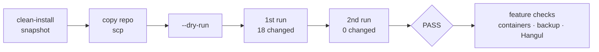
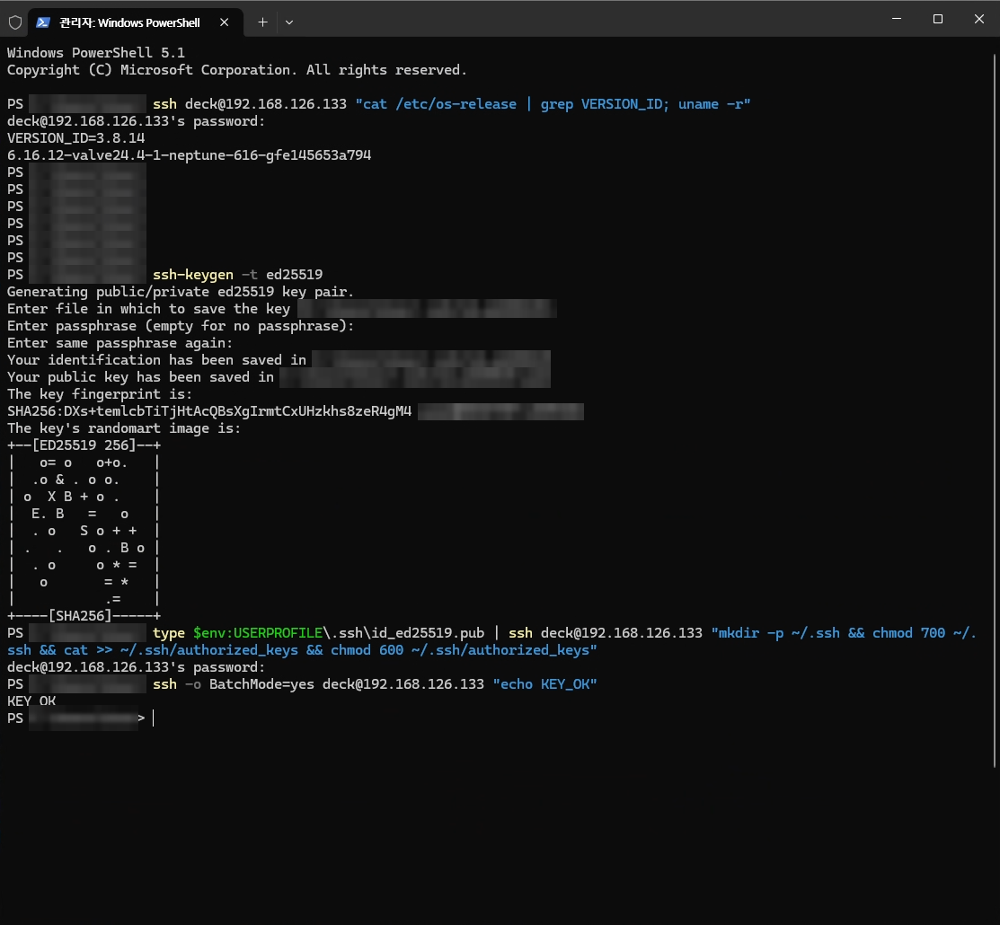

# ステップ 6 · SteamOS-Unattended の実行

[English](../README.md) | [한국어](README.ko.md) | **日本語** | [简体中文](README.zh-CN.md) | [Español](README.es.md) | [Français](README.fr.md)

  

クリーンな SteamOS でスクリプトを実行し、2 回目の実行で何も変わらないこと（冪等性）を確かめてから、すべての機能を実際に確認します。

> [!TIP]
> **実機の Steam Deck** では、デスクトップモードの Konsole でこの 1 行だけで済みます。最初は `--dry-run` を付けて内容を確認してください。
>
> ```bash
> curl -fsSL https://raw.githubusercontent.com/jongwooish/SteamOS-Unattended/main/install.sh | bash -s -- --profile full
> ```

## 目次

- [概要](#概要)
- [前提条件](#前提条件)
- [手順](#手順)
  - [6-1. 接続を確認する](#6-1-接続を確認する)
  - [6-2. SSH 鍵の登録とスナップショット](#6-2-ssh-鍵の登録とスナップショット)
  - [6-3. リポジトリを取得する](#6-3-リポジトリを取得する)
  - [6-4. 自動テスト（スナップショットあり）](#6-4-自動テストスナップショットあり)
  - [6-5. 手動実行（スナップショットなし）](#6-5-手動実行スナップショットなし)
  - [6-6. 機能の確認](#6-6-機能の確認)
  - [6-7. ハングル入力](#6-7-ハングル入力)
- [確認](#確認)
- [次へ](#次へ)

---

## 概要

このページの残りは、ステップ 1〜5 で作った VMware のテスト VM を、ホストの **Windows PowerShell** から操作します。



> [!IMPORTANT]
> 以下のコマンドはすべて `PS C:\…>` プロンプトで実行します。`(deck@steamdeck ~)$` が見えたら VM の中なので、先に `exit` してください（[T12](../../../04-Troubleshooting/README/README.ja.md#t12)）。

## 前提条件

- [ ] [ステップ 5](../../05-Desktop-Autostart/README/README.ja.md) 完了 — インストール後のシステムがデスクトップまで起動する
- [ ] VM の IP アドレス（VM で `ip -4 a`）。このガイドでは `192.168.126.133` を使います
- [ ] ホストに Git またはリポジトリの ZIP

---

## 手順

### 6-1. 接続を確認する

```powershell
ssh deck@192.168.126.133 "cat /etc/os-release | grep VERSION_ID; uname -r"
```


### 6-2. SSH 鍵の登録とスナップショット

自動テストが途中でパスワードを求めないようにします。

```powershell
ssh-keygen -t ed25519
type $env:USERPROFILE\.ssh\id_ed25519.pub | ssh deck@192.168.126.133 "mkdir -p ~/.ssh && chmod 700 ~/.ssh && cat >> ~/.ssh/authorized_keys && chmod 600 ~/.ssh/authorized_keys"
ssh -o BatchMode=yes deck@192.168.126.133 "echo KEY_OK"
```



パスワードなしで `KEY_OK` が出れば成功です。この状態を `clean-install` スナップショットとして保存します。

```powershell
$vmrun = "C:\Program Files (x86)\VMware\VMware Workstation\vmrun.exe"
$vmx   = "D:\VMs\SteamOS\SteamOS.vmx"   # your own path
& $vmrun -T ws snapshot $vmx clean-install
& $vmrun -T ws listSnapshots $vmx
```

> [!NOTE]
> 正確な `.vmx` のパスは `& $vmrun list`（実行中の VM 一覧）で確認できます。[T10](../../../04-Troubleshooting/README/README.ja.md#t10) を参照してください。

### 6-3. リポジトリを取得する

```powershell
git clone https://github.com/jongwooish/SteamOS-Unattended.git C:\VMs\steamos-unattended
```

<details>
<summary>ZIP でダウンロードした場合</summary>

```powershell
Expand-Archive -Path "$env:USERPROFILE\Downloads\SteamOS-Unattended-main.zip" -DestinationPath C:\VMs -Force
Rename-Item C:\VMs\SteamOS-Unattended-main steamos-unattended
dir C:\VMs\steamos-unattended
```


</details>

### 6-4. 自動テスト（スナップショットあり）

```powershell
cd C:\VMs\steamos-unattended
powershell -ExecutionPolicy Bypass -File .\tests\vm-test.ps1 -Vmx $vmx
```

[`tests/vm-test.ps1`](../../../../tests/vm-test.ps1) はスナップショットの復元 → SSH 待機 → リポジトリのコピー → `--dry-run` → 1 回目 → 2 回目の順に実行し、最後の実行の変更が 0 件なら **PASS** を表示します。

<a id="manual-run"></a>

### 6-5. 手動実行（スナップショットなし）

```powershell
ssh deck@192.168.126.133 "rm -rf ~/steamos-unattended"
scp -r C:\VMs\steamos-unattended deck@192.168.126.133:~/steamos-unattended
ssh deck@192.168.126.133 "chmod +x ~/steamos-unattended/install.sh ~/steamos-unattended/modules/*.sh ~/steamos-unattended/lib/*.sh"

ssh -t deck@192.168.126.133 "cd ~/steamos-unattended && ./install.sh --profile full --dry-run"
ssh -t deck@192.168.126.133 "cd ~/steamos-unattended && ./install.sh --profile full"
```

**1 回目 — 変更 18 件、失敗 0 件**


`flathub (--user)` が実行済みになるのは、SteamOS にユーザー用の Flathub リモートが最初から登録されているためです。最後のモジュール `60-etc-keep` で deck のパスワードを 1 回だけ求められます。

**2 回目 — 変更 0 件（冪等）**

```powershell
ssh -t deck@192.168.126.133 "cd ~/steamos-unattended && ./install.sh --profile full"
```


すべての項目が実行済みとなり、sudo のパスワードも求められません。

### 6-6. 機能の確認

```powershell
ssh deck@192.168.126.133 "distrobox enter netkit -- nmap --version | head -1; distrobox enter devbox -- git --version; systemctl --user list-timers su-backup.timer --no-pager; ~/.local/bin/su-backup; ls ~/Backups"
```


| 確認 | 結果 |
| --- | --- |
| `netkit` コンテナ | `Nmap version 7.95` |
| `devbox` コンテナ | `git version 2.56.1` |
| 手動バックアップ | `…tar.gz (36K)` を作成 |
| 自動バックアップ | タイマーの `LAST 00:02:29` と `backup-…-000229.tar.gz` が一致 → **深夜 0 時に自動実行** |

> [!NOTE]
> 最初の `distrobox enter` で出る `Starting container… [ OK ]` の行は、distrobox の初回だけの準備処理です。

### 6-7. ハングル入力

入力メソッドの設定は **次回ログインから** 反映されます。スタートメニューからログアウトして再ログインし、Firefox のアドレスバーで **Ctrl+Space** を押して入力します。


システムトレイに fcitx5 のアイコンがあれば、入力メソッドが動作しています。

> [!WARNING]
> 画面にハングルが *表示される* ことと *入力できる* ことは別です（[T13](../../../04-Troubleshooting/README/README.ja.md#t13)）。

---

## 確認

- [ ] 1 回目が `failed 0` で終わる
- [ ] 2 回目が `changed 0` で終わり、sudo を求められない
- [ ] コンテナ内で `nmap` と `git` が動く
- [ ] `~/Backups` にタイマーが作ったバックアップがある
- [ ] Ctrl+Space でハングルに切り替えて入力できる

> [!TIP]
> 最初からやり直すには `clean-install` に戻します: `& $vmrun -T ws revertToSnapshot $vmx clean-install`。

## 次へ

構成はこれで完了です。問題があれば [トラブルシューティング](../../../04-Troubleshooting/README/README.ja.md) を、各ファイルがなぜその場所にあるのかは [ファイルシステム](../../../05-Filesystem/README/README.ja.md) を参照してください。
