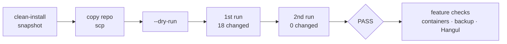
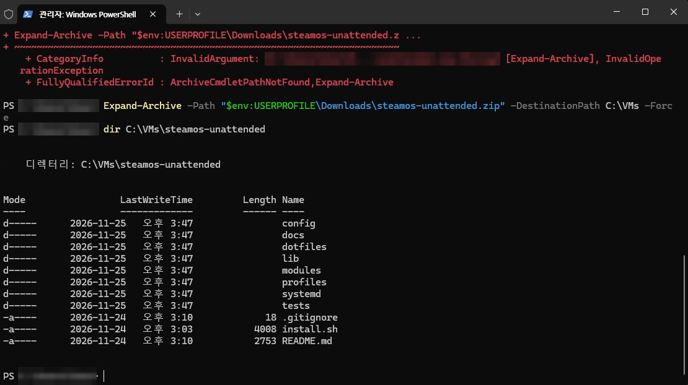
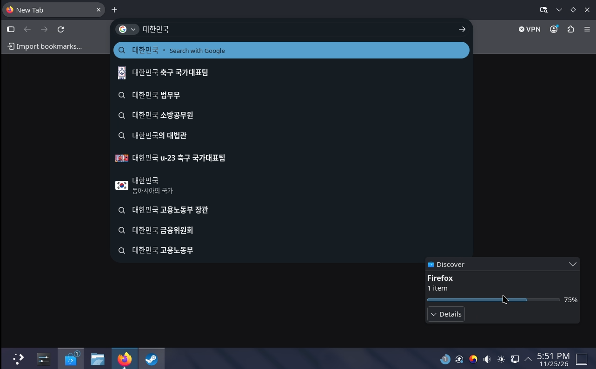

# 6단계 · SteamOS-Unattended 실행

[English](../README.md) | **한국어** | [日本語](README.ja.md) | [简体中文](README.zh-CN.md) | [Español](README.es.md) | [Français](README.fr.md)

  

깨끗한 SteamOS에서 스크립트를 실행하고, 두 번째 실행에서 아무것도 바뀌지 않는지(멱등성) 증명한 뒤, 모든 기능을 실제로 확인합니다.

> [!TIP]
> **실제 Steam Deck** 에서는 데스크톱 모드의 Konsole에서 아래 한 줄이면 됩니다. 처음이라면 `--dry-run` 을 붙여 먼저 미리 보세요.
>
> ```bash
> curl -fsSL https://raw.githubusercontent.com/jongwooish/SteamOS-Unattended/main/install.sh | bash -s -- --profile full
> ```

## 목차

- [개요](#개요)
- [준비물](#준비물)
- [진행](#진행)
  - [6-1. 접속 확인](#6-1-접속-확인)
  - [6-2. SSH 키 등록과 스냅샷](#6-2-ssh-키-등록과-스냅샷)
  - [6-3. 저장소 받기](#6-3-저장소-받기)
  - [6-4. 자동 테스트 (스냅샷이 있을 때)](#6-4-자동-테스트-스냅샷이-있을-때)
  - [6-5. 직접 실행 (스냅샷 없이)](#6-5-직접-실행-스냅샷-없이)
  - [6-6. 기능 확인](#6-6-기능-확인)
  - [6-7. 한글 입력](#6-7-한글-입력)
- [확인](#확인)
- [다음 단계](#다음-단계)

---

## 개요

이 문서의 나머지는 1~5단계에서 만든 VMware 테스트 VM을 호스트의 **Windows PowerShell** 에서 다룹니다.



> [!IMPORTANT]
> 아래 명령은 모두 `PS C:\…>` 프롬프트에서 실행합니다. `(deck@steamdeck ~)$` 가 보이면 VM 안이므로 먼저 `exit` 를 입력하세요([T12](../../../04-Troubleshooting/README/README.ko.md#t12)).

## 준비물

- [ ] [5단계](../../05-Desktop-Autostart/README/README.ko.md) 완료 — 설치본이 데스크톱으로 부팅됨
- [ ] VM의 IP 주소(VM에서 `ip -4 a`). 이 문서는 `192.168.126.133` 을 사용합니다
- [ ] 호스트에 Git 또는 저장소 ZIP

---

## 진행

### 6-1. 접속 확인

```powershell
ssh deck@192.168.126.133 "cat /etc/os-release | grep VERSION_ID; uname -r"
```


### 6-2. SSH 키 등록과 스냅샷

자동 테스트가 중간에 비밀번호를 묻지 않게 합니다.

```powershell
ssh-keygen -t ed25519
type $env:USERPROFILE\.ssh\id_ed25519.pub | ssh deck@192.168.126.133 "mkdir -p ~/.ssh && chmod 700 ~/.ssh && cat >> ~/.ssh/authorized_keys && chmod 600 ~/.ssh/authorized_keys"
ssh -o BatchMode=yes deck@192.168.126.133 "echo KEY_OK"
```


비밀번호 입력 없이 `KEY_OK` 가 나오면 성공입니다. 이 상태를 `clean-install` 스냅샷으로 저장합니다.

```powershell
$vmrun = "C:\Program Files (x86)\VMware\VMware Workstation\vmrun.exe"
$vmx   = "D:\VMs\SteamOS\SteamOS.vmx"   # your own path
& $vmrun -T ws snapshot $vmx clean-install
& $vmrun -T ws listSnapshots $vmx
```

> [!NOTE]
> 정확한 `.vmx` 경로는 `& $vmrun list` (실행 중인 VM 목록)로 찾습니다. [T10](../../../04-Troubleshooting/README/README.ko.md#t10)을 참고하세요.

### 6-3. 저장소 받기

```powershell
git clone https://github.com/jongwooish/SteamOS-Unattended.git C:\VMs\steamos-unattended
```

<details>
<summary>ZIP으로 받은 경우</summary>

```powershell
Expand-Archive -Path "$env:USERPROFILE\Downloads\SteamOS-Unattended-main.zip" -DestinationPath C:\VMs -Force
Rename-Item C:\VMs\SteamOS-Unattended-main steamos-unattended
dir C:\VMs\steamos-unattended
```



</details>

### 6-4. 자동 테스트 (스냅샷이 있을 때)

```powershell
cd C:\VMs\steamos-unattended
powershell -ExecutionPolicy Bypass -File .\tests\vm-test.ps1 -Vmx $vmx
```

[`tests/vm-test.ps1`](../../../../tests/vm-test.ps1) 는 스냅샷 복원 → SSH 대기 → 저장소 복사 → `--dry-run` → 첫 실행 → 재실행을 차례로 진행하고, 마지막 실행이 변경 0건이면 **PASS** 를 출력합니다.

<a id="manual-run"></a>

### 6-5. 직접 실행 (스냅샷 없이)

```powershell
ssh deck@192.168.126.133 "rm -rf ~/steamos-unattended"
scp -r C:\VMs\steamos-unattended deck@192.168.126.133:~/steamos-unattended
ssh deck@192.168.126.133 "chmod +x ~/steamos-unattended/install.sh ~/steamos-unattended/modules/*.sh ~/steamos-unattended/lib/*.sh"

ssh -t deck@192.168.126.133 "cd ~/steamos-unattended && ./install.sh --profile full --dry-run"
ssh -t deck@192.168.126.133 "cd ~/steamos-unattended && ./install.sh --profile full"
```

**첫 실행 — 변경 18건, 실패 0건**


`flathub (--user)` 가 이미 됨으로 나오는 이유는 SteamOS에 사용자용 Flathub 저장소가 기본으로 등록되어 있기 때문입니다. 마지막 모듈 `60-etc-keep` 에서 deck 비밀번호를 한 번 묻습니다.

**두 번째 실행 — 변경 0건 (멱등)**

```powershell
ssh -t deck@192.168.126.133 "cd ~/steamos-unattended && ./install.sh --profile full"
```


모든 항목이 이미 됨으로 나오고, sudo 비밀번호도 묻지 않습니다.

### 6-6. 기능 확인

```powershell
ssh deck@192.168.126.133 "distrobox enter netkit -- nmap --version | head -1; distrobox enter devbox -- git --version; systemctl --user list-timers su-backup.timer --no-pager; ~/.local/bin/su-backup; ls ~/Backups"
```


| 확인 | 결과 |
| --- | --- |
| `netkit` 컨테이너 | `Nmap version 7.95` |
| `devbox` 컨테이너 | `git version 2.56.1` |
| 수동 백업 | `…tar.gz (36K)` 생성 |
| 자동 백업 | 타이머 `LAST 00:02:29` 와 `backup-…-000229.tar.gz` 가 일치 → **자정에 스스로 실행됨** |

> [!NOTE]
> 처음 `distrobox enter` 할 때 나오는 `Starting container… [ OK ]` 줄은 distrobox의 최초 1회 준비 작업입니다.

### 6-7. 한글 입력

입력기 설정은 **다음 로그인부터** 적용됩니다. 시작 메뉴에서 로그아웃한 뒤 다시 로그인하고, Firefox 주소창에서 **Ctrl+Space** 로 전환해 입력합니다.



시스템 트레이에 fcitx5 아이콘이 보이면 입력기가 실행 중입니다.

> [!WARNING]
> 화면에 한글이 *보이는* 것과 *입력되는* 것은 다릅니다([T13](../../../04-Troubleshooting/README/README.ko.md#t13)).

---

## 확인

- [ ] 첫 실행이 `failed 0` 으로 끝남
- [ ] 두 번째 실행이 `changed 0` 으로 끝나고 sudo를 묻지 않음
- [ ] 컨테이너 안에서 `nmap` 과 `git` 이 실행됨
- [ ] `~/Backups` 에 타이머가 만든 백업이 있음
- [ ] Ctrl+Space 로 한글 전환 후 입력됨

> [!TIP]
> 처음부터 다시 테스트하려면 `clean-install` 로 되돌립니다: `& $vmrun -T ws revertToSnapshot $vmx clean-install`.

## 다음 단계

구성이 끝났습니다. 문제가 생기면 [트러블슈팅](../../../04-Troubleshooting/README/README.ko.md)을, 파일이 왜 그 위치에 있는지 알고 싶다면 [파일 시스템](../../../05-Filesystem/README/README.ko.md)을 읽어 보세요.
