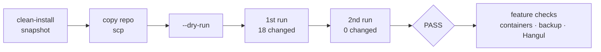
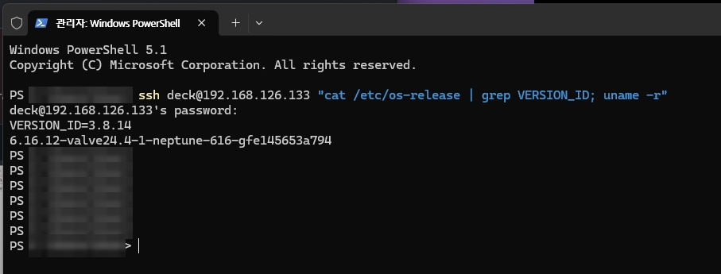

# 第 6 步 · 运行 SteamOS-Unattended

[English](../README.md) | [한국어](README.ko.md) | [日本語](README.ja.md) | **简体中文** | [Español](README.es.md) | [Français](README.fr.md)

  

在干净的 SteamOS 上运行脚本，证明第二次运行不做任何改动（幂等性），然后逐项实际验证功能。

> [!TIP]
> **在真实的 Steam Deck 上**，只需在桌面模式的 Konsole 中运行这一行。首次使用请先加 `--dry-run` 预览。
>
> ```bash
> curl -fsSL https://raw.githubusercontent.com/jongwooish/SteamOS-Unattended/main/install.sh | bash -s -- --profile full
> ```

## 目录

- [概述](#概述)
- [前提条件](#前提条件)
- [步骤](#步骤)
  - [6-1. 检查连接](#6-1-检查连接)
  - [6-2. 注册 SSH 密钥并创建快照](#6-2-注册-ssh-密钥并创建快照)
  - [6-3. 获取仓库](#6-3-获取仓库)
  - [6-4. 自动测试（有快照时）](#6-4-自动测试有快照时)
  - [6-5. 手动运行（无快照）](#6-5-手动运行无快照)
  - [6-6. 功能检查](#6-6-功能检查)
  - [6-7. 韩文输入](#6-7-韩文输入)
- [验证](#验证)
- [下一步](#下一步)

---

## 概述

本页其余部分在主机的 **Windows PowerShell** 中操作第 1～5 步创建的 VMware 测试虚拟机。



> [!IMPORTANT]
> 以下命令都在 `PS C:\…>` 提示符下运行。如果看到 `(deck@steamdeck ~)$`，说明你在虚拟机内部，请先输入 `exit`（[T12](../../../04-Troubleshooting/README/README.zh-CN.md#t12)）。

## 前提条件

- [ ] 已完成 [第 5 步](../../05-Desktop-Autostart/README/README.zh-CN.md) — 安装后的系统能启动到桌面
- [ ] 虚拟机的 IP 地址（在虚拟机中运行 `ip -4 a`）。本指南使用 `192.168.126.133`
- [ ] 主机上有 Git 或仓库 ZIP

---

## 步骤

### 6-1. 检查连接

```powershell
ssh deck@192.168.126.133 "cat /etc/os-release | grep VERSION_ID; uname -r"
```



### 6-2. 注册 SSH 密钥并创建快照

自动测试绝不能中途停下来询问密码。

```powershell
ssh-keygen -t ed25519
type $env:USERPROFILE\.ssh\id_ed25519.pub | ssh deck@192.168.126.133 "mkdir -p ~/.ssh && chmod 700 ~/.ssh && cat >> ~/.ssh/authorized_keys && chmod 600 ~/.ssh/authorized_keys"
ssh -o BatchMode=yes deck@192.168.126.133 "echo KEY_OK"
```


不需要输入密码就出现 `KEY_OK` 即为成功。把这个状态保存为 `clean-install` 快照：

```powershell
$vmrun = "C:\Program Files (x86)\VMware\VMware Workstation\vmrun.exe"
$vmx   = "D:\VMs\SteamOS\SteamOS.vmx"   # your own path
& $vmrun -T ws snapshot $vmx clean-install
& $vmrun -T ws listSnapshots $vmx
```

> [!NOTE]
> 用 `& $vmrun list`（正在运行的虚拟机）查找准确的 `.vmx` 路径，参见 [T10](../../../04-Troubleshooting/README/README.zh-CN.md#t10)。

### 6-3. 获取仓库

```powershell
git clone https://github.com/jongwooish/SteamOS-Unattended.git C:\VMs\steamos-unattended
```

<details>
<summary>以 ZIP 下载的情况</summary>

```powershell
Expand-Archive -Path "$env:USERPROFILE\Downloads\SteamOS-Unattended-main.zip" -DestinationPath C:\VMs -Force
Rename-Item C:\VMs\SteamOS-Unattended-main steamos-unattended
dir C:\VMs\steamos-unattended
```


</details>

### 6-4. 自动测试（有快照时）

```powershell
cd C:\VMs\steamos-unattended
powershell -ExecutionPolicy Bypass -File .\tests\vm-test.ps1 -Vmx $vmx
```

[`tests/vm-test.ps1`](../../../../tests/vm-test.ps1) 依次执行：恢复快照 → 等待 SSH → 复制仓库 → `--dry-run` → 第一次运行 → 第二次运行；最后一次运行改动为 0 时输出 **PASS**。

<a id="manual-run"></a>

### 6-5. 手动运行（无快照）

```powershell
ssh deck@192.168.126.133 "rm -rf ~/steamos-unattended"
scp -r C:\VMs\steamos-unattended deck@192.168.126.133:~/steamos-unattended
ssh deck@192.168.126.133 "chmod +x ~/steamos-unattended/install.sh ~/steamos-unattended/modules/*.sh ~/steamos-unattended/lib/*.sh"

ssh -t deck@192.168.126.133 "cd ~/steamos-unattended && ./install.sh --profile full --dry-run"
ssh -t deck@192.168.126.133 "cd ~/steamos-unattended && ./install.sh --profile full"
```

**第一次运行 — 改动 18 项，失败 0 项**


`flathub (--user)` 显示为已完成，是因为 SteamOS 自带用户级 Flathub 远程仓库。最后一个模块 `60-etc-keep` 会询问一次 deck 密码。

**第二次运行 — 改动 0 项（幂等）**

```powershell
ssh -t deck@192.168.126.133 "cd ~/steamos-unattended && ./install.sh --profile full"
```


所有项目都显示为已完成，也完全不会请求 sudo。

### 6-6. 功能检查

```powershell
ssh deck@192.168.126.133 "distrobox enter netkit -- nmap --version | head -1; distrobox enter devbox -- git --version; systemctl --user list-timers su-backup.timer --no-pager; ~/.local/bin/su-backup; ls ~/Backups"
```


| 检查项 | 结果 |
| --- | --- |
| `netkit` 容器 | `Nmap version 7.95` |
| `devbox` 容器 | `git version 2.56.1` |
| 手动备份 | 生成 `…tar.gz (36K)` |
| 定时备份 | 计时器 `LAST 00:02:29` 与 `backup-…-000229.tar.gz` 一致 → **午夜自动运行** |

> [!NOTE]
> 第一次 `distrobox enter` 时出现的 `Starting container… [ OK ]` 是 distrobox 仅一次的初始化。

### 6-7. 韩文输入

输入法设置在 **下次登录** 后生效。从开始菜单注销并重新登录，然后在 Firefox 地址栏按 **Ctrl+Space** 切换并输入。


系统托盘中出现 fcitx5 图标，说明输入法正在运行。

> [!WARNING]
> 屏幕上能 *显示* 韩文，不等于能 *输入* 韩文（[T13](../../../04-Troubleshooting/README/README.zh-CN.md#t13)）。

---

## 验证

- [ ] 第一次运行以 `failed 0` 结束
- [ ] 第二次运行以 `changed 0` 结束且不请求 sudo
- [ ] `nmap` 和 `git` 能在各自容器中运行
- [ ] `~/Backups` 中有计时器生成的备份
- [ ] Ctrl+Space 可切换到韩文并输入

> [!TIP]
> 要从头再测一次，恢复到 `clean-install`：`& $vmrun -T ws revertToSnapshot $vmx clean-install`。

## 下一步

配置到此完成。遇到问题请查看 [故障排除](../../../04-Troubleshooting/README/README.zh-CN.md)；想了解各文件为何放在那里，请阅读 [文件系统](../../../05-Filesystem/README/README.zh-CN.md)。
