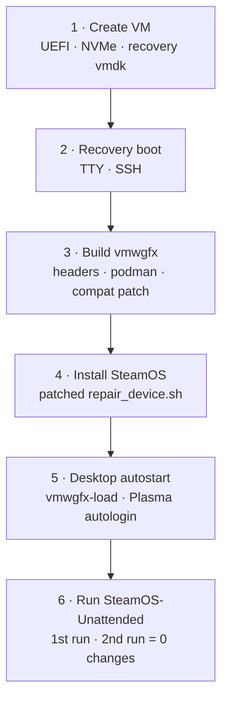

# Configuration

**English** | [한국어](README/README.ko.md) | [日本語](README/README.ja.md) | [简体中文](README/README.zh-CN.md) | [Español](README/README.es.md) | [Français](README/README.fr.md)

  

Build a SteamOS test machine in VMware Workstation from the official recovery image, then run SteamOS-Unattended on it. Every step was performed for real and comes with screenshots.

> [!TIP]
> **Have a real Steam Deck?** Steps 1–5 only exist to make SteamOS run in VMware. Go straight to [Step 6](06-Run-Unattended/README.md).

## Contents

- [Flow](#flow)
- [Steps](#steps)
- [Conventions](#conventions)

---

## Flow

## Steps

| # | Step | What you get | Time |
| --- | --- | --- | --- |
| 1 | [Create the VM](01-Create-VM/README.md) | A UEFI VM with the recovery image on SATA and an empty NVMe disk | ~15 min |
| 2 | [Recovery boot and SSH](02-Recovery-Boot/README.md) | Root cause of the black screen and SSH access to the recovery system | ~15 min |
| 3 | [Build the vmwgfx driver](03-vmwgfx-Driver/README.md) | A `vmwgfx.ko` built for the exact SteamOS kernel; the recovery desktop appears | ~60 min |
| 4 | [Install SteamOS to NVMe](04-Install-SteamOS/README.md) | SteamOS installed with a VMware-safe copy of the installer | ~30 min |
| 5 | [Desktop autostart](05-Desktop-Autostart/README.md) | The installed system boots into Desktop Mode by itself | ~20 min |
| 6 | [Run SteamOS-Unattended](06-Run-Unattended/README.md) | 18 changes on the first run, 0 on the second, every feature verified | ~30 min |

## Conventions

| Notation | Meaning |
| --- | --- |
| `PS C:\…>` | Run in Windows PowerShell on the host |
| `(deck@steamdeck ~)$` | Run inside the VM (over SSH or in Konsole) |
| `192.168.126.133` | The VM IP used throughout — replace it with yours |
| `/mnt/build` | The extra work disk added in Step 3 |

> [!NOTE]
> Before you start, read [Cautions](../02-Cautions/README.md) and collect the files in [Downloads](../01-Downloads/README.md). If anything breaks, every error met along the way is in [Troubleshooting](../04-Troubleshooting/README.md).
