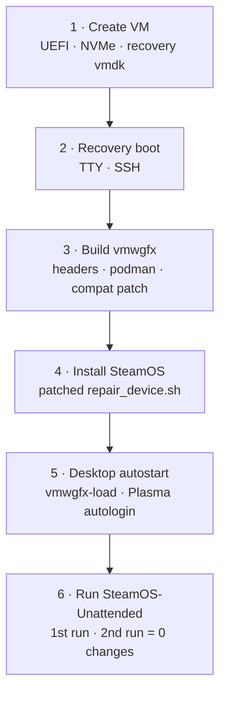

# Configuración

[English](../README.md) | [한국어](README.ko.md) | [日本語](README.ja.md) | [简体中文](README.zh-CN.md) | **Español** | [Français](README.fr.md)

  

Crea una máquina de prueba con SteamOS en VMware Workstation a partir de la imagen de recuperación oficial y ejecuta SteamOS-Unattended en ella. Cada paso se hizo de verdad e incluye capturas.

> [!TIP]
> **¿Tienes una Steam Deck real?** Los pasos 1–5 solo sirven para que SteamOS funcione en VMware. Ve directamente al [Paso 6](../06-Run-Unattended/README/README.es.md).

## Índice

- [Flujo](#flujo)
- [Pasos](#pasos)
- [Convenciones](#convenciones)

---

## Flujo

## Pasos

| # | Paso | Qué obtienes | Tiempo |
| --- | --- | --- | --- |
| 1 | [Crear la VM](../01-Create-VM/README/README.es.md) | Una VM UEFI con la imagen de recuperación en SATA y un disco NVMe vacío | ~15 min |
| 2 | [Arranque de recuperación y SSH](../02-Recovery-Boot/README/README.es.md) | La causa de la pantalla negra y acceso SSH al sistema de recuperación | ~15 min |
| 3 | [Compilar el controlador vmwgfx](../03-vmwgfx-Driver/README/README.es.md) | Un `vmwgfx.ko` para el kernel exacto de SteamOS; aparece el escritorio de recuperación | ~60 min |
| 4 | [Instalar SteamOS en NVMe](../04-Install-SteamOS/README/README.es.md) | SteamOS instalado con una copia del instalador adaptada a VMware | ~30 min |
| 5 | [Inicio automático del escritorio](../05-Desktop-Autostart/README/README.es.md) | El sistema instalado arranca solo en el modo escritorio | ~20 min |
| 6 | [Ejecutar SteamOS-Unattended](../06-Run-Unattended/README/README.es.md) | 18 cambios en la primera ejecución, 0 en la segunda, todo verificado | ~30 min |

## Convenciones

| Notación | Significado |
| --- | --- |
| `PS C:\…>` | Se ejecuta en Windows PowerShell en el anfitrión |
| `(deck@steamdeck ~)$` | Se ejecuta dentro de la VM (por SSH o en Konsole) |
| `192.168.126.133` | La IP de la VM usada en toda la guía — sustitúyela por la tuya |
| `/mnt/build` | El disco de trabajo adicional del Paso 3 |

> [!NOTE]
> Antes de empezar, lee las [Precauciones](../../02-Cautions/README/README.es.md) y reúne los archivos de [Descargas](../../01-Downloads/README/README.es.md). Si algo falla, todos los errores encontrados por el camino están en [Solución de problemas](../../04-Troubleshooting/README/README.es.md).
