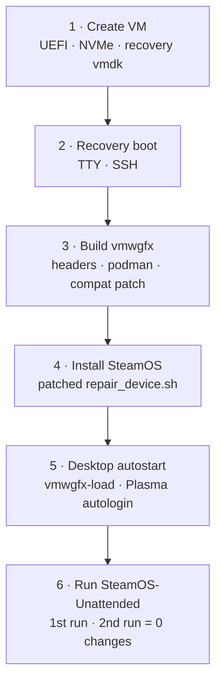

# Configuration

[English](../README.md) | [한국어](README.ko.md) | [日本語](README.ja.md) | [简体中文](README.zh-CN.md) | [Español](README.es.md) | **Français**

  

Construire une machine de test SteamOS dans VMware Workstation à partir de l'image de récupération officielle, puis y lancer SteamOS-Unattended. Chaque étape a été réellement effectuée et est illustrée de captures.

> [!TIP]
> **Vous avez un vrai Steam Deck ?** Les étapes 1 à 5 servent uniquement à faire tourner SteamOS dans VMware. Passez directement à l'[étape 6](../06-Run-Unattended/README/README.fr.md).

## Sommaire

- [Déroulement](#déroulement)
- [Étapes](#étapes)
- [Conventions](#conventions)

---

## Déroulement

## Étapes

| # | Étape | Résultat | Durée |
| --- | --- | --- | --- |
| 1 | [Créer la VM](../01-Create-VM/README/README.fr.md) | Une VM UEFI avec l'image de récupération en SATA et un disque NVMe vide | ~15 min |
| 2 | [Démarrage de récupération et SSH](../02-Recovery-Boot/README/README.fr.md) | La cause de l'écran noir et un accès SSH au système de récupération | ~15 min |
| 3 | [Compiler le pilote vmwgfx](../03-vmwgfx-Driver/README/README.fr.md) | Un `vmwgfx.ko` pour le noyau exact de SteamOS ; le bureau de récupération s'affiche | ~60 min |
| 4 | [Installer SteamOS sur le NVMe](../04-Install-SteamOS/README/README.fr.md) | SteamOS installé avec une copie de l'installateur adaptée à VMware | ~30 min |
| 5 | [Démarrage automatique du bureau](../05-Desktop-Autostart/README/README.fr.md) | Le système installé démarre seul en mode bureau | ~20 min |
| 6 | [Lancer SteamOS-Unattended](../06-Run-Unattended/README/README.fr.md) | 18 changements à la première exécution, 0 à la deuxième, tout vérifié | ~30 min |

## Conventions

| Notation | Signification |
| --- | --- |
| `PS C:\…>` | À lancer dans Windows PowerShell sur l'hôte |
| `(deck@steamdeck ~)$` | À lancer dans la VM (via SSH ou dans Konsole) |
| `192.168.126.133` | L'IP de la VM utilisée partout — remplacez-la par la vôtre |
| `/mnt/build` | Le disque de travail ajouté à l'étape 3 |

> [!NOTE]
> Avant de commencer, lisez les [Précautions](../../02-Cautions/README/README.fr.md) et rassemblez les fichiers des [Téléchargements](../../01-Downloads/README/README.fr.md). En cas de problème, toutes les erreurs rencontrées en chemin sont dans [Dépannage](../../04-Troubleshooting/README/README.fr.md).
