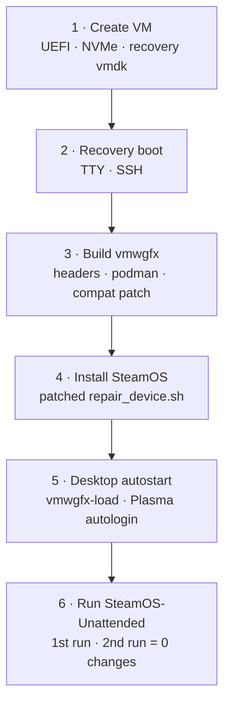

# 構成

[English](../README.md) | [한국어](README.ko.md) | **日本語** | [简体中文](README.zh-CN.md) | [Español](README.es.md) | [Français](README.fr.md)

  

公式のリカバリーイメージから VMware Workstation に SteamOS のテストマシンを作り、その上で SteamOS-Unattended を実行します。すべての手順は実際に行ったもので、スクリーンショット付きです。

> [!TIP]
> **実機の Steam Deck をお持ちですか?** ステップ 1〜5 は VMware で SteamOS を動かすためだけの手順です。[ステップ 6](../06-Run-Unattended/README/README.ja.md) に進んでください。

## 目次

- [流れ](#流れ)
- [ステップ](#ステップ)
- [表記](#表記)

---

## 流れ

## ステップ

| # | ステップ | 得られるもの | 時間 |
| --- | --- | --- | --- |
| 1 | [VM の作成](../01-Create-VM/README/README.ja.md) | SATA にリカバリーイメージ、空の NVMe ディスクを持つ UEFI VM | 約 15 分 |
| 2 | [リカバリー起動と SSH](../02-Recovery-Boot/README/README.ja.md) | 黒い画面の根本原因の特定と、リカバリーシステムへの SSH 接続 | 約 15 分 |
| 3 | [vmwgfx ドライバーのビルド](../03-vmwgfx-Driver/README/README.ja.md) | SteamOS カーネルに完全一致する `vmwgfx.ko`、リカバリーのデスクトップ表示 | 約 60 分 |
| 4 | [NVMe への SteamOS インストール](../04-Install-SteamOS/README/README.ja.md) | VMware 向けに修正したインストーラーのコピーでインストール | 約 30 分 |
| 5 | [デスクトップの自動起動](../05-Desktop-Autostart/README/README.ja.md) | インストール後のシステムが自動でデスクトップモードに起動 | 約 20 分 |
| 6 | [SteamOS-Unattended の実行](../06-Run-Unattended/README/README.ja.md) | 1 回目で 18 件、2 回目で 0 件の変更、全機能を確認 | 約 30 分 |

## 表記

| 表記 | 意味 |
| --- | --- |
| `PS C:\…>` | ホストの Windows PowerShell で実行 |
| `(deck@steamdeck ~)$` | VM の中で実行（SSH または Konsole） |
| `192.168.126.133` | 全体で使う VM の IP — 自分の IP に置き換えてください |
| `/mnt/build` | ステップ 3 で追加する作業ディスク |

> [!NOTE]
> 始める前に [注意事項](../../02-Cautions/README/README.ja.md) を読み、[ダウンロード](../../01-Downloads/README/README.ja.md) のファイルを用意してください。問題が起きたら、途中で出会ったすべてのエラーが [トラブルシューティング](../../04-Troubleshooting/README/README.ja.md) にあります。
