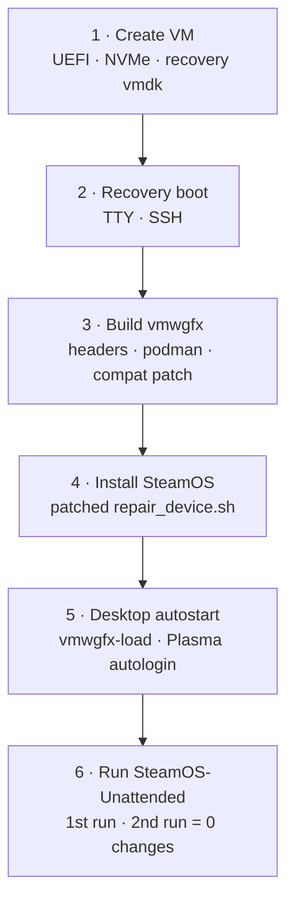

# 구성

[English](../README.md) | **한국어** | [日本語](README.ja.md) | [简体中文](README.zh-CN.md) | [Español](README.es.md) | [Français](README.fr.md)

  

공식 복구 이미지로 VMware Workstation에 SteamOS 테스트 머신을 만들고, 그 위에서 SteamOS-Unattended를 실행합니다. 모든 단계는 실제로 진행했고 화면을 함께 실었습니다.

> [!TIP]
> **실제 Steam Deck이 있나요?** 1~5단계는 VMware에서 SteamOS를 띄우기 위한 과정입니다. 바로 [6단계](../06-Run-Unattended/README/README.ko.md)로 가세요.

## 목차

- [흐름](#흐름)
- [단계](#단계)
- [표기 규칙](#표기-규칙)

---

## 흐름

## 단계

| # | 단계 | 결과 | 시간 |
| --- | --- | --- | --- |
| 1 | [VM 만들기](../01-Create-VM/README/README.ko.md) | SATA에 복구 이미지, 빈 NVMe 디스크가 있는 UEFI VM | 약 15분 |
| 2 | [복구 부팅과 SSH](../02-Recovery-Boot/README/README.ko.md) | 검은 화면의 근본 원인 확인, 복구 시스템에 SSH 접속 | 약 15분 |
| 3 | [vmwgfx 드라이버 빌드](../03-vmwgfx-Driver/README/README.ko.md) | SteamOS 커널과 정확히 맞는 `vmwgfx.ko`, 복구 데스크톱 표시 | 약 60분 |
| 4 | [NVMe에 SteamOS 설치](../04-Install-SteamOS/README/README.ko.md) | VMware용으로 고친 설치 스크립트 복사본으로 SteamOS 설치 | 약 30분 |
| 5 | [데스크톱 자동 실행](../05-Desktop-Autostart/README/README.ko.md) | 설치본이 스스로 데스크톱 모드로 부팅 | 약 20분 |
| 6 | [SteamOS-Unattended 실행](../06-Run-Unattended/README/README.ko.md) | 첫 실행 변경 18건, 두 번째 0건, 모든 기능 확인 | 약 30분 |

## 표기 규칙

| 표기 | 의미 |
| --- | --- |
| `PS C:\…>` | 호스트의 Windows PowerShell에서 실행 |
| `(deck@steamdeck ~)$` | VM 안에서 실행 (SSH 또는 Konsole) |
| `192.168.126.133` | 문서 전체에서 쓰는 VM IP — 자신의 IP로 바꾸세요 |
| `/mnt/build` | 3단계에서 추가하는 작업 디스크 |

> [!NOTE]
> 시작 전에 [주의사항](../../02-Cautions/README/README.ko.md)을 읽고 [자료실](../../01-Downloads/README/README.ko.md)의 파일을 받아 두세요. 문제가 생기면 진행 중 만난 모든 오류가 [트러블슈팅](../../04-Troubleshooting/README/README.ko.md)에 있습니다.
