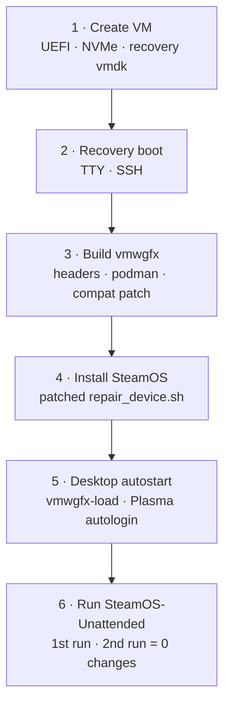

# 配置

[English](../README.md) | [한국어](README.ko.md) | [日本語](README.ja.md) | **简体中文** | [Español](README.es.md) | [Français](README.fr.md)

  

用官方恢复镜像在 VMware Workstation 中搭建一台 SteamOS 测试机，然后在上面运行 SteamOS-Unattended。每一步都实际操作过，并附有截图。

> [!TIP]
> **有真实的 Steam Deck？** 第 1～5 步只是为了让 SteamOS 在 VMware 中运行。请直接前往 [第 6 步](../06-Run-Unattended/README/README.zh-CN.md)。

## 目录

- [流程](#流程)
- [步骤](#步骤)
- [约定](#约定)

---

## 流程

## 步骤

| # | 步骤 | 得到的结果 | 时间 |
| --- | --- | --- | --- |
| 1 | [创建虚拟机](../01-Create-VM/README/README.zh-CN.md) | 一台 UEFI 虚拟机：SATA 上是恢复镜像，另有一块空 NVMe 磁盘 | 约 15 分钟 |
| 2 | [恢复启动与 SSH](../02-Recovery-Boot/README/README.zh-CN.md) | 找到黑屏的根本原因，并通过 SSH 访问恢复系统 | 约 15 分钟 |
| 3 | [构建 vmwgfx 驱动](../03-vmwgfx-Driver/README/README.zh-CN.md) | 与 SteamOS 内核完全匹配的 `vmwgfx.ko`；恢复桌面出现 | 约 60 分钟 |
| 4 | [将 SteamOS 安装到 NVMe](../04-Install-SteamOS/README/README.zh-CN.md) | 使用为 VMware 修改的安装程序副本完成安装 | 约 30 分钟 |
| 5 | [桌面自动启动](../05-Desktop-Autostart/README/README.zh-CN.md) | 安装后的系统自动启动到桌面模式 | 约 20 分钟 |
| 6 | [运行 SteamOS-Unattended](../06-Run-Unattended/README/README.zh-CN.md) | 第一次 18 项改动，第二次 0 项，所有功能均已验证 | 约 30 分钟 |

## 约定

| 写法 | 含义 |
| --- | --- |
| `PS C:\…>` | 在主机的 Windows PowerShell 中运行 |
| `(deck@steamdeck ~)$` | 在虚拟机内运行（SSH 或 Konsole） |
| `192.168.126.133` | 全文使用的虚拟机 IP — 请替换为你的 IP |
| `/mnt/build` | 第 3 步添加的工作盘 |

> [!NOTE]
> 开始前请阅读 [注意事项](../../02-Cautions/README/README.zh-CN.md)，并准备好 [下载](../../01-Downloads/README/README.zh-CN.md) 中的文件。遇到问题时，过程中碰到的所有错误都记录在 [故障排除](../../04-Troubleshooting/README/README.zh-CN.md) 中。
