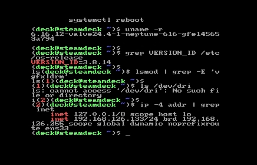
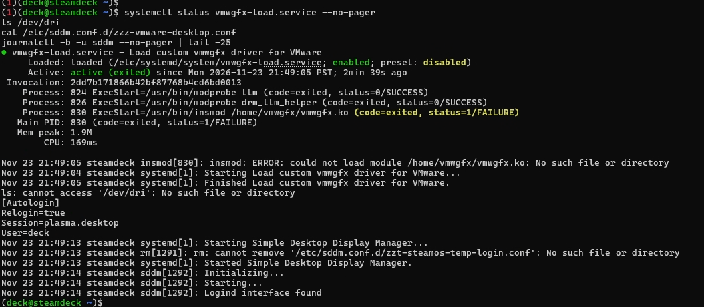

# Troubleshooting

**English** | [한국어](README/README.ko.md) | [日本語](README/README.ja.md) | [简体中文](README/README.zh-CN.md) | [Español](README/README.es.md) | [Français](README/README.fr.md)

  

Every problem below actually happened while building this project. Each entry lists the symptom, the cause and the fix, with the screen captured at the time.

## Contents

- [Index](#index)
- [VM and recovery boot](#vm-and-recovery-boot)
  - [T1 · Stuck at network boot (PXE)](#t1--stuck-at-network-boot-pxe)
  - [T2 · Only a blinking cursor after the boot log](#t2--only-a-blinking-cursor-after-the-boot-log)
  - [T3 · VM settings are greyed out](#t3--vm-settings-are-greyed-out)
- [Driver build](#driver-build)
  - [T4 · pacman fails with Read-only file system](#t4--pacman-fails-with-read-only-file-system)
  - [T5 · implicit declaration of function during the build](#t5--implicit-declaration-of-function-during-the-build)
- [Installation](#installation)
  - [T6 · Installer closes immediately / Please run as root / cannot open display](#t6--installer-closes-immediately--please-run-as-root--cannot-open-display)
  - [T7 · nvme format fails with Invalid Command Opcode](#t7--nvme-format-fails-with-invalid-command-opcode)
- [Installed system](#installed-system)
  - [T8 · Black screen / vmwgfx.ko No such file or directory](#t8--black-screen--vmwgfxko-no-such-file-or-directory)
  - [T9 · Black screen for a while after reboot](#t9--black-screen-for-a-while-after-reboot)
- [Running the script](#running-the-script)
  - [T10 · .vmx not found / Cannot open VM](#t10--vmx-not-found--cannot-open-vm)
  - [T11 · The snapshot does not exist](#t11--the-snapshot-does-not-exist)
  - [T12 · Windows commands run inside the VM](#t12--windows-commands-run-inside-the-vm)
  - [T13 · Korean is displayed but cannot be typed](#t13--korean-is-displayed-but-cannot-be-typed)
  - [T14 · Expand-Archive cannot find the path](#t14--expand-archive-cannot-find-the-path)
- [Usage](#usage)
  - [T15 · Black screen after Return to Gaming Mode](#t15--black-screen-after-return-to-gaming-mode)

---

## Index

| # | Symptom | Stage |
| --- | --- | --- |
| [T1](#t1) | Stuck at `Network boot from Intel E1000 … DHCP` | [Create VM](../03-Configuration/01-Create-VM/README.md) |
| [T2](#t2) | Only a blinking cursor after the `[ OK ]` log | [Recovery boot](../03-Configuration/02-Recovery-Boot/README.md) |
| [T3](#t3) | VM settings are greyed out | [Create VM](../03-Configuration/01-Create-VM/README.md) |
| [T4](#t4) | `could not lock database: Read-only file system` | [Driver](../03-Configuration/03-vmwgfx-Driver/README.md) |
| [T5](#t5) | `implicit declaration of function 'clean_record_shared_mapping_range'` | [Driver](../03-Configuration/03-vmwgfx-Driver/README.md) |
| [T6](#t6) | Installer window closes right after Proceed | [Install](../03-Configuration/04-Install-SteamOS/README.md) |
| [T7](#t7) | `NVMe status: Invalid Command Opcode` | [Install](../03-Configuration/04-Install-SteamOS/README.md) |
| [T8](#t8) | Installed system boots to a black screen | [Desktop](../03-Configuration/05-Desktop-Autostart/README.md) |
| [T9](#t9) | Black screen for a while after reboot | [Desktop](../03-Configuration/05-Desktop-Autostart/README.md) |
| [T10](#t10) | `Cannot open VM … cannot be found` | [Run](../03-Configuration/06-Run-Unattended/README.md) |
| [T11](#t11) | `The snapshot does not exist` | [Run](../03-Configuration/06-Run-Unattended/README.md) |
| [T12](#t12) | `cd: C:VMs…: No such file`, `powershell: command not found` | [Run](../03-Configuration/06-Run-Unattended/README.md) |
| [T13](#t13) | Korean is displayed but cannot be typed | [Run](../03-Configuration/06-Run-Unattended/README.md) |
| [T14](#t14) | `Expand-Archive` cannot find the path | [Run](../03-Configuration/06-Run-Unattended/README.md) |
| [T15](#t15) | Black screen after Return to Gaming Mode | Usage |

---

## VM and recovery boot

<a id="t1"></a>

### T1 · Stuck at network boot (PXE)


**Cause** — The VM firmware was created as **BIOS**. The recovery image boots only on UEFI, so BIOS does not see the disk and falls back to network boot. Changing the boot order in BIOS does not help.

**Fix**

1. VM → Power → Power Off
2. Edit virtual machine settings → **Options → Advanced → Firmware type: UEFI**, and **clear** Enable secure boot
3. Power On to Firmware → Boot Manager → `EFI VMware Virtual SATA Hard Drive (0.0)`

With UEFI, Boot Manager lists entries that start with `EFI …` ([Step 2](../03-Configuration/02-Recovery-Boot/README.md)).

<a id="t2"></a>

### T2 · Only a blinking cursor after the boot log


**Cause** — The SteamOS kernel has no VMware graphics driver (`vmwgfx`), so no graphics device (`/dev/dri`) is created. More memory, CPUs or video memory do not help. A TTY (Ctrl+Alt+Space → F3) shows that `/dev/dri` is missing:



**Fix** — Build vmwgfx for the exact same kernel version and load it ([Step 3](../03-Configuration/03-vmwgfx-Driver/README.md)).

> [!NOTE]
> Game Mode needs Vulkan, so it will not start in VMware even with the driver. Desktop Mode does.

<a id="t3"></a>

### T3 · VM settings are greyed out


**Cause** — The VM is powered on. The memory page also says the VM must be off to reduce memory. The `You must update Tools to enable 3D acceleration` warning is for Windows guests and can be ignored.

**Fix** — VM → Power → Power Off, then change the settings.

---

## Driver build

<a id="t4"></a>

### T4 · pacman fails with Read-only file system


**Cause** — The SteamOS pacman database lives in the read-only system area (`/usr/lib/holo/pacmandb`). It is not a network problem.

**Fix** — Do not unlock the system. Copy the database to the work disk and use that copy for downloads only:

```bash
sudo cp -a "$(pacman-conf DBPath)" /mnt/build/db
sudo pacman --dbpath /mnt/build/db -Sw --noconfirm --cachedir /mnt/build/pkg linux-neptune-616-headers
```

> [!IMPORTANT]
> Do **not** run `-Sy`. The package list shipped in the image points to the headers that match the running kernel.

<a id="t5"></a>

### T5 · implicit declaration of function during the build


**Cause** — `wp_shared_mapping_range` and `clean_record_shared_mapping_range`, used by `vmwgfx_page_dirty.c`, belong to `CONFIG_MAPPING_DIRTY_HELPERS`. It is normally selected by vmwgfx, so it was disabled together when Valve turned vmwgfx off. It is built into the kernel and cannot be added as a module.

**Fix** — Add a replacement implementation ([`vmware/compat_dirty.h`](../../vmware/compat_dirty.h)) inside vmwgfx and rebuild ([compat patch](../03-Configuration/03-vmwgfx-Driver/README.md#compat-patch)).

---

## Installation

<a id="t6"></a>

### T6 · Installer closes immediately / Please run as root / cannot open display

Clicking Proceed in **Wipe Device & Install SteamOS** closes the window, and the NVMe disk has no partitions:


Running the script directly over SSH reveals two errors:


**Cause**

1. The installer needs root.
2. It shows a confirmation dialog (zenity) first, and an SSH session has no display.

**Fix** — Run it with `sudo` from **Terminal with repair tools** on the VM screen and keep a log on the work disk:

```bash
sudo ~/tools/repair_device_vm.sh all 2>&1 | tee /mnt/build/install.log
```

If the window closes again, `tail -30 /mnt/build/install.log` over SSH shows why.

<a id="t7"></a>

### T7 · nvme format fails with Invalid Command Opcode


**Cause** — The installer starts with a hardware format (`nvme format`), which VMware's virtual NVMe does not support. The step is meant for the real Steam Deck SSD and can be skipped on an empty virtual disk.

**Fix** — Keep the original and turn only that command into one that always succeeds in a copy ([Step 4](../03-Configuration/04-Install-SteamOS/README.md)):

```bash
cp ~/tools/repair_device.sh ~/tools/repair_device_vm.sh
sed -i 's/nvme format/true nvme format/' ~/tools/repair_device_vm.sh
```

---

## Installed system

<a id="t8"></a>

### T8 · Black screen / vmwgfx.ko No such file or directory



**Cause** — The autoload service and desktop config are in place, but the driver is not at `/home/vmwgfx/vmwgfx.ko`. SDDM starts normally but has no display device to draw on.

**Fix** — Copy the driver from the host and apply it right away:

```powershell
scp C:\VMs\vmwgfx.ko deck@192.168.126.133:/home/deck/
```

```bash
sudo mkdir -p /home/vmwgfx
sudo mv /home/deck/vmwgfx.ko /home/vmwgfx/
sudo systemctl restart vmwgfx-load.service
ls /dev/dri
sudo systemctl restart display-manager
```

> [!TIP]
> If scp is refused, the host key probably changed because a new OS was installed at the same IP. Run `ssh-keygen -R 192.168.126.133` and retry.

<a id="t9"></a>

### T9 · Black screen for a while after reboot

**Cause** — Not a failure. In a VM part of the desktop is rendered on the CPU, and first-boot tasks overlap, so it takes **1–2 minutes**.

**Fix** — Wait at least two minutes. If nothing appears, check over SSH:

```bash
systemctl status vmwgfx-load.service --no-pager | tail -5
ls /dev/dri
sudo dmesg | grep -i vmwgfx | tail -10
```

---

## Running the script

<a id="t10"></a>

### T10 · .vmx not found / Cannot open VM


**Cause** — The VM lives in VMware's default folder (Documents\Virtual Machines), and the `.vmx` sits **inside a folder named after the VM**: `…\VM\SteamOS\SteamOS.vmx`, not `…\VM\SteamOS.vmx`.

**Fix** — List running VMs to get the exact path:

```powershell
& "C:\Program Files (x86)\VMware\VMware Workstation\vmrun.exe" list
```

> [!CAUTION]
> Passing another VM's path reverts **that** VM to its snapshot.

Early versions of `tests/vm-test.ps1` kept going after this error. It now stops with FAIL when the path is missing or the snapshot revert fails.

<a id="t11"></a>

### T11 · The snapshot does not exist


**Cause** — The `clean-install` snapshot has not been taken yet.

**Fix**

```powershell
& $vmrun -T ws snapshot $vmx clean-install
& $vmrun -T ws listSnapshots $vmx
```

To continue without a snapshot, follow the [manual run](../03-Configuration/06-Run-Unattended/README.md#manual-run).

<a id="t12"></a>

### T12 · Windows commands run inside the VM


**Cause** — You entered the VM with `ssh deck@…` first and then pasted Windows commands. The VM does not know `C:\` paths or `powershell`, and `ssh deck@192.168.126.133` from inside the VM connects to itself and asks for a password.

**Fix** — `exit`, confirm the prompt is `PS C:\…>`, then run the command. The `ssh "command"` and `scp` lines in these docs connect to the VM and return **when run from Windows**.

| Prompt | Where you are |
| --- | --- |
| `PS C:\…>` | Windows PowerShell |
| `(deck@steamdeck ~)$` | SteamOS inside the VM |

<a id="t13"></a>

### T13 · Korean is displayed but cannot be typed


**Cause** — Displaying Korean (e.g. search suggestions) only needs a font; typing needs the input method (fcitx5). Its settings apply from the **next login**, and in a VM the Han/Eng key is captured by Windows or VMware first.

**Fix** — Log out, log back in and switch with **Ctrl+Space**.


<a id="t14"></a>

### T14 · Expand-Archive cannot find the path


**Cause** — The ZIP is not in Downloads, or it was saved under another name such as `SteamOS-Unattended-main (1).zip`.

**Fix** — Find it, then pass the result to `-Path`:

```powershell
Get-ChildItem $env:USERPROFILE -Recurse -Filter SteamOS-Unattended*.zip -ErrorAction SilentlyContinue | Select-Object FullName
```

---

## Usage

<a id="t15"></a>

### T15 · Black screen after Return to Gaming Mode

**Cause** — Game Mode (gamescope) needs Vulkan, which the VMware virtual GPU does not provide.

**Fix** — Run `sudo reboot` over SSH. Thanks to `zzz-vmware-desktop.conf` the VM returns to the desktop.

> [!NOTE]
> This does not apply to a real Steam Deck.
