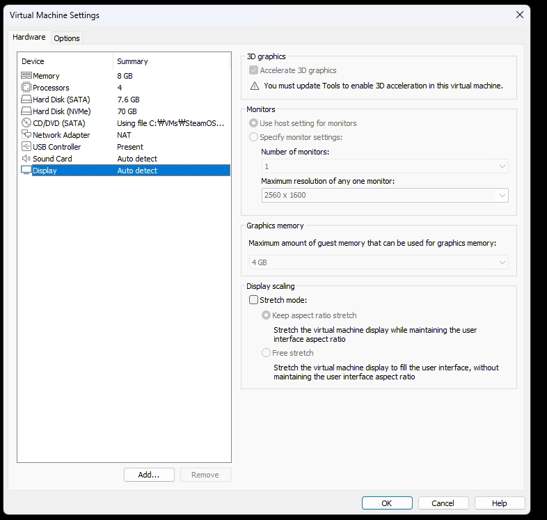
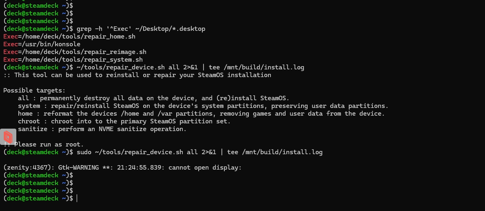
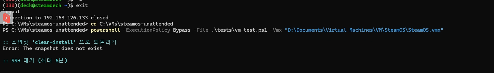
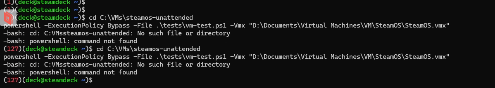
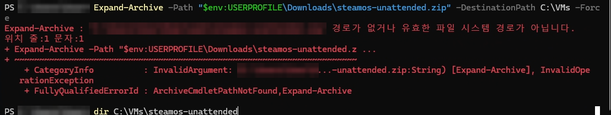

# Solución de problemas

[English](../README.md) | [한국어](README.ko.md) | [日本語](README.ja.md) | [简体中文](README.zh-CN.md) | **Español** | [Français](README.fr.md)

  

Todos los problemas de abajo ocurrieron de verdad al construir este proyecto. Cada entrada indica el síntoma, la causa y la solución, con la pantalla capturada en ese momento.

## Índice

- [Lista de problemas](#lista-de-problemas)
- [VM y arranque de recuperación](#vm-y-arranque-de-recuperación)
  - [T1 · Se queda en el arranque por red (PXE)](#t1--se-queda-en-el-arranque-por-red-pxe)
  - [T2 · Solo un cursor parpadeando tras el registro de arranque](#t2--solo-un-cursor-parpadeando-tras-el-registro-de-arranque)
  - [T3 · La configuración de la VM está en gris](#t3--la-configuración-de-la-vm-está-en-gris)
- [Compilación del controlador](#compilación-del-controlador)
  - [T4 · pacman falla con Read-only file system](#t4--pacman-falla-con-read-only-file-system)
  - [T5 · implicit declaration of function durante la compilación](#t5--implicit-declaration-of-function-durante-la-compilación)
- [Instalación](#instalación)
  - [T6 · El instalador se cierra al instante / Please run as root / cannot open display](#t6--el-instalador-se-cierra-al-instante--please-run-as-root--cannot-open-display)
  - [T7 · nvme format falla con Invalid Command Opcode](#t7--nvme-format-falla-con-invalid-command-opcode)
- [Sistema instalado](#sistema-instalado)
  - [T8 · Pantalla negra / vmwgfx.ko No such file or directory](#t8--pantalla-negra--vmwgfxko-no-such-file-or-directory)
  - [T9 · Pantalla negra un rato tras reiniciar](#t9--pantalla-negra-un-rato-tras-reiniciar)
- [Ejecución del script](#ejecución-del-script)
  - [T10 · No se encuentra el .vmx / Cannot open VM](#t10--no-se-encuentra-el-vmx--cannot-open-vm)
  - [T11 · The snapshot does not exist](#t11--the-snapshot-does-not-exist)
  - [T12 · Comandos de Windows ejecutados dentro de la VM](#t12--comandos-de-windows-ejecutados-dentro-de-la-vm)
  - [T13 · El coreano se ve pero no se puede escribir](#t13--el-coreano-se-ve-pero-no-se-puede-escribir)
  - [T14 · Expand-Archive no encuentra la ruta](#t14--expand-archive-no-encuentra-la-ruta)
- [Uso](#uso)
  - [T15 · Pantalla negra tras Return to Gaming Mode](#t15--pantalla-negra-tras-return-to-gaming-mode)

---

## Lista de problemas

| # | Síntoma | Etapa |
| --- | --- | --- |
| [T1](#t1) | Se queda en `Network boot from Intel E1000 … DHCP` | [Crear la VM](../../03-Configuration/01-Create-VM/README/README.es.md) |
| [T2](#t2) | Solo un cursor parpadeando tras el registro `[ OK ]` | [Arranque de recuperación](../../03-Configuration/02-Recovery-Boot/README/README.es.md) |
| [T3](#t3) | La configuración de la VM está en gris | [Crear la VM](../../03-Configuration/01-Create-VM/README/README.es.md) |
| [T4](#t4) | `could not lock database: Read-only file system` | [Controlador](../../03-Configuration/03-vmwgfx-Driver/README/README.es.md) |
| [T5](#t5) | `implicit declaration of function 'clean_record_shared_mapping_range'` | [Controlador](../../03-Configuration/03-vmwgfx-Driver/README/README.es.md) |
| [T6](#t6) | El instalador se cierra justo después de Proceed | [Instalación](../../03-Configuration/04-Install-SteamOS/README/README.es.md) |
| [T7](#t7) | `NVMe status: Invalid Command Opcode` | [Instalación](../../03-Configuration/04-Install-SteamOS/README/README.es.md) |
| [T8](#t8) | El sistema instalado arranca en pantalla negra | [Escritorio](../../03-Configuration/05-Desktop-Autostart/README/README.es.md) |
| [T9](#t9) | Pantalla negra un rato tras reiniciar | [Escritorio](../../03-Configuration/05-Desktop-Autostart/README/README.es.md) |
| [T10](#t10) | `Cannot open VM … cannot be found` | [Ejecución](../../03-Configuration/06-Run-Unattended/README/README.es.md) |
| [T11](#t11) | `The snapshot does not exist` | [Ejecución](../../03-Configuration/06-Run-Unattended/README/README.es.md) |
| [T12](#t12) | `cd: C:VMs…: No such file`, `powershell: command not found` | [Ejecución](../../03-Configuration/06-Run-Unattended/README/README.es.md) |
| [T13](#t13) | El coreano se ve pero no se puede escribir | [Ejecución](../../03-Configuration/06-Run-Unattended/README/README.es.md) |
| [T14](#t14) | `Expand-Archive` no encuentra la ruta | [Ejecución](../../03-Configuration/06-Run-Unattended/README/README.es.md) |
| [T15](#t15) | Pantalla negra tras Return to Gaming Mode | Uso |

---

## VM y arranque de recuperación

<a id="t1"></a>

### T1 · Se queda en el arranque por red (PXE)


**Causa** — El firmware de la VM se creó como **BIOS**. La imagen de recuperación solo arranca en UEFI, así que la BIOS no ve el disco y pasa al arranque por red. Cambiar el orden de arranque en la BIOS no sirve.

**Solución**

1. VM → Power → Power Off
2. Edit virtual machine settings → **Options → Advanced → Firmware type: UEFI**, y **desmarca** Enable secure boot
3. Power On to Firmware → Boot Manager → `EFI VMware Virtual SATA Hard Drive (0.0)`

Con UEFI, Boot Manager muestra entradas que empiezan por `EFI …` ([Paso 2](../../03-Configuration/02-Recovery-Boot/README/README.es.md)).

<a id="t2"></a>

### T2 · Solo un cursor parpadeando tras el registro de arranque


**Causa** — El kernel de SteamOS no tiene el controlador gráfico de VMware (`vmwgfx`), así que no se crea ningún dispositivo gráfico (`/dev/dri`). Más memoria, CPU o memoria de vídeo no ayudan. Una TTY (Ctrl+Alt+Space → F3) muestra que falta `/dev/dri`:


**Solución** — Compila vmwgfx para exactamente la misma versión del kernel y cárgalo ([Paso 3](../../03-Configuration/03-vmwgfx-Driver/README/README.es.md)).

> [!NOTE]
> El modo juego necesita Vulkan, así que no arranca en VMware ni con el controlador. El modo escritorio sí.

<a id="t3"></a>

### T3 · La configuración de la VM está en gris



**Causa** — La VM está encendida. La página de memoria también indica que debe estar apagada para reducirla. El aviso `You must update Tools to enable 3D acceleration` es para invitados Windows y se puede ignorar.

**Solución** — VM → Power → Power Off y cambia la configuración.

---

## Compilación del controlador

<a id="t4"></a>

### T4 · pacman falla con Read-only file system


**Causa** — La base de datos de pacman de SteamOS está en la zona de sistema de solo lectura (`/usr/lib/holo/pacmandb`). No es un problema de red.

**Solución** — No desbloquees el sistema. Copia la base de datos al disco de trabajo y usa esa copia solo para descargar:

```bash
sudo cp -a "$(pacman-conf DBPath)" /mnt/build/db
sudo pacman --dbpath /mnt/build/db -Sw --noconfirm --cachedir /mnt/build/pkg linux-neptune-616-headers
```

> [!IMPORTANT]
> **No** ejecutes `-Sy`. La lista de paquetes incluida en la imagen apunta a las cabeceras que coinciden con el kernel en ejecución.

<a id="t5"></a>

### T5 · implicit declaration of function durante la compilación


**Causa** — `wp_shared_mapping_range` y `clean_record_shared_mapping_range`, usadas por `vmwgfx_page_dirty.c`, pertenecen a `CONFIG_MAPPING_DIRTY_HELPERS`. Normalmente la activa vmwgfx, por lo que se desactivó junto con él cuando Valve lo apagó. Forma parte del kernel y no puede añadirse como módulo.

**Solución** — Añade una implementación sustituta ([`vmware/compat_dirty.h`](../../../vmware/compat_dirty.h)) dentro de vmwgfx y recompila ([parche de compatibilidad](../../03-Configuration/03-vmwgfx-Driver/README/README.es.md#compat-patch)).

---

## Instalación

<a id="t6"></a>

### T6 · El instalador se cierra al instante / Please run as root / cannot open display

Al pulsar Proceed en **Wipe Device & Install SteamOS** la ventana se cierra y el disco NVMe no tiene particiones:


Ejecutar el script directamente por SSH muestra dos errores:




**Causa**

1. El instalador necesita root.
2. Primero muestra un diálogo de confirmación (zenity), y una sesión SSH no tiene pantalla.

**Solución** — Ejecútalo con `sudo` desde **Terminal with repair tools** en la pantalla de la VM y guarda un registro en el disco de trabajo:

```bash
sudo ~/tools/repair_device_vm.sh all 2>&1 | tee /mnt/build/install.log
```

Si la ventana se vuelve a cerrar, `tail -30 /mnt/build/install.log` por SSH muestra el motivo.

<a id="t7"></a>

### T7 · nvme format falla con Invalid Command Opcode


**Causa** — El instalador empieza con un formateo por hardware (`nvme format`), que el NVMe virtual de VMware no admite. Ese paso está pensado para el SSD de una Steam Deck real y se puede omitir en un disco virtual vacío.

**Solución** — Conserva el original y, en una copia, convierte solo ese comando en uno que siempre tenga éxito ([Paso 4](../../03-Configuration/04-Install-SteamOS/README/README.es.md)):

```bash
cp ~/tools/repair_device.sh ~/tools/repair_device_vm.sh
sed -i 's/nvme format/true nvme format/' ~/tools/repair_device_vm.sh
```

---

## Sistema instalado

<a id="t8"></a>

### T8 · Pantalla negra / vmwgfx.ko No such file or directory


**Causa** — El servicio de carga automática y la configuración del escritorio están en su sitio, pero el controlador no está en `/home/vmwgfx/vmwgfx.ko`. SDDM arranca con normalidad pero no tiene dispositivo de pantalla donde dibujar.

**Solución** — Copia el controlador desde el anfitrión y aplícalo al momento:

```powershell
scp C:\VMs\vmwgfx.ko deck@192.168.126.133:/home/deck/
```

```bash
sudo mkdir -p /home/vmwgfx
sudo mv /home/deck/vmwgfx.ko /home/vmwgfx/
sudo systemctl restart vmwgfx-load.service
ls /dev/dri
sudo systemctl restart display-manager
```

> [!TIP]
> Si scp se rechaza, probablemente cambió la clave del host porque se instaló un sistema nuevo en la misma IP. Ejecuta `ssh-keygen -R 192.168.126.133` y vuelve a intentarlo.

<a id="t9"></a>

### T9 · Pantalla negra un rato tras reiniciar

**Causa** — No es un fallo. En una VM parte del escritorio se dibuja con la CPU y las tareas del primer arranque se solapan, así que tarda **1–2 minutos**.

**Solución** — Espera al menos dos minutos. Si no aparece nada, compruébalo por SSH:

```bash
systemctl status vmwgfx-load.service --no-pager | tail -5
ls /dev/dri
sudo dmesg | grep -i vmwgfx | tail -10
```

---

## Ejecución del script

<a id="t10"></a>

### T10 · No se encuentra el .vmx / Cannot open VM


**Causa** — La VM está en la carpeta predeterminada de VMware (Documentos\Virtual Machines), y el `.vmx` está **dentro de una carpeta con el nombre de la VM**: `…\VM\SteamOS\SteamOS.vmx`, no `…\VM\SteamOS.vmx`.

**Solución** — Lista las VMs en ejecución para obtener la ruta exacta:

```powershell
& "C:\Program Files (x86)\VMware\VMware Workstation\vmrun.exe" list
```

> [!CAUTION]
> Pasar la ruta de otra VM restaura **esa** VM a su instantánea.

Las primeras versiones de `tests/vm-test.ps1` seguían adelante tras este error. Ahora se detiene con FAIL si falta la ruta o falla la restauración de la instantánea.

<a id="t11"></a>

### T11 · The snapshot does not exist



**Causa** — Aún no se ha creado la instantánea `clean-install`.

**Solución**

```powershell
& $vmrun -T ws snapshot $vmx clean-install
& $vmrun -T ws listSnapshots $vmx
```

Para continuar sin instantánea, sigue la [ejecución manual](../../03-Configuration/06-Run-Unattended/README/README.es.md#manual-run).

<a id="t12"></a>

### T12 · Comandos de Windows ejecutados dentro de la VM




**Causa** — Entraste primero en la VM con `ssh deck@…` y luego pegaste comandos de Windows. La VM no conoce las rutas `C:\` ni `powershell`, y `ssh deck@192.168.126.133` desde dentro de la VM se conecta a sí misma y pide una contraseña.

**Solución** — Haz `exit`, comprueba que el prompt es `PS C:\…>` y ejecuta el comando. Las líneas `ssh "comando"` y `scp` de esta documentación se conectan a la VM y vuelven **cuando se ejecutan desde Windows**.

| Prompt | Dónde estás |
| --- | --- |
| `PS C:\…>` | Windows PowerShell |
| `(deck@steamdeck ~)$` | SteamOS dentro de la VM |

<a id="t13"></a>

### T13 · El coreano se ve pero no se puede escribir


**Causa** — Mostrar coreano (por ejemplo, sugerencias de búsqueda) solo requiere una fuente; escribirlo requiere el método de entrada (fcitx5). Su configuración se aplica desde el **siguiente inicio de sesión**, y en una VM Windows o VMware capturan antes la tecla Han/Eng.

**Solución** — Cierra sesión, vuelve a entrar y cambia con **Ctrl+Space**.


<a id="t14"></a>

### T14 · Expand-Archive no encuentra la ruta



**Causa** — El ZIP no está en Descargas o se guardó con otro nombre, como `SteamOS-Unattended-main (1).zip`.

**Solución** — Búscalo y pasa el resultado a `-Path`:

```powershell
Get-ChildItem $env:USERPROFILE -Recurse -Filter SteamOS-Unattended*.zip -ErrorAction SilentlyContinue | Select-Object FullName
```

---

## Uso

<a id="t15"></a>

### T15 · Pantalla negra tras Return to Gaming Mode

**Causa** — El modo juego (gamescope) necesita Vulkan, que la GPU virtual de VMware no ofrece.

**Solución** — Ejecuta `sudo reboot` por SSH. Gracias a `zzz-vmware-desktop.conf`, la VM vuelve al escritorio.

> [!NOTE]
> No se aplica a una Steam Deck real.
