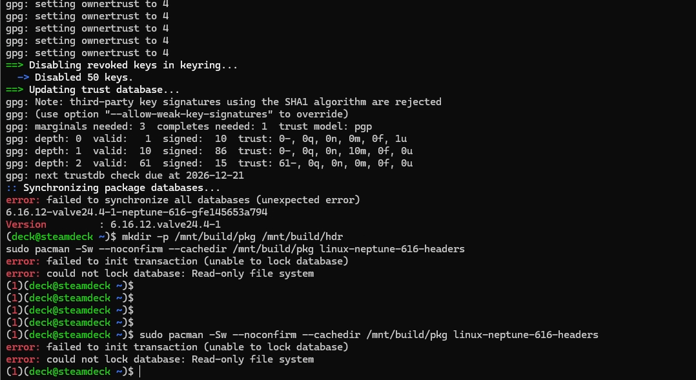
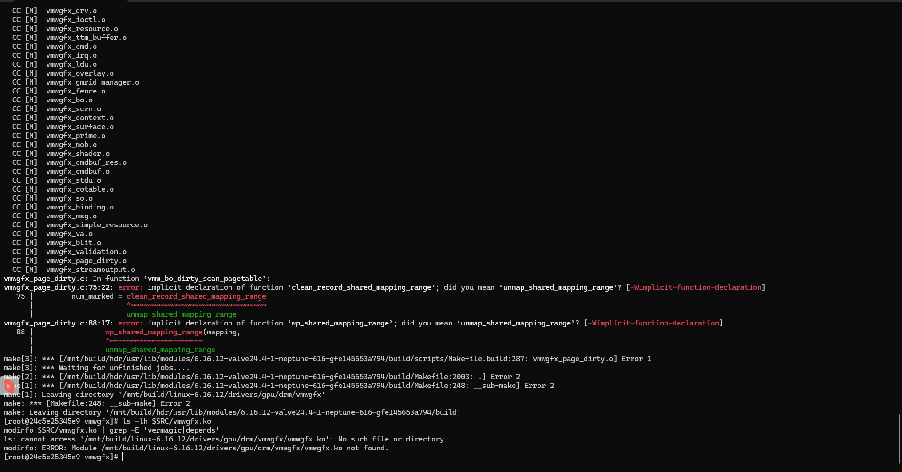

# Dépannage

[English](../README.md) | [한국어](README.ko.md) | [日本語](README.ja.md) | [简体中文](README.zh-CN.md) | [Español](README.es.md) | **Français**

  

Tous les problèmes ci-dessous sont réellement survenus pendant la construction de ce projet. Chaque entrée donne le symptôme, la cause et la solution, avec l'écran capturé sur le moment.

## Sommaire

- [Index](#index)
- [VM et démarrage de récupération](#vm-et-démarrage-de-récupération)
  - [T1 · Bloqué sur le démarrage réseau (PXE)](#t1--bloqué-sur-le-démarrage-réseau-pxe)
  - [T2 · Seul un curseur clignote après le journal de démarrage](#t2--seul-un-curseur-clignote-après-le-journal-de-démarrage)
  - [T3 · Les paramètres de la VM sont grisés](#t3--les-paramètres-de-la-vm-sont-grisés)
- [Compilation du pilote](#compilation-du-pilote)
  - [T4 · pacman échoue avec Read-only file system](#t4--pacman-échoue-avec-read-only-file-system)
  - [T5 · implicit declaration of function pendant la compilation](#t5--implicit-declaration-of-function-pendant-la-compilation)
- [Installation](#installation)
  - [T6 · L'installateur se ferme aussitôt / Please run as root / cannot open display](#t6--linstallateur-se-ferme-aussitôt--please-run-as-root--cannot-open-display)
  - [T7 · nvme format échoue avec Invalid Command Opcode](#t7--nvme-format-échoue-avec-invalid-command-opcode)
- [Système installé](#système-installé)
  - [T8 · Écran noir / vmwgfx.ko No such file or directory](#t8--écran-noir--vmwgfxko-no-such-file-or-directory)
  - [T9 · Écran noir un moment après le redémarrage](#t9--écran-noir-un-moment-après-le-redémarrage)
- [Exécution du script](#exécution-du-script)
  - [T10 · .vmx introuvable / Cannot open VM](#t10--vmx-introuvable--cannot-open-vm)
  - [T11 · The snapshot does not exist](#t11--the-snapshot-does-not-exist)
  - [T12 · Des commandes Windows lancées dans la VM](#t12--des-commandes-windows-lancées-dans-la-vm)
  - [T13 · Le coréen s'affiche mais ne peut pas être saisi](#t13--le-coréen-saffiche-mais-ne-peut-pas-être-saisi)
  - [T14 · Expand-Archive ne trouve pas le chemin](#t14--expand-archive-ne-trouve-pas-le-chemin)
- [Utilisation](#utilisation)
  - [T15 · Écran noir après Return to Gaming Mode](#t15--écran-noir-après-return-to-gaming-mode)

---

## Index

| # | Symptôme | Étape |
| --- | --- | --- |
| [T1](#t1) | Bloqué sur `Network boot from Intel E1000 … DHCP` | [Créer la VM](../../03-Configuration/01-Create-VM/README/README.fr.md) |
| [T2](#t2) | Seul un curseur clignote après le journal `[ OK ]` | [Démarrage de récupération](../../03-Configuration/02-Recovery-Boot/README/README.fr.md) |
| [T3](#t3) | Les paramètres de la VM sont grisés | [Créer la VM](../../03-Configuration/01-Create-VM/README/README.fr.md) |
| [T4](#t4) | `could not lock database: Read-only file system` | [Pilote](../../03-Configuration/03-vmwgfx-Driver/README/README.fr.md) |
| [T5](#t5) | `implicit declaration of function 'clean_record_shared_mapping_range'` | [Pilote](../../03-Configuration/03-vmwgfx-Driver/README/README.fr.md) |
| [T6](#t6) | L'installateur se ferme juste après Proceed | [Installation](../../03-Configuration/04-Install-SteamOS/README/README.fr.md) |
| [T7](#t7) | `NVMe status: Invalid Command Opcode` | [Installation](../../03-Configuration/04-Install-SteamOS/README/README.fr.md) |
| [T8](#t8) | Le système installé démarre sur un écran noir | [Bureau](../../03-Configuration/05-Desktop-Autostart/README/README.fr.md) |
| [T9](#t9) | Écran noir un moment après le redémarrage | [Bureau](../../03-Configuration/05-Desktop-Autostart/README/README.fr.md) |
| [T10](#t10) | `Cannot open VM … cannot be found` | [Exécution](../../03-Configuration/06-Run-Unattended/README/README.fr.md) |
| [T11](#t11) | `The snapshot does not exist` | [Exécution](../../03-Configuration/06-Run-Unattended/README/README.fr.md) |
| [T12](#t12) | `cd: C:VMs…: No such file`, `powershell: command not found` | [Exécution](../../03-Configuration/06-Run-Unattended/README/README.fr.md) |
| [T13](#t13) | Le coréen s'affiche mais ne peut pas être saisi | [Exécution](../../03-Configuration/06-Run-Unattended/README/README.fr.md) |
| [T14](#t14) | `Expand-Archive` ne trouve pas le chemin | [Exécution](../../03-Configuration/06-Run-Unattended/README/README.fr.md) |
| [T15](#t15) | Écran noir après Return to Gaming Mode | Utilisation |

---

## VM et démarrage de récupération

<a id="t1"></a>

### T1 · Bloqué sur le démarrage réseau (PXE)


**Cause** — Le firmware de la VM a été créé en **BIOS**. L'image de récupération ne démarre qu'en UEFI : le BIOS ne voit donc pas le disque et passe au démarrage réseau. Changer l'ordre de démarrage dans le BIOS n'y change rien.

**Solution**

1. VM → Power → Power Off
2. Edit virtual machine settings → **Options → Advanced → Firmware type: UEFI**, et **décochez** Enable secure boot
3. Power On to Firmware → Boot Manager → `EFI VMware Virtual SATA Hard Drive (0.0)`

En UEFI, Boot Manager liste des entrées commençant par `EFI …` ([Étape 2](../../03-Configuration/02-Recovery-Boot/README/README.fr.md)).

<a id="t2"></a>

### T2 · Seul un curseur clignote après le journal de démarrage


**Cause** — Le noyau SteamOS n'a pas de pilote graphique VMware (`vmwgfx`), donc aucun périphérique graphique (`/dev/dri`) n'est créé. Plus de mémoire, de CPU ou de mémoire vidéo n'aide pas. Un TTY (Ctrl+Alt+Space → F3) montre que `/dev/dri` est absent :


**Solution** — Compilez vmwgfx pour exactement la même version du noyau et chargez-le ([Étape 3](../../03-Configuration/03-vmwgfx-Driver/README/README.fr.md)).

> [!NOTE]
> Le mode jeu a besoin de Vulkan : il ne démarre pas dans VMware, même avec le pilote. Le mode bureau, si.

<a id="t3"></a>

### T3 · Les paramètres de la VM sont grisés


**Cause** — La VM est allumée. La page mémoire indique aussi qu'elle doit être éteinte pour réduire la mémoire. L'avertissement `You must update Tools to enable 3D acceleration` concerne les invités Windows et peut être ignoré.

**Solution** — VM → Power → Power Off, puis modifiez les paramètres.

---

## Compilation du pilote

<a id="t4"></a>

### T4 · pacman échoue avec Read-only file system




**Cause** — La base pacman de SteamOS se trouve dans la zone système en lecture seule (`/usr/lib/holo/pacmandb`). Ce n'est pas un problème réseau.

**Solution** — Ne déverrouillez pas le système. Copiez la base sur le disque de travail et utilisez cette copie uniquement pour télécharger :

```bash
sudo cp -a "$(pacman-conf DBPath)" /mnt/build/db
sudo pacman --dbpath /mnt/build/db -Sw --noconfirm --cachedir /mnt/build/pkg linux-neptune-616-headers
```

> [!IMPORTANT]
> N'exécutez **pas** `-Sy`. La liste de paquets fournie dans l'image pointe vers les en-têtes qui correspondent au noyau en cours.

<a id="t5"></a>

### T5 · implicit declaration of function pendant la compilation



**Cause** — `wp_shared_mapping_range` et `clean_record_shared_mapping_range`, utilisées par `vmwgfx_page_dirty.c`, appartiennent à `CONFIG_MAPPING_DIRTY_HELPERS`. Cette option est normalement sélectionnée par vmwgfx ; elle a donc été désactivée en même temps quand Valve a coupé vmwgfx. Elle fait partie du noyau lui-même et ne peut pas être ajoutée en module.

**Solution** — Ajoutez une implémentation de remplacement ([`vmware/compat_dirty.h`](../../../vmware/compat_dirty.h)) dans vmwgfx et recompilez ([correctif de compatibilité](../../03-Configuration/03-vmwgfx-Driver/README/README.fr.md#compat-patch)).

---

## Installation

<a id="t6"></a>

### T6 · L'installateur se ferme aussitôt / Please run as root / cannot open display

Cliquer sur Proceed dans **Wipe Device & Install SteamOS** ferme la fenêtre, et le disque NVMe n'a aucune partition :


Lancer le script directement via SSH révèle deux erreurs :


**Cause**

1. L'installateur a besoin des droits root.
2. Il affiche d'abord une boîte de confirmation (zenity), et une session SSH n'a pas d'affichage.

**Solution** — Lancez-le avec `sudo` depuis **Terminal with repair tools** à l'écran de la VM, en gardant un journal sur le disque de travail :

```bash
sudo ~/tools/repair_device_vm.sh all 2>&1 | tee /mnt/build/install.log
```

Si la fenêtre se ferme encore, `tail -30 /mnt/build/install.log` via SSH en donne la raison.

<a id="t7"></a>

### T7 · nvme format échoue avec Invalid Command Opcode


**Cause** — L'installateur commence par un formatage matériel (`nvme format`), que le NVMe virtuel de VMware ne prend pas en charge. Cette étape vise le SSD d'un vrai Steam Deck et peut être ignorée sur un disque virtuel vide.

**Solution** — Gardez l'original et, dans une copie, transformez seulement cette commande en une commande qui réussit toujours ([Étape 4](../../03-Configuration/04-Install-SteamOS/README/README.fr.md)) :

```bash
cp ~/tools/repair_device.sh ~/tools/repair_device_vm.sh
sed -i 's/nvme format/true nvme format/' ~/tools/repair_device_vm.sh
```

---

## Système installé

<a id="t8"></a>

### T8 · Écran noir / vmwgfx.ko No such file or directory


**Cause** — Le service de chargement automatique et la configuration du bureau sont en place, mais le pilote n'est pas dans `/home/vmwgfx/vmwgfx.ko`. SDDM démarre normalement mais n'a aucun périphérique d'affichage où dessiner.

**Solution** — Copiez le pilote depuis l'hôte et appliquez-le immédiatement :

```powershell
scp C:\VMs\vmwgfx.ko deck@192.168.126.133:/home/deck/
```

```bash
sudo mkdir -p /home/vmwgfx
sudo mv /home/deck/vmwgfx.ko /home/vmwgfx/
sudo systemctl restart vmwgfx-load.service
ls /dev/dri
sudo systemctl restart display-manager
```

> [!TIP]
> Si scp est refusé, la clé d'hôte a probablement changé parce qu'un nouveau système a été installé à la même IP. Exécutez `ssh-keygen -R 192.168.126.133` puis réessayez.

<a id="t9"></a>

### T9 · Écran noir un moment après le redémarrage

**Cause** — Ce n'est pas une panne. Dans une VM, une partie du bureau est rendue par le CPU et les tâches du premier démarrage se chevauchent : cela prend **1 à 2 minutes**.

**Solution** — Attendez au moins deux minutes. Si rien n'apparaît, vérifiez via SSH :

```bash
systemctl status vmwgfx-load.service --no-pager | tail -5
ls /dev/dri
sudo dmesg | grep -i vmwgfx | tail -10
```

---

## Exécution du script

<a id="t10"></a>

### T10 · .vmx introuvable / Cannot open VM


**Cause** — La VM se trouve dans le dossier par défaut de VMware (Documents\Virtual Machines), et le `.vmx` est **dans un dossier portant le nom de la VM** : `…\VM\SteamOS\SteamOS.vmx`, et non `…\VM\SteamOS.vmx`.

**Solution** — Listez les VM en cours pour obtenir le chemin exact :

```powershell
& "C:\Program Files (x86)\VMware\VMware Workstation\vmrun.exe" list
```

> [!CAUTION]
> Indiquer le chemin d'une autre VM restaure **cette** VM à son instantané.

Les premières versions de `tests/vm-test.ps1` continuaient après cette erreur. Il s'arrête désormais sur FAIL si le chemin manque ou si la restauration de l'instantané échoue.

<a id="t11"></a>

### T11 · The snapshot does not exist


**Cause** — L'instantané `clean-install` n'a pas encore été pris.

**Solution**

```powershell
& $vmrun -T ws snapshot $vmx clean-install
& $vmrun -T ws listSnapshots $vmx
```

Pour continuer sans instantané, suivez l'[exécution manuelle](../../03-Configuration/06-Run-Unattended/README/README.fr.md#manual-run).

<a id="t12"></a>

### T12 · Des commandes Windows lancées dans la VM


**Cause** — Vous êtes d'abord entré dans la VM avec `ssh deck@…`, puis avez collé des commandes Windows. La VM ne connaît ni les chemins `C:\` ni `powershell`, et `ssh deck@192.168.126.133` lancé depuis la VM se connecte à elle-même et demande un mot de passe.

**Solution** — Faites `exit`, vérifiez que l'invite est `PS C:\…>`, puis lancez la commande. Les lignes `ssh "commande"` et `scp` de cette documentation se connectent à la VM et reviennent **lorsqu'elles sont lancées depuis Windows**.

| Invite | Où vous êtes |
| --- | --- |
| `PS C:\…>` | Windows PowerShell |
| `(deck@steamdeck ~)$` | SteamOS dans la VM |

<a id="t13"></a>

### T13 · Le coréen s'affiche mais ne peut pas être saisi


**Cause** — Afficher du coréen (par exemple des suggestions de recherche) ne demande qu'une police ; le saisir demande la méthode de saisie (fcitx5). Ses réglages s'appliquent à la **prochaine connexion**, et dans une VM la touche Han/Eng est d'abord capturée par Windows ou VMware.

**Solution** — Déconnectez-vous, reconnectez-vous et basculez avec **Ctrl+Space**.


<a id="t14"></a>

### T14 · Expand-Archive ne trouve pas le chemin


**Cause** — Le ZIP n'est pas dans Téléchargements, ou il a été enregistré sous un autre nom comme `SteamOS-Unattended-main (1).zip`.

**Solution** — Retrouvez-le, puis passez le résultat à `-Path` :

```powershell
Get-ChildItem $env:USERPROFILE -Recurse -Filter SteamOS-Unattended*.zip -ErrorAction SilentlyContinue | Select-Object FullName
```

---

## Utilisation

<a id="t15"></a>

### T15 · Écran noir après Return to Gaming Mode

**Cause** — Le mode jeu (gamescope) a besoin de Vulkan, que le GPU virtuel de VMware ne fournit pas.

**Solution** — Lancez `sudo reboot` via SSH. Grâce à `zzz-vmware-desktop.conf`, la VM revient au bureau.

> [!NOTE]
> Cela ne concerne pas un vrai Steam Deck.
