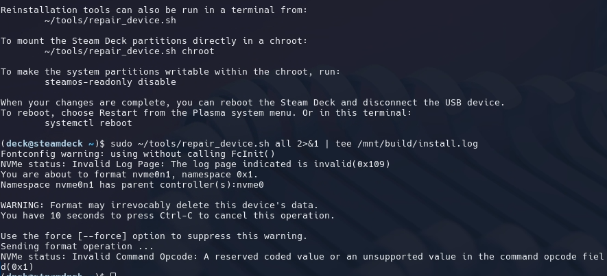

# トラブルシューティング

[English](../README.md) | [한국어](README.ko.md) | **日本語** | [简体中文](README.zh-CN.md) | [Español](README.es.md) | [Français](README.fr.md)

  

以下の問題はすべて、このプロジェクトを作る中で実際に起きたものです。各項目は症状・原因・対処の順にまとめ、当時のスクリーンショットをそのまま載せています。

## 目次

- [索引](#索引)
- [VM とリカバリー起動](#vm-とリカバリー起動)
  - [T1 · ネットワークブート（PXE）で止まる](#t1--ネットワークブートpxeで止まる)
  - [T2 · 起動ログの後にカーソルが点滅するだけ](#t2--起動ログの後にカーソルが点滅するだけ)
  - [T3 · VM の設定がグレーアウトして変更できない](#t3--vm-の設定がグレーアウトして変更できない)
- [ドライバーのビルド](#ドライバーのビルド)
  - [T4 · pacman が Read-only file system で失敗する](#t4--pacman-が-read-only-file-system-で失敗する)
  - [T5 · ビルド中の implicit declaration of function エラー](#t5--ビルド中の-implicit-declaration-of-function-エラー)
- [インストール](#インストール)
  - [T6 · インストーラーがすぐ閉じる / Please run as root / cannot open display](#t6--インストーラーがすぐ閉じる--please-run-as-root--cannot-open-display)
  - [T7 · nvme format が Invalid Command Opcode で失敗する](#t7--nvme-format-が-invalid-command-opcode-で失敗する)
- [インストール後のシステム](#インストール後のシステム)
  - [T8 · 黒い画面 / vmwgfx.ko No such file or directory](#t8--黒い画面--vmwgfxko-no-such-file-or-directory)
  - [T9 · 再起動後しばらく黒い画面](#t9--再起動後しばらく黒い画面)
- [スクリプトの実行](#スクリプトの実行)
  - [T10 · .vmx が見つからない / Cannot open VM](#t10--vmx-が見つからない--cannot-open-vm)
  - [T11 · The snapshot does not exist](#t11--the-snapshot-does-not-exist)
  - [T12 · Windows のコマンドを VM の中で実行した](#t12--windows-のコマンドを-vm-の中で実行した)
  - [T13 · 韓国語は表示されるが入力できない](#t13--韓国語は表示されるが入力できない)
  - [T14 · Expand-Archive がパスを見つけられない](#t14--expand-archive-がパスを見つけられない)
- [利用](#利用)
  - [T15 · Return to Gaming Mode 後に黒い画面](#t15--return-to-gaming-mode-後に黒い画面)

---

## 索引

| # | 症状 | 段階 |
| --- | --- | --- |
| [T1](#t1) | `Network boot from Intel E1000 … DHCP` で止まる | [VM の作成](../../03-Configuration/01-Create-VM/README/README.ja.md) |
| [T2](#t2) | `[ OK ]` ログの後にカーソルが点滅するだけ | [リカバリー起動](../../03-Configuration/02-Recovery-Boot/README/README.ja.md) |
| [T3](#t3) | VM の設定がグレーアウトしている | [VM の作成](../../03-Configuration/01-Create-VM/README/README.ja.md) |
| [T4](#t4) | `could not lock database: Read-only file system` | [ドライバー](../../03-Configuration/03-vmwgfx-Driver/README/README.ja.md) |
| [T5](#t5) | `implicit declaration of function 'clean_record_shared_mapping_range'` | [ドライバー](../../03-Configuration/03-vmwgfx-Driver/README/README.ja.md) |
| [T6](#t6) | Proceed の直後にインストーラーが閉じる | [インストール](../../03-Configuration/04-Install-SteamOS/README/README.ja.md) |
| [T7](#t7) | `NVMe status: Invalid Command Opcode` | [インストール](../../03-Configuration/04-Install-SteamOS/README/README.ja.md) |
| [T8](#t8) | インストール後のシステムが黒い画面で起動 | [デスクトップ](../../03-Configuration/05-Desktop-Autostart/README/README.ja.md) |
| [T9](#t9) | 再起動後しばらく黒い画面 | [デスクトップ](../../03-Configuration/05-Desktop-Autostart/README/README.ja.md) |
| [T10](#t10) | `Cannot open VM … cannot be found` | [実行](../../03-Configuration/06-Run-Unattended/README/README.ja.md) |
| [T11](#t11) | `The snapshot does not exist` | [実行](../../03-Configuration/06-Run-Unattended/README/README.ja.md) |
| [T12](#t12) | `cd: C:VMs…: No such file`、`powershell: command not found` | [実行](../../03-Configuration/06-Run-Unattended/README/README.ja.md) |
| [T13](#t13) | 韓国語は表示されるが入力できない | [実行](../../03-Configuration/06-Run-Unattended/README/README.ja.md) |
| [T14](#t14) | `Expand-Archive` がパスを見つけられない | [実行](../../03-Configuration/06-Run-Unattended/README/README.ja.md) |
| [T15](#t15) | Return to Gaming Mode 後に黒い画面 | 利用 |

---

## VM とリカバリー起動

<a id="t1"></a>

### T1 · ネットワークブート（PXE）で止まる


**原因** — VM のファームウェアが **BIOS** で作成されています。リカバリーイメージは UEFI でしか起動しないため、BIOS はディスクを認識できずネットワークブートに進みます。BIOS で起動順を変えても解決しません。

**対処**

1. VM → Power → Power Off
2. Edit virtual machine settings → **Options → Advanced → Firmware type: UEFI**、Enable secure boot の **チェックを外す**
3. Power On to Firmware → Boot Manager → `EFI VMware Virtual SATA Hard Drive (0.0)`

UEFI なら Boot Manager に `EFI …` で始まる項目が並びます（[ステップ 2](../../03-Configuration/02-Recovery-Boot/README/README.ja.md)）。

<a id="t2"></a>

### T2 · 起動ログの後にカーソルが点滅するだけ


**原因** — SteamOS のカーネルに VMware のグラフィックドライバー（`vmwgfx`）がなく、グラフィックデバイス（`/dev/dri`）が作られません。メモリ、CPU、ビデオメモリを増やしても解決しません。TTY（Ctrl+Alt+Space → F3）で確認すると `/dev/dri` がありません。


**対処** — まったく同じカーネルバージョンで vmwgfx をビルドして読み込みます（[ステップ 3](../../03-Configuration/03-vmwgfx-Driver/README/README.ja.md)）。

> [!NOTE]
> ゲームモードは Vulkan が必要なため、ドライバーを入れても VMware では起動しません。デスクトップモードは起動します。

<a id="t3"></a>

### T3 · VM の設定がグレーアウトして変更できない


**原因** — VM の電源が入っています。メモリの画面にも、減らすには電源を切る必要があると表示されます。`You must update Tools to enable 3D acceleration` の警告は Windows ゲスト向けなので無視して構いません。

**対処** — VM → Power → Power Off の後、設定を変更します。

---

## ドライバーのビルド

<a id="t4"></a>

### T4 · pacman が Read-only file system で失敗する


**原因** — SteamOS の pacman データベースは読み取り専用のシステム領域（`/usr/lib/holo/pacmandb`）にあります。ネットワークの問題ではありません。

**対処** — システムのロックは解除しません。データベースを作業ディスクにコピーし、そのコピーでダウンロードだけを行います。

```bash
sudo cp -a "$(pacman-conf DBPath)" /mnt/build/db
sudo pacman --dbpath /mnt/build/db -Sw --noconfirm --cachedir /mnt/build/pkg linux-neptune-616-headers
```

> [!IMPORTANT]
> `-Sy` は実行 **しないでください**。イメージに含まれるパッケージ一覧が、動作中のカーネルに合うヘッダーを指しています。

<a id="t5"></a>

### T5 · ビルド中の implicit declaration of function エラー


**原因** — `vmwgfx_page_dirty.c` が使う `wp_shared_mapping_range` と `clean_record_shared_mapping_range` は `CONFIG_MAPPING_DIRTY_HELPERS` に属します。本来 vmwgfx によって有効になる機能のため、Valve が vmwgfx を無効にした際に一緒に無効になりました。カーネル本体の機能なのでモジュールとして追加できません。

**対処** — vmwgfx の中に代替実装（[`vmware/compat_dirty.h`](../../../vmware/compat_dirty.h)）を入れて再ビルドします（[互換パッチ](../../03-Configuration/03-vmwgfx-Driver/README/README.ja.md#compat-patch)）。

---

## インストール

<a id="t6"></a>

### T6 · インストーラーがすぐ閉じる / Please run as root / cannot open display

**Wipe Device & Install SteamOS** で Proceed を押すとウィンドウが閉じ、NVMe ディスクにはパーティションが一つもありません。


SSH からスクリプトを直接実行すると、2 つのエラーが出ます。


**原因**

1. インストーラーには root 権限が必要です。
2. 最初に確認ダイアログ（zenity）を表示しますが、SSH セッションには画面がありません。

**対処** — VM 画面の **Terminal with repair tools** から `sudo` で実行し、ログを作業ディスクに残します。

```bash
sudo ~/tools/repair_device_vm.sh all 2>&1 | tee /mnt/build/install.log
```

再びウィンドウが閉じても、SSH で `tail -30 /mnt/build/install.log` を見れば原因がわかります。

<a id="t7"></a>

### T7 · nvme format が Invalid Command Opcode で失敗する



**原因** — インストーラーは最初にハードウェアフォーマット（`nvme format`）を行いますが、VMware の仮想 NVMe はこのコマンドに対応していません。実機の Steam Deck SSD 向けの処理なので、空の仮想ディスクでは省略して問題ありません。

**対処** — 元のファイルはそのまま残し、コピーの中でそのコマンドだけを必ず成功するコマンドに置き換えます（[ステップ 4](../../03-Configuration/04-Install-SteamOS/README/README.ja.md)）。

```bash
cp ~/tools/repair_device.sh ~/tools/repair_device_vm.sh
sed -i 's/nvme format/true nvme format/' ~/tools/repair_device_vm.sh
```

---

## インストール後のシステム

<a id="t8"></a>

### T8 · 黒い画面 / vmwgfx.ko No such file or directory


**原因** — 自動読み込みサービスとデスクトップ設定は入っていますが、ドライバーが `/home/vmwgfx/vmwgfx.ko` にありません。SDDM は正常に起動しますが、描画するディスプレイデバイスがありません。

**対処** — ホストからドライバーをコピーし、すぐに適用します。

```powershell
scp C:\VMs\vmwgfx.ko deck@192.168.126.133:/home/deck/
```

```bash
sudo mkdir -p /home/vmwgfx
sudo mv /home/deck/vmwgfx.ko /home/vmwgfx/
sudo systemctl restart vmwgfx-load.service
ls /dev/dri
sudo systemctl restart display-manager
```

> [!TIP]
> scp が拒否される場合は、同じ IP に OS を再インストールしてホスト鍵が変わったことが多いです。`ssh-keygen -R 192.168.126.133` を実行して再試行してください。

<a id="t9"></a>

### T9 · 再起動後しばらく黒い画面

**原因** — 故障ではありません。VM ではデスクトップの一部を CPU で描画し、初回起動の処理も重なるため **1〜2 分** かかります。

**対処** — 少なくとも 2 分は待ちます。それでも表示されなければ SSH で確認します。

```bash
systemctl status vmwgfx-load.service --no-pager | tail -5
ls /dev/dri
sudo dmesg | grep -i vmwgfx | tail -10
```

---

## スクリプトの実行

<a id="t10"></a>

### T10 · .vmx が見つからない / Cannot open VM


**原因** — VM は VMware の既定フォルダー（ドキュメント\Virtual Machines）にあり、`.vmx` は **VM 名のフォルダーの中** にあります。`…\VM\SteamOS.vmx` ではなく `…\VM\SteamOS\SteamOS.vmx` が正解です。

**対処** — 実行中の VM 一覧から正確なパスを確認します。

```powershell
& "C:\Program Files (x86)\VMware\VMware Workstation\vmrun.exe" list
```

> [!CAUTION]
> 別の VM のパスを渡すと、**その VM** がスナップショットに戻ってしまいます。

初期の `tests/vm-test.ps1` はこのエラーの後も処理を続けていました。現在は、パスがない場合やスナップショットの復元に失敗した場合にすぐ FAIL で停止します。

<a id="t11"></a>

### T11 · The snapshot does not exist


**原因** — `clean-install` スナップショットをまだ作成していません。

**対処**

```powershell
& $vmrun -T ws snapshot $vmx clean-install
& $vmrun -T ws listSnapshots $vmx
```

スナップショットなしで進めるには [手動実行](../../03-Configuration/06-Run-Unattended/README/README.ja.md#manual-run) に従ってください。

<a id="t12"></a>

### T12 · Windows のコマンドを VM の中で実行した


**原因** — 先に `ssh deck@…` で VM に入り、その後 Windows 用のコマンドを貼り付けました。VM は `C:\` のパスや `powershell` を知らず、VM 内で `ssh deck@192.168.126.133` を実行すると自分自身に接続しようとしてパスワードを求めます。

**対処** — `exit` で抜け、プロンプトが `PS C:\…>` であることを確認してから実行します。このドキュメントの `ssh "コマンド"` と `scp` は、**Windows から実行すると** VM に接続して自動的に戻ってきます。

| プロンプト | 場所 |
| --- | --- |
| `PS C:\…>` | Windows PowerShell |
| `(deck@steamdeck ~)$` | VM 内の SteamOS |

<a id="t13"></a>

### T13 · 韓国語は表示されるが入力できない


**原因** — 韓国語（検索候補など）の表示はフォントがあれば十分ですが、入力には入力メソッド（fcitx5）が必要です。その設定は **次回ログインから** 反映され、VM では韓/英キーを Windows や VMware が先に取ってしまいます。

**対処** — ログアウトして再ログインし、**Ctrl+Space** で切り替えます。


<a id="t14"></a>

### T14 · Expand-Archive がパスを見つけられない


**原因** — ZIP がダウンロードフォルダーにないか、`SteamOS-Unattended-main (1).zip` のように別名で保存されています。

**対処** — ファイルを探し、見つかったパスを `-Path` に渡します。

```powershell
Get-ChildItem $env:USERPROFILE -Recurse -Filter SteamOS-Unattended*.zip -ErrorAction SilentlyContinue | Select-Object FullName
```

---

## 利用

<a id="t15"></a>

### T15 · Return to Gaming Mode 後に黒い画面

**原因** — ゲームモード（gamescope）は Vulkan を必要としますが、VMware の仮想 GPU は提供していません。

**対処** — SSH で `sudo reboot` を実行します。`zzz-vmware-desktop.conf` のおかげでデスクトップに戻ります。

> [!NOTE]
> 実機の Steam Deck には該当しません。
