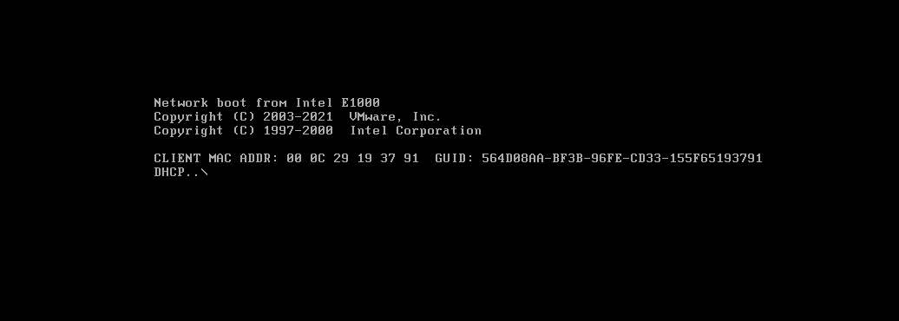
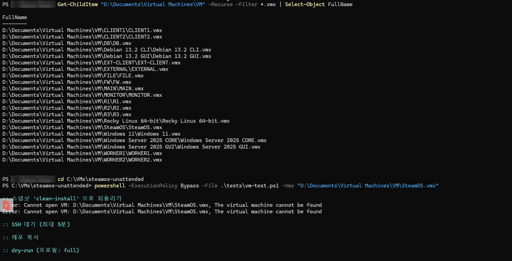
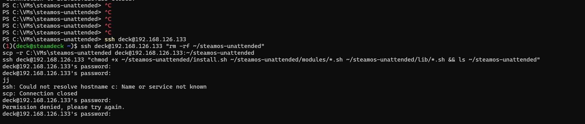

# 트러블슈팅

[English](../README.md) | **한국어** | [日本語](README.ja.md) | [简体中文](README.zh-CN.md) | [Español](README.es.md) | [Français](README.fr.md)

  

아래 문제는 모두 이 프로젝트를 만들면서 실제로 겪은 것입니다. 항목마다 증상, 원인, 해결 순서로 정리했고, 당시 찍은 화면을 그대로 붙였습니다.

## 목차

- [색인](#색인)
- [VM과 복구 부팅](#vm과-복구-부팅)
  - [T1 · 네트워크 부팅(PXE) 화면에서 멈춤](#t1--네트워크-부팅pxe-화면에서-멈춤)
  - [T2 · 부팅 로그 끝에서 커서만 깜빡임](#t2--부팅-로그-끝에서-커서만-깜빡임)
  - [T3 · VM 설정이 회색이라 바뀌지 않음](#t3--vm-설정이-회색이라-바뀌지-않음)
- [드라이버 빌드](#드라이버-빌드)
  - [T4 · pacman이 Read-only file system으로 실패](#t4--pacman이-read-only-file-system으로-실패)
  - [T5 · 빌드 중 implicit declaration of function 오류](#t5--빌드-중-implicit-declaration-of-function-오류)
- [설치](#설치)
  - [T6 · 설치 창이 바로 닫힘 / Please run as root / cannot open display](#t6--설치-창이-바로-닫힘--please-run-as-root--cannot-open-display)
  - [T7 · nvme format이 Invalid Command Opcode로 실패](#t7--nvme-format이-invalid-command-opcode로-실패)
- [설치본](#설치본)
  - [T8 · 검은 화면 / vmwgfx.ko No such file or directory](#t8--검은-화면--vmwgfxko-no-such-file-or-directory)
  - [T9 · 재부팅 후 한동안 검은 화면](#t9--재부팅-후-한동안-검은-화면)
- [스크립트 실행](#스크립트-실행)
  - [T10 · .vmx 파일을 찾을 수 없음 / Cannot open VM](#t10--vmx-파일을-찾을-수-없음--cannot-open-vm)
  - [T11 · The snapshot does not exist](#t11--the-snapshot-does-not-exist)
  - [T12 · Windows 명령이 VM 안에서 실행됨](#t12--windows-명령이-vm-안에서-실행됨)
  - [T13 · 한글이 보이는데 입력이 안 됨](#t13--한글이-보이는데-입력이-안-됨)
  - [T14 · Expand-Archive가 경로를 찾지 못함](#t14--expand-archive가-경로를-찾지-못함)
- [사용](#사용)
  - [T15 · Return to Gaming Mode 후 검은 화면](#t15--return-to-gaming-mode-후-검은-화면)

---

## 색인

| # | 증상 | 단계 |
| --- | --- | --- |
| [T1](#t1) | `Network boot from Intel E1000 … DHCP` 에서 멈춤 | [VM 만들기](../../03-Configuration/01-Create-VM/README/README.ko.md) |
| [T2](#t2) | `[ OK ]` 로그 뒤 커서만 깜빡임 | [복구 부팅](../../03-Configuration/02-Recovery-Boot/README/README.ko.md) |
| [T3](#t3) | VM 설정 항목이 회색 | [VM 만들기](../../03-Configuration/01-Create-VM/README/README.ko.md) |
| [T4](#t4) | `could not lock database: Read-only file system` | [드라이버](../../03-Configuration/03-vmwgfx-Driver/README/README.ko.md) |
| [T5](#t5) | `implicit declaration of function 'clean_record_shared_mapping_range'` | [드라이버](../../03-Configuration/03-vmwgfx-Driver/README/README.ko.md) |
| [T6](#t6) | 설치 창이 Proceed 뒤 바로 닫힘 | [설치](../../03-Configuration/04-Install-SteamOS/README/README.ko.md) |
| [T7](#t7) | `NVMe status: Invalid Command Opcode` | [설치](../../03-Configuration/04-Install-SteamOS/README/README.ko.md) |
| [T8](#t8) | 설치본 부팅 후 검은 화면 | [데스크톱](../../03-Configuration/05-Desktop-Autostart/README/README.ko.md) |
| [T9](#t9) | 재부팅 후 한동안 검은 화면 | [데스크톱](../../03-Configuration/05-Desktop-Autostart/README/README.ko.md) |
| [T10](#t10) | `Cannot open VM … cannot be found` | [실행](../../03-Configuration/06-Run-Unattended/README/README.ko.md) |
| [T11](#t11) | `The snapshot does not exist` | [실행](../../03-Configuration/06-Run-Unattended/README/README.ko.md) |
| [T12](#t12) | `cd: C:VMs…: No such file`, `powershell: command not found` | [실행](../../03-Configuration/06-Run-Unattended/README/README.ko.md) |
| [T13](#t13) | 한글은 보이는데 입력이 안 됨 | [실행](../../03-Configuration/06-Run-Unattended/README/README.ko.md) |
| [T14](#t14) | `Expand-Archive` 가 경로를 찾지 못함 | [실행](../../03-Configuration/06-Run-Unattended/README/README.ko.md) |
| [T15](#t15) | Return to Gaming Mode 후 검은 화면 | 사용 |

---

## VM과 복구 부팅

<a id="t1"></a>

### T1 · 네트워크 부팅(PXE) 화면에서 멈춤



**원인** — VM 펌웨어가 **BIOS** 로 만들어졌습니다. 복구 이미지는 UEFI에서만 부팅되므로 BIOS는 디스크를 인식하지 못하고 네트워크 부팅으로 넘어갑니다. BIOS에서 부팅 순서를 바꿔도 해결되지 않습니다.

**해결**

1. VM → Power → Power Off
2. Edit virtual machine settings → **Options → Advanced → Firmware type: UEFI**, Enable secure boot **해제**
3. Power On to Firmware → Boot Manager → `EFI VMware Virtual SATA Hard Drive (0.0)`

UEFI라면 Boot Manager에 `EFI …` 로 시작하는 항목이 보입니다([2단계](../../03-Configuration/02-Recovery-Boot/README/README.ko.md)).

<a id="t2"></a>

### T2 · 부팅 로그 끝에서 커서만 깜빡임


**원인** — SteamOS 커널에 VMware 그래픽 드라이버(`vmwgfx`)가 없어 그래픽 장치(`/dev/dri`)가 생기지 않습니다. 메모리, CPU, 그래픽 메모리를 늘려도 해결되지 않습니다. TTY(Ctrl+Alt+Space → F3)에서 확인하면 `/dev/dri` 가 없습니다.


**해결** — 똑같은 커널 버전으로 vmwgfx를 빌드해 로드합니다([3단계](../../03-Configuration/03-vmwgfx-Driver/README/README.ko.md)).

> [!NOTE]
> 게임 모드는 Vulkan이 필요해서 드라이버를 넣어도 VMware에서는 뜨지 않습니다. 데스크톱 모드는 뜹니다.

<a id="t3"></a>

### T3 · VM 설정이 회색이라 바뀌지 않음


**원인** — VM이 켜져 있습니다. 메모리 화면에도 전원을 꺼야 줄일 수 있다는 안내가 나옵니다. `You must update Tools to enable 3D acceleration` 경고는 Windows 게스트용이라 무시해도 됩니다.

**해결** — VM → Power → Power Off 후 다시 설정합니다.

---

## 드라이버 빌드

<a id="t4"></a>

### T4 · pacman이 Read-only file system으로 실패


**원인** — SteamOS의 pacman 데이터베이스는 읽기 전용 시스템 영역(`/usr/lib/holo/pacmandb`)에 있습니다. 네트워크 문제가 아닙니다.

**해결** — 시스템 잠금을 풀지 않습니다. 데이터베이스를 작업 디스크로 복사하고, 그 복사본으로 다운로드만 합니다.

```bash
sudo cp -a "$(pacman-conf DBPath)" /mnt/build/db
sudo pacman --dbpath /mnt/build/db -Sw --noconfirm --cachedir /mnt/build/pkg linux-neptune-616-headers
```

> [!IMPORTANT]
> `-Sy` 는 실행하지 **마세요**. 이미지에 들어 있던 패키지 목록이 현재 커널과 맞는 헤더를 가리킵니다.

<a id="t5"></a>

### T5 · 빌드 중 implicit declaration of function 오류


**원인** — `vmwgfx_page_dirty.c` 가 쓰는 `wp_shared_mapping_range`, `clean_record_shared_mapping_range` 는 `CONFIG_MAPPING_DIRTY_HELPERS` 에 속합니다. 원래 vmwgfx가 켜면서 함께 켜지는 기능이라 Valve가 vmwgfx를 끌 때 같이 꺼졌습니다. 커널 본체 기능이라 모듈로 넣을 수 없습니다.

**해결** — vmwgfx 안에 대체 구현([`vmware/compat_dirty.h`](../../../vmware/compat_dirty.h))을 넣고 다시 빌드합니다([호환 패치](../../03-Configuration/03-vmwgfx-Driver/README/README.ko.md#compat-patch)).

---

## 설치

<a id="t6"></a>

### T6 · 설치 창이 바로 닫힘 / Please run as root / cannot open display

**Wipe Device & Install SteamOS** 에서 Proceed를 누르면 창이 닫히고, NVMe 디스크에 파티션이 하나도 없습니다.


스크립트를 SSH에서 직접 실행하면 두 가지 오류가 나옵니다.


**원인**

1. 설치 스크립트는 root 권한이 필요합니다.
2. 시작 전에 확인 창(zenity)을 띄우는데, SSH 세션에는 화면이 없습니다.

**해결** — VM 화면의 **Terminal with repair tools** 에서 `sudo` 로 실행하고, 로그를 작업 디스크에 남깁니다.

```bash
sudo ~/tools/repair_device_vm.sh all 2>&1 | tee /mnt/build/install.log
```

창이 다시 닫혀도 SSH에서 `tail -30 /mnt/build/install.log` 로 원인을 볼 수 있습니다.

<a id="t7"></a>

### T7 · nvme format이 Invalid Command Opcode로 실패


**원인** — 설치 스크립트는 맨 처음 하드웨어 포맷(`nvme format`)을 하는데, VMware의 가상 NVMe는 이 명령을 지원하지 않습니다. 실제 Steam Deck SSD용 단계라 빈 가상 디스크에서는 건너뛰어도 됩니다.

**해결** — 원본은 그대로 두고, 복사본에서 그 명령만 항상 성공하는 명령으로 바꿉니다([4단계](../../03-Configuration/04-Install-SteamOS/README/README.ko.md)).

```bash
cp ~/tools/repair_device.sh ~/tools/repair_device_vm.sh
sed -i 's/nvme format/true nvme format/' ~/tools/repair_device_vm.sh
```

---

## 설치본

<a id="t8"></a>

### T8 · 검은 화면 / vmwgfx.ko No such file or directory


**원인** — 자동 로드 서비스와 데스크톱 설정은 들어갔지만, 드라이버가 `/home/vmwgfx/vmwgfx.ko` 에 없습니다. SDDM은 정상으로 시작하지만 그릴 화면 장치가 없습니다.

**해결** — 호스트에서 드라이버를 복사하고 바로 적용합니다.

```powershell
scp C:\VMs\vmwgfx.ko deck@192.168.126.133:/home/deck/
```

```bash
sudo mkdir -p /home/vmwgfx
sudo mv /home/deck/vmwgfx.ko /home/vmwgfx/
sudo systemctl restart vmwgfx-load.service
ls /dev/dri
sudo systemctl restart display-manager
```

> [!TIP]
> scp가 거부되면 같은 IP에 OS를 새로 설치해 호스트 키가 바뀐 경우가 많습니다. `ssh-keygen -R 192.168.126.133` 후 다시 시도하세요.

<a id="t9"></a>

### T9 · 재부팅 후 한동안 검은 화면

**원인** — 고장이 아닙니다. VM에서는 데스크톱 일부를 CPU로 그리고 첫 부팅 작업이 겹쳐서 **1~2분** 걸립니다.

**해결** — 최소 2분은 기다립니다. 그래도 안 뜨면 SSH로 확인합니다.

```bash
systemctl status vmwgfx-load.service --no-pager | tail -5
ls /dev/dri
sudo dmesg | grep -i vmwgfx | tail -10
```

---

## 스크립트 실행

<a id="t10"></a>

### T10 · .vmx 파일을 찾을 수 없음 / Cannot open VM




**원인** — VM이 VMware 기본 폴더(문서\Virtual Machines)에 있고, `.vmx` 는 **VM 이름의 폴더 안에** 있습니다. `…\VM\SteamOS.vmx` 가 아니라 `…\VM\SteamOS\SteamOS.vmx` 가 맞습니다.

**해결** — 실행 중인 VM 목록에서 정확한 경로를 확인합니다.

```powershell
& "C:\Program Files (x86)\VMware\VMware Workstation\vmrun.exe" list
```

> [!CAUTION]
> 다른 VM의 경로를 넣으면 **그 VM** 이 스냅샷으로 되돌아갑니다.

초기 버전의 `tests/vm-test.ps1` 은 이 오류가 나도 계속 진행했습니다. 지금은 경로가 없거나 스냅샷 복원에 실패하면 바로 FAIL로 멈춥니다.

<a id="t11"></a>

### T11 · The snapshot does not exist


**원인** — `clean-install` 스냅샷을 아직 찍지 않았습니다.

**해결**

```powershell
& $vmrun -T ws snapshot $vmx clean-install
& $vmrun -T ws listSnapshots $vmx
```

스냅샷 없이 진행하려면 [직접 실행](../../03-Configuration/06-Run-Unattended/README/README.ko.md#manual-run)을 따르세요.

<a id="t12"></a>

### T12 · Windows 명령이 VM 안에서 실행됨




**원인** — 먼저 `ssh deck@…` 로 VM에 들어간 뒤 Windows용 명령을 붙여 넣었습니다. VM은 `C:\` 경로나 `powershell` 을 모르고, VM 안에서 `ssh deck@192.168.126.133` 을 실행하면 자기 자신에 접속하려다 비밀번호를 묻습니다.

**해결** — `exit` 로 나와 프롬프트가 `PS C:\…>` 인지 확인한 뒤 실행합니다. 이 문서의 `ssh "명령"`, `scp` 는 **Windows에서 실행하면** VM에 접속했다가 알아서 돌아옵니다.

| 프롬프트 | 위치 |
| --- | --- |
| `PS C:\…>` | Windows PowerShell |
| `(deck@steamdeck ~)$` | VM 안의 SteamOS |

<a id="t13"></a>

### T13 · 한글이 보이는데 입력이 안 됨


**원인** — 화면에 한글(검색어 추천 등)을 보여 주는 데는 글꼴만 있으면 되지만, 입력은 입력기(fcitx5)가 해야 합니다. 입력기 설정은 **다음 로그인부터** 적용되고, VM에서는 한/영 키를 Windows나 VMware가 먼저 가져갑니다.

**해결** — 로그아웃 후 다시 로그인하고 **Ctrl+Space** 로 전환합니다.


<a id="t14"></a>

### T14 · Expand-Archive가 경로를 찾지 못함


**원인** — ZIP이 다운로드 폴더에 없거나, `SteamOS-Unattended-main (1).zip` 처럼 다른 이름으로 저장되었습니다.

**해결** — 파일을 찾은 뒤 결과 경로를 `-Path` 에 넣습니다.

```powershell
Get-ChildItem $env:USERPROFILE -Recurse -Filter SteamOS-Unattended*.zip -ErrorAction SilentlyContinue | Select-Object FullName
```

---

## 사용

<a id="t15"></a>

### T15 · Return to Gaming Mode 후 검은 화면

**원인** — 게임 모드(gamescope)는 Vulkan이 필요한데, VMware 가상 GPU는 이를 제공하지 않습니다.

**해결** — SSH로 `sudo reboot` 를 실행합니다. `zzz-vmware-desktop.conf` 덕분에 데스크톱으로 돌아옵니다.

> [!NOTE]
> 실제 Steam Deck에는 해당하지 않습니다.
