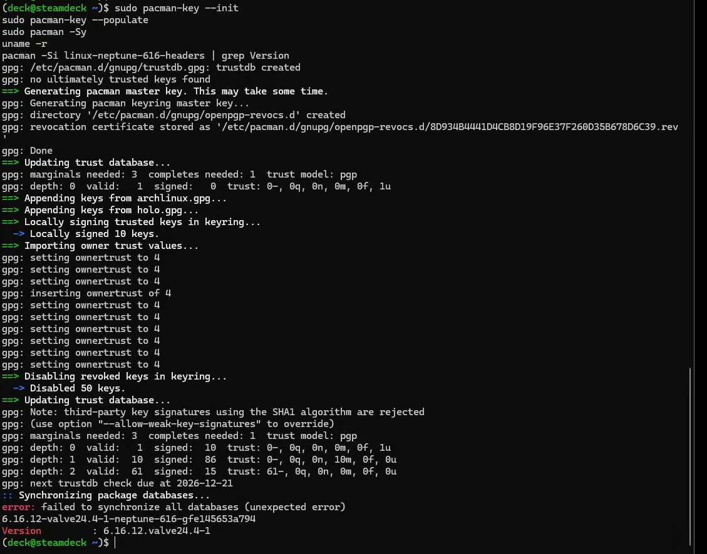
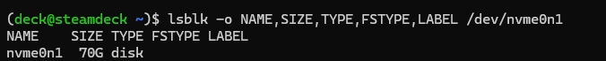
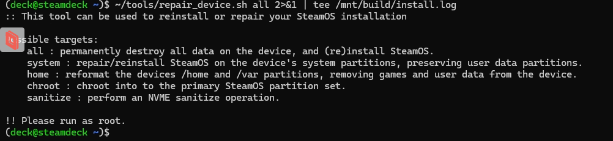
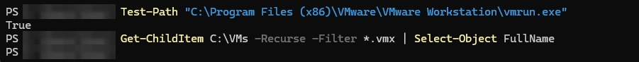
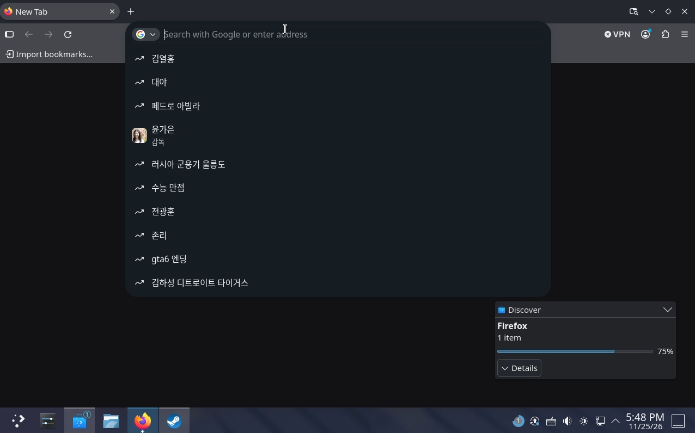

# 故障排除

[English](../README.md) | [한국어](README.ko.md) | [日本語](README.ja.md) | **简体中文** | [Español](README.es.md) | [Français](README.fr.md)

  

以下问题都是在构建本项目时实际遇到的。每一项按症状、原因、解决方法整理，并附上当时的截图。

## 目录

- [索引](#索引)
- [虚拟机与恢复启动](#虚拟机与恢复启动)
  - [T1 · 停在网络启动（PXE）](#t1--停在网络启动pxe)
  - [T2 · 启动日志之后只有光标闪烁](#t2--启动日志之后只有光标闪烁)
  - [T3 · 虚拟机设置是灰色的，无法修改](#t3--虚拟机设置是灰色的无法修改)
- [驱动构建](#驱动构建)
  - [T4 · pacman 因 Read-only file system 失败](#t4--pacman-因-read-only-file-system-失败)
  - [T5 · 构建时出现 implicit declaration of function](#t5--构建时出现-implicit-declaration-of-function)
- [安装](#安装)
  - [T6 · 安装窗口立即关闭 / Please run as root / cannot open display](#t6--安装窗口立即关闭--please-run-as-root--cannot-open-display)
  - [T7 · nvme format 因 Invalid Command Opcode 失败](#t7--nvme-format-因-invalid-command-opcode-失败)
- [安装后的系统](#安装后的系统)
  - [T8 · 黑屏 / vmwgfx.ko No such file or directory](#t8--黑屏--vmwgfxko-no-such-file-or-directory)
  - [T9 · 重启后一段时间黑屏](#t9--重启后一段时间黑屏)
- [运行脚本](#运行脚本)
  - [T10 · 找不到 .vmx / Cannot open VM](#t10--找不到-vmx--cannot-open-vm)
  - [T11 · The snapshot does not exist](#t11--the-snapshot-does-not-exist)
  - [T12 · 在虚拟机内运行了 Windows 命令](#t12--在虚拟机内运行了-windows-命令)
  - [T13 · 能显示韩文但无法输入](#t13--能显示韩文但无法输入)
  - [T14 · Expand-Archive 找不到路径](#t14--expand-archive-找不到路径)
- [使用](#使用)
  - [T15 · Return to Gaming Mode 后黑屏](#t15--return-to-gaming-mode-后黑屏)

---

## 索引

| # | 症状 | 阶段 |
| --- | --- | --- |
| [T1](#t1) | 停在 `Network boot from Intel E1000 … DHCP` | [创建虚拟机](../../03-Configuration/01-Create-VM/README/README.zh-CN.md) |
| [T2](#t2) | `[ OK ]` 日志之后只有光标闪烁 | [恢复启动](../../03-Configuration/02-Recovery-Boot/README/README.zh-CN.md) |
| [T3](#t3) | 虚拟机设置是灰色的 | [创建虚拟机](../../03-Configuration/01-Create-VM/README/README.zh-CN.md) |
| [T4](#t4) | `could not lock database: Read-only file system` | [驱动](../../03-Configuration/03-vmwgfx-Driver/README/README.zh-CN.md) |
| [T5](#t5) | `implicit declaration of function 'clean_record_shared_mapping_range'` | [驱动](../../03-Configuration/03-vmwgfx-Driver/README/README.zh-CN.md) |
| [T6](#t6) | 点击 Proceed 后安装窗口立即关闭 | [安装](../../03-Configuration/04-Install-SteamOS/README/README.zh-CN.md) |
| [T7](#t7) | `NVMe status: Invalid Command Opcode` | [安装](../../03-Configuration/04-Install-SteamOS/README/README.zh-CN.md) |
| [T8](#t8) | 安装后的系统启动为黑屏 | [桌面](../../03-Configuration/05-Desktop-Autostart/README/README.zh-CN.md) |
| [T9](#t9) | 重启后一段时间黑屏 | [桌面](../../03-Configuration/05-Desktop-Autostart/README/README.zh-CN.md) |
| [T10](#t10) | `Cannot open VM … cannot be found` | [运行](../../03-Configuration/06-Run-Unattended/README/README.zh-CN.md) |
| [T11](#t11) | `The snapshot does not exist` | [运行](../../03-Configuration/06-Run-Unattended/README/README.zh-CN.md) |
| [T12](#t12) | `cd: C:VMs…: No such file`、`powershell: command not found` | [运行](../../03-Configuration/06-Run-Unattended/README/README.zh-CN.md) |
| [T13](#t13) | 能显示韩文但无法输入 | [运行](../../03-Configuration/06-Run-Unattended/README/README.zh-CN.md) |
| [T14](#t14) | `Expand-Archive` 找不到路径 | [运行](../../03-Configuration/06-Run-Unattended/README/README.zh-CN.md) |
| [T15](#t15) | Return to Gaming Mode 后黑屏 | 使用 |

---

## 虚拟机与恢复启动

<a id="t1"></a>

### T1 · 停在网络启动（PXE）


**原因** — 虚拟机固件被创建为 **BIOS**。恢复镜像只能在 UEFI 下启动，所以 BIOS 识别不到磁盘，转而进行网络启动。在 BIOS 中调整启动顺序也无济于事。

**解决方法**

1. VM → Power → Power Off
2. Edit virtual machine settings → **Options → Advanced → Firmware type: UEFI**，并 **取消** Enable secure boot
3. Power On to Firmware → Boot Manager → `EFI VMware Virtual SATA Hard Drive (0.0)`

使用 UEFI 时，Boot Manager 会列出以 `EFI …` 开头的条目（[第 2 步](../../03-Configuration/02-Recovery-Boot/README/README.zh-CN.md)）。

<a id="t2"></a>

### T2 · 启动日志之后只有光标闪烁


**原因** — SteamOS 内核没有 VMware 图形驱动（`vmwgfx`），因此不会创建图形设备（`/dev/dri`）。增加内存、CPU 或显存都没有用。在 TTY（Ctrl+Alt+Space → F3）中查看可以发现 `/dev/dri` 不存在：


**解决方法** — 针对完全相同的内核版本构建 vmwgfx 并加载（[第 3 步](../../03-Configuration/03-vmwgfx-Driver/README/README.zh-CN.md)）。

> [!NOTE]
> 游戏模式需要 Vulkan，即使装了驱动也无法在 VMware 中启动。桌面模式可以。

<a id="t3"></a>

### T3 · 虚拟机设置是灰色的，无法修改


**原因** — 虚拟机处于开机状态。内存页面也提示必须关机才能减少内存。`You must update Tools to enable 3D acceleration` 警告针对 Windows 客户机，可以忽略。

**解决方法** — VM → Power → Power Off，然后修改设置。

---

## 驱动构建

<a id="t4"></a>

### T4 · pacman 因 Read-only file system 失败




**原因** — SteamOS 的 pacman 数据库位于只读系统区域（`/usr/lib/holo/pacmandb`）。这不是网络问题。

**解决方法** — 不要解锁系统。把数据库复制到工作盘，只用这份副本下载：

```bash
sudo cp -a "$(pacman-conf DBPath)" /mnt/build/db
sudo pacman --dbpath /mnt/build/db -Sw --noconfirm --cachedir /mnt/build/pkg linux-neptune-616-headers
```

> [!IMPORTANT]
> **不要** 运行 `-Sy`。镜像自带的软件包列表指向与当前内核匹配的头文件。

<a id="t5"></a>

### T5 · 构建时出现 implicit declaration of function


**原因** — `vmwgfx_page_dirty.c` 使用的 `wp_shared_mapping_range` 和 `clean_record_shared_mapping_range` 属于 `CONFIG_MAPPING_DIRTY_HELPERS`。它通常由 vmwgfx 选中，所以 Valve 关闭 vmwgfx 时它也一起被关闭了。它是内核本体功能，无法作为模块加入。

**解决方法** — 在 vmwgfx 中加入替代实现（[`vmware/compat_dirty.h`](../../../vmware/compat_dirty.h)）后重新构建（[兼容补丁](../../03-Configuration/03-vmwgfx-Driver/README/README.zh-CN.md#compat-patch)）。

---

## 安装

<a id="t6"></a>

### T6 · 安装窗口立即关闭 / Please run as root / cannot open display

在 **Wipe Device & Install SteamOS** 中点击 Proceed 后窗口关闭，NVMe 磁盘上没有任何分区：



通过 SSH 直接运行脚本会出现两个错误：




**原因**

1. 安装脚本需要 root 权限。
2. 它会先弹出确认对话框（zenity），而 SSH 会话没有显示器。

**解决方法** — 在虚拟机画面的 **Terminal with repair tools** 中用 `sudo` 运行，并把日志保存在工作盘上：

```bash
sudo ~/tools/repair_device_vm.sh all 2>&1 | tee /mnt/build/install.log
```

如果窗口再次关闭，可以通过 SSH 运行 `tail -30 /mnt/build/install.log` 查看原因。

<a id="t7"></a>

### T7 · nvme format 因 Invalid Command Opcode 失败


**原因** — 安装脚本一开始会进行硬件格式化（`nvme format`），而 VMware 的虚拟 NVMe 不支持这条命令。这一步是为真实 Steam Deck 的 SSD 准备的，在空的虚拟磁盘上可以跳过。

**解决方法** — 保留原文件，在副本中只把这条命令改成总是成功的命令（[第 4 步](../../03-Configuration/04-Install-SteamOS/README/README.zh-CN.md)）：

```bash
cp ~/tools/repair_device.sh ~/tools/repair_device_vm.sh
sed -i 's/nvme format/true nvme format/' ~/tools/repair_device_vm.sh
```

---

## 安装后的系统

<a id="t8"></a>

### T8 · 黑屏 / vmwgfx.ko No such file or directory


**原因** — 自动加载服务和桌面配置已经就位，但驱动不在 `/home/vmwgfx/vmwgfx.ko`。SDDM 正常启动，却没有可用于绘制的显示设备。

**解决方法** — 从主机复制驱动并立即生效：

```powershell
scp C:\VMs\vmwgfx.ko deck@192.168.126.133:/home/deck/
```

```bash
sudo mkdir -p /home/vmwgfx
sudo mv /home/deck/vmwgfx.ko /home/vmwgfx/
sudo systemctl restart vmwgfx-load.service
ls /dev/dri
sudo systemctl restart display-manager
```

> [!TIP]
> 如果 scp 被拒绝，多半是在同一 IP 上重装了系统导致主机密钥变化。运行 `ssh-keygen -R 192.168.126.133` 后重试。

<a id="t9"></a>

### T9 · 重启后一段时间黑屏

**原因** — 这不是故障。在虚拟机中桌面有一部分由 CPU 渲染，首次启动任务又同时进行，所以需要 **1～2 分钟**。

**解决方法** — 至少等待两分钟。如果仍然没有画面，通过 SSH 检查：

```bash
systemctl status vmwgfx-load.service --no-pager | tail -5
ls /dev/dri
sudo dmesg | grep -i vmwgfx | tail -10
```

---

## 运行脚本

<a id="t10"></a>

### T10 · 找不到 .vmx / Cannot open VM




**原因** — 虚拟机位于 VMware 默认文件夹（文档\Virtual Machines），而 `.vmx` 在 **以虚拟机命名的文件夹中**：正确的是 `…\VM\SteamOS\SteamOS.vmx`，而不是 `…\VM\SteamOS.vmx`。

**解决方法** — 列出正在运行的虚拟机以获得准确路径：

```powershell
& "C:\Program Files (x86)\VMware\VMware Workstation\vmrun.exe" list
```

> [!CAUTION]
> 传入其他虚拟机的路径会让 **那台** 虚拟机恢复到快照。

早期版本的 `tests/vm-test.ps1` 在出现这个错误后仍会继续执行。现在当路径不存在或快照恢复失败时，它会立即以 FAIL 停止。

<a id="t11"></a>

### T11 · The snapshot does not exist


**原因** — 还没有创建 `clean-install` 快照。

**解决方法**

```powershell
& $vmrun -T ws snapshot $vmx clean-install
& $vmrun -T ws listSnapshots $vmx
```

如果要在没有快照的情况下继续，请按照 [手动运行](../../03-Configuration/06-Run-Unattended/README/README.zh-CN.md#manual-run) 操作。

<a id="t12"></a>

### T12 · 在虚拟机内运行了 Windows 命令


**原因** — 先用 `ssh deck@…` 进入了虚拟机，然后粘贴了 Windows 命令。虚拟机不认识 `C:\` 路径和 `powershell`，在虚拟机内运行 `ssh deck@192.168.126.133` 会连接到自己并询问密码。

**解决方法** — 输入 `exit` 退出，确认提示符是 `PS C:\…>` 后再运行。本文档中的 `ssh "命令"` 和 `scp` **在 Windows 上运行时** 会连接到虚拟机并自动返回。

| 提示符 | 所在位置 |
| --- | --- |
| `PS C:\…>` | Windows PowerShell |
| `(deck@steamdeck ~)$` | 虚拟机内的 SteamOS |

<a id="t13"></a>

### T13 · 能显示韩文但无法输入



**原因** — 显示韩文（例如搜索建议）只需要字体，而输入需要输入法（fcitx5）。输入法设置在 **下次登录** 后生效，并且在虚拟机中韩/英键会先被 Windows 或 VMware 截获。

**解决方法** — 注销并重新登录，然后用 **Ctrl+Space** 切换。


<a id="t14"></a>

### T14 · Expand-Archive 找不到路径


**原因** — ZIP 不在下载文件夹中，或者被保存成了 `SteamOS-Unattended-main (1).zip` 之类的其他名称。

**解决方法** — 找到文件后，把结果路径传给 `-Path`：

```powershell
Get-ChildItem $env:USERPROFILE -Recurse -Filter SteamOS-Unattended*.zip -ErrorAction SilentlyContinue | Select-Object FullName
```

---

## 使用

<a id="t15"></a>

### T15 · Return to Gaming Mode 后黑屏

**原因** — 游戏模式（gamescope）需要 Vulkan，而 VMware 虚拟 GPU 不提供。

**解决方法** — 通过 SSH 运行 `sudo reboot`。得益于 `zzz-vmware-desktop.conf`，虚拟机会回到桌面。

> [!NOTE]
> 这不适用于真实的 Steam Deck。
