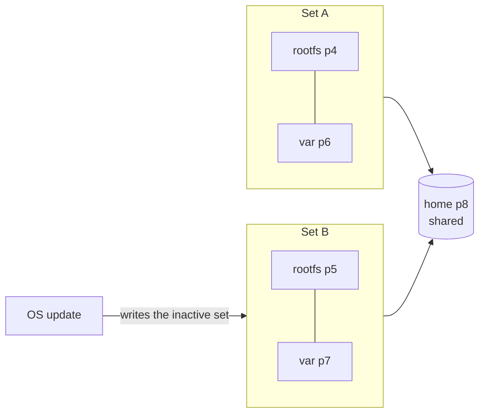

# Filesystem

**English** | [한국어](README/README.ko.md) | [日本語](README/README.ja.md) | [简体中文](README/README.zh-CN.md) | [Español](README/README.es.md) | [Français](README/README.fr.md)

  

What an OS update wipes and what survives. Everything here was checked by hand on SteamOS 3.8.14 in VMware, and it is the reason every file in this repository lives where it does.

## Contents

- [Disk layout: two systems (A/B) and one shared home](#disk-layout-two-systems-ab-and-one-shared-home)
- [Is it really read-only?](#is-it-really-read-only)
- [/etc: only listed files carry over](#etc-only-listed-files-carry-over)
- [pacman's database is read-only too](#pacmans-database-is-read-only-too)
- [Preinstalled tools](#preinstalled-tools)
- [Placement rules for this repository](#placement-rules-for-this-repository)

---

## Disk layout: two systems (A/B) and one shared home

| Partition | Size | Role |
| --- | --- | --- |
| `nvme0n1p1` esp | 256M | Bootloader |
| `p2` / `p3` efi | 64M | Boot entries A / B |
| `p4` / `p5` rootfs | 5G, btrfs | System A / B (`/`) |
| `p6` / `p7` var | 256M | Logs and `/etc` changes A / B (`/var`) |
| `p8` home | Remainder | User data (`/home`), **shared by A and B** |




An update writes a complete new system into the set that is **not** running (booted from A → written to B) and switches to it on the next boot. Only `/home` is used by both sets, so it is the only place untouched by updates.

## Is it really read-only?


```text
$ steamos-readonly status
enabled
$ sudo touch /usr/test-write
touch: cannot touch '/usr/test-write': Read-only file system
$ touch ~/test-write && echo HOME_OK
HOME_OK
```

## /etc: only listed files carry over

Changes to `/etc` are stored on the active set's var partition. When an update swaps A and B, **only files on the keep list** are copied to the new set.

| List | Path |
| --- | --- |
| Default | `/usr/lib/rauc/atomic-update-keep.conf` |
| User additions | `/etc/atomic-update.conf.d/*.conf` |


> [!WARNING]
> The bundled `example-additional-keep-list.conf` warns that a broad pattern such as `/etc/**` hides every future `/etc` change shipped by updates. Keep entries file-specific.

That is why this repository barely touches `/etc`, and when it does, the `60-etc-keep` module registers exactly those files.

## pacman's database is read-only too

`pacman-conf DBPath` is `/usr/lib/holo/pacmandb/`, so even `pacman -Sy` fails with `Read-only file system`. To download packages only, copy the database somewhere writable and point `--dbpath` at it ([T4](../04-Troubleshooting/README.md#t4)).

## Preinstalled tools


| Tool | Version | Used for |
| --- | --- | --- |
| Flatpak | flathub (system), flathub-beta | GUI apps |
| distrobox | 1.8.1.2 | CLI tool containers |
| podman | 5.5.2 | distrobox backend |

## Placement rules for this repository

| Location | After an update | How this repository uses it |
| --- | --- | --- |
| `/usr` | Replaced | Never touched |
| `/etc` | Only keep-listed files survive | Minimum necessary + `60-etc-keep` |
| `/home` | Survives | Flatpak `--user`, distrobox, dotfiles, systemd user units, logs |

> [!TIP]
> Rule of thumb: if it is not in `/home` or on the keep list, assume the next update deletes it.
