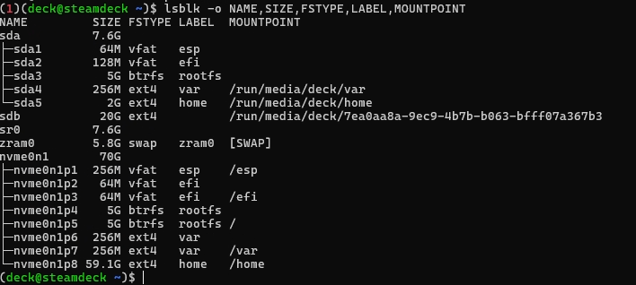
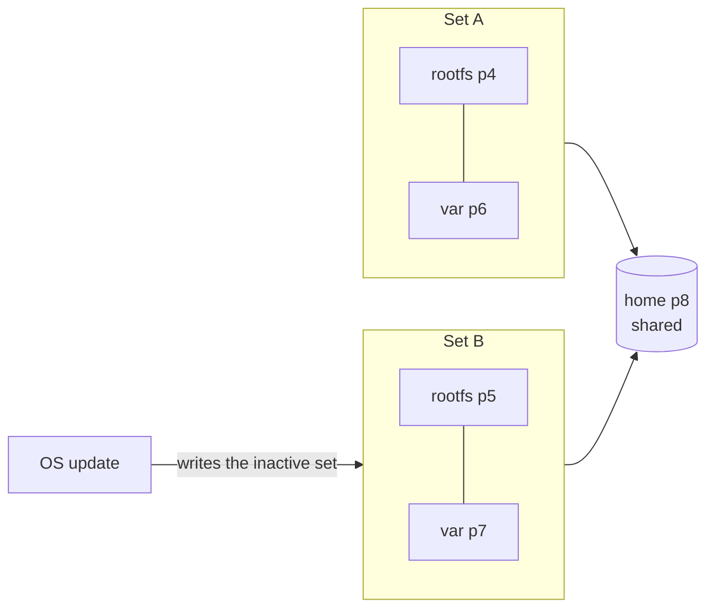
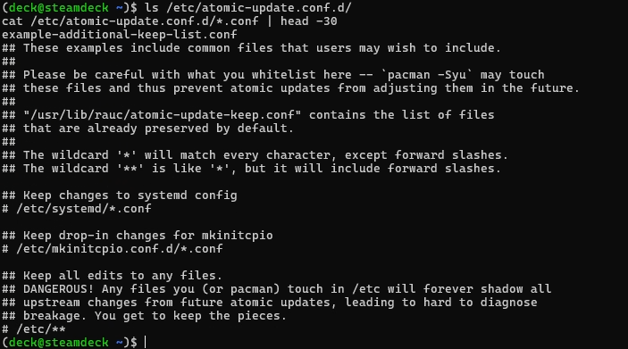

# Sistema de archivos

[English](../README.md) | [한국어](README.ko.md) | [日本語](README.ja.md) | [简体中文](README.zh-CN.md) | **Español** | [Français](README.fr.md)

  

Qué borra una actualización del sistema y qué sobrevive. Todo se comprobó a mano en SteamOS 3.8.14 sobre VMware, y es la razón de que cada archivo de este repositorio esté donde está.

## Índice

- [Estructura del disco: dos sistemas (A/B) y un home compartido](#estructura-del-disco-dos-sistemas-ab-y-un-home-compartido)
- [¿De verdad es de solo lectura?](#de-verdad-es-de-solo-lectura)
- [/etc: solo pasan los archivos de la lista](#etc-solo-pasan-los-archivos-de-la-lista)
- [La base de datos de pacman también es de solo lectura](#la-base-de-datos-de-pacman-también-es-de-solo-lectura)
- [Herramientas preinstaladas](#herramientas-preinstaladas)
- [Reglas de ubicación de este repositorio](#reglas-de-ubicación-de-este-repositorio)

---

## Estructura del disco: dos sistemas (A/B) y un home compartido

| Partición | Tamaño | Función |
| --- | --- | --- |
| `nvme0n1p1` esp | 256M | Cargador de arranque |
| `p2` / `p3` efi | 64M | Entradas de arranque A / B |
| `p4` / `p5` rootfs | 5G, btrfs | Sistema A / B (`/`) |
| `p6` / `p7` var | 256M | Registros y cambios de `/etc` A / B (`/var`) |
| `p8` home | El resto | Datos de usuario (`/home`), **compartido por A y B** |





Una actualización escribe un sistema nuevo completo en el conjunto que **no** está en uso (arrancado desde A → se escribe en B) y cambia a él en el siguiente arranque. Solo `/home` lo usan ambos conjuntos, así que es el único lugar que las actualizaciones no tocan.

## ¿De verdad es de solo lectura?


```text
$ steamos-readonly status
enabled
$ sudo touch /usr/test-write
touch: cannot touch '/usr/test-write': Read-only file system
$ touch ~/test-write && echo HOME_OK
HOME_OK
```

## /etc: solo pasan los archivos de la lista

Los cambios en `/etc` se guardan en la partición var del conjunto activo. Cuando una actualización intercambia A y B, **solo los archivos de la lista de conservación** se copian al nuevo conjunto.

| Lista | Ruta |
| --- | --- |
| Predeterminada | `/usr/lib/rauc/atomic-update-keep.conf` |
| Añadidos del usuario | `/etc/atomic-update.conf.d/*.conf` |



> [!WARNING]
> El archivo incluido `example-additional-keep-list.conf` advierte que un patrón amplio como `/etc/**` oculta todos los cambios futuros de `/etc` que traigan las actualizaciones. Indica cada archivo por separado.

Por eso este repositorio apenas toca `/etc`, y cuando lo hace, el módulo `60-etc-keep` registra exactamente esos archivos.

## La base de datos de pacman también es de solo lectura

`pacman-conf DBPath` es `/usr/lib/holo/pacmandb/`, así que incluso `pacman -Sy` falla con `Read-only file system`. Para solo descargar paquetes, copia la base de datos a un lugar con escritura y apunta `--dbpath` a ella ([T4](../../04-Troubleshooting/README/README.es.md#t4)).

## Herramientas preinstaladas


| Herramienta | Versión | Uso |
| --- | --- | --- |
| Flatpak | flathub (system), flathub-beta | Aplicaciones gráficas |
| distrobox | 1.8.1.2 | Contenedores de herramientas CLI |
| podman | 5.5.2 | Backend de distrobox |

## Reglas de ubicación de este repositorio

| Ubicación | Tras una actualización | Cómo la usa este repositorio |
| --- | --- | --- |
| `/usr` | Se reemplaza | Nunca se toca |
| `/etc` | Solo sobreviven los archivos de la lista | Lo mínimo necesario + `60-etc-keep` |
| `/home` | Sobrevive | Flatpak `--user`, distrobox, dotfiles, unidades de usuario de systemd, registros |

> [!TIP]
> Regla práctica: si no está en `/home` ni en la lista de conservación, da por hecho que la próxima actualización lo borrará.
